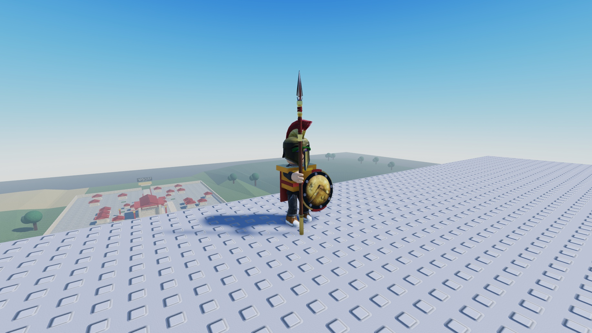
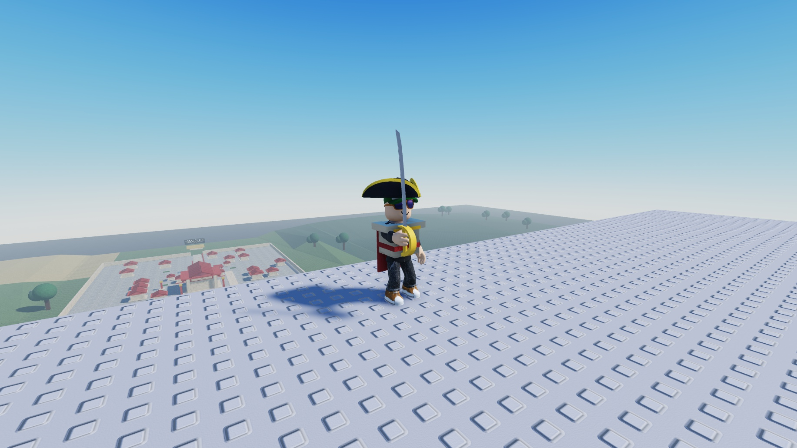
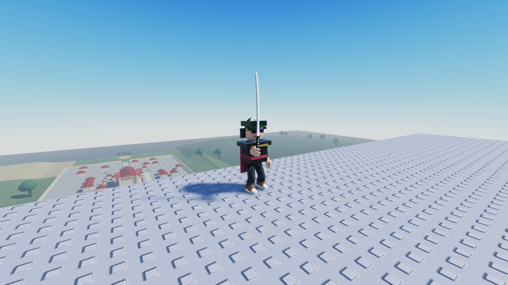
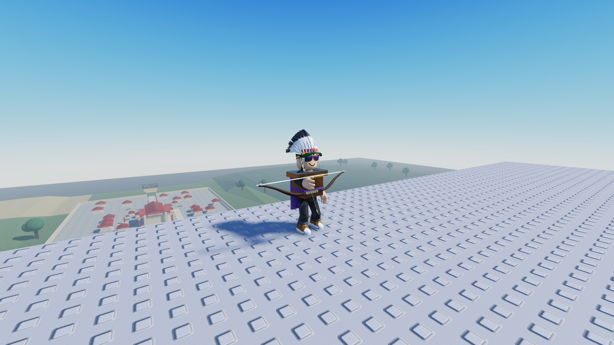
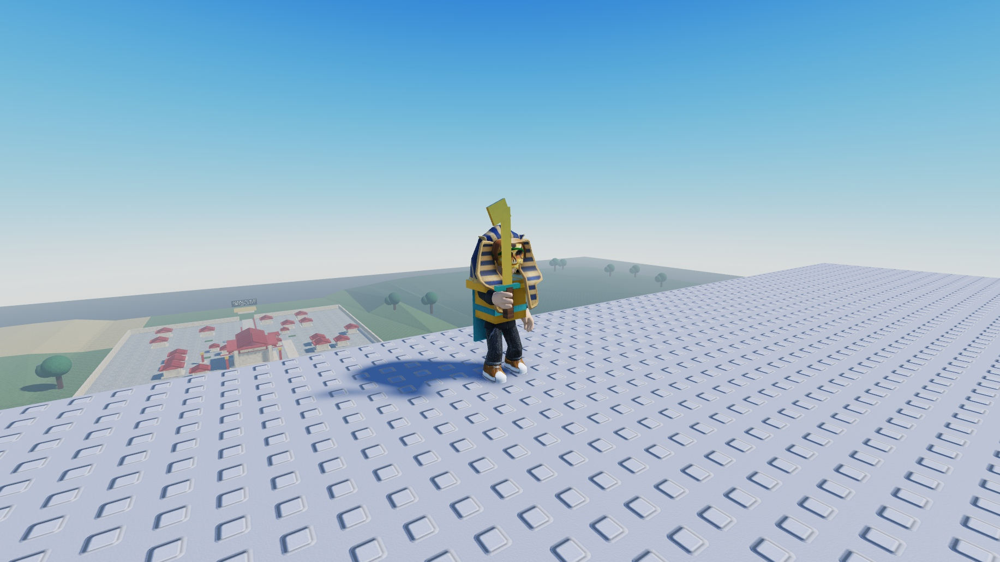
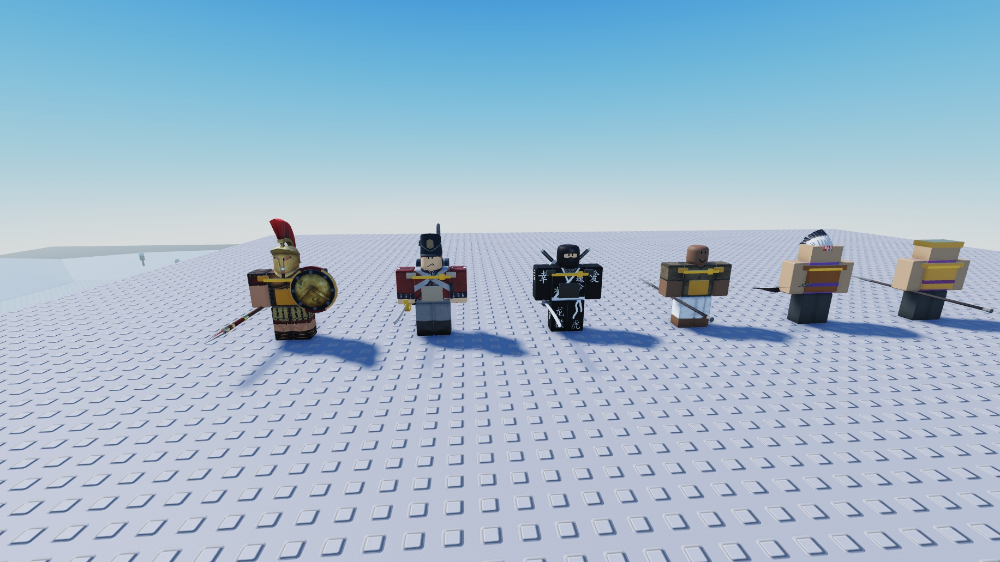
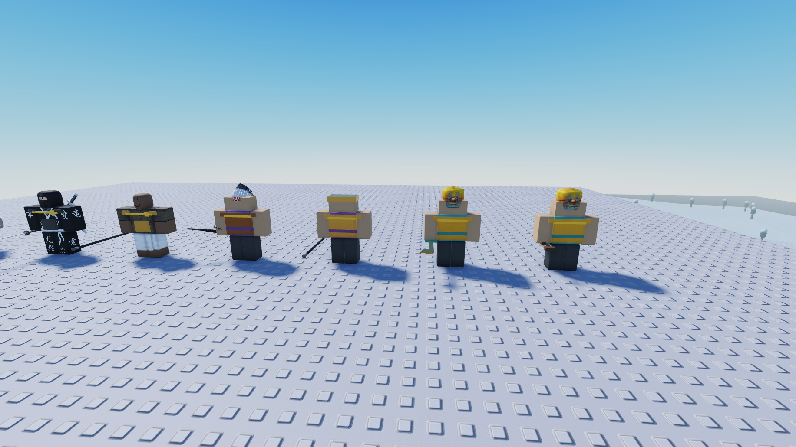

# Civilization models and cosmetics

## Farmer template

`farm-templates/farmer.rbxmx` is an exported clone of the user's
`Workspace.Farmer` R15 rig (October 15, 2026), mapped to
`ServerStorage.FarmTemplates.farmer`. The original stays untouched. Farm tenders
preserve its mesh body, clothes and hat. Runtime clones remove imported Humanoids, scripts, physics and external
references, then add a disabled Humanoid solely to render classic clothing.
Every part remains anchored and
nonblocking. Server poses animate the connected limbs along crop-row routines.
This visual asset never controls farm production or combat.

The XML export explicitly preserves the fifteen legacy MeshId URLs. Rojo 7.7.1
can build them correctly, but its live plugin may leave read-only MeshContent
empty on first insertion in this Studio version. If the hat/body become blocks,
import the farmer `.rbxmx` into ServerStorage.FarmTemplates and restart Play;
the focused rig test rejects missing body/hat mesh IDs.

## Custom melee templates

Rojo maps `npc-templates/*.rbxm` to `ServerStorage.NPCTemplates`. These are exported copies of the five models the user placed in Studio:

| Asset | Civilization | Original model |
| --- | --- | --- |
| sparta.rbxm | Sparta | Workspace.GiraffeStrange |
| britain.rbxm | Britain | Workspace.little british dude |
| japan.rbxm | Japan | Workspace.Ninja |
| seneca.rbxm | Seneca | Workspace.Models.Native (inner character) |
| maurya.rbxm | Maurya | Workspace.Indian Guy |

The original Workspace models are preserved. Melee spawns clone the templates, retain clothing and headwear, remove embedded logic, and repair/unanchor the rig before it enters Workspace. Weapon and armor upgrades add generated gear without replacing the original clothing. Ranged troops and civilizations without a template keep their generated rigs.

To replace a template, export its R6 character model as the corresponding `.rbxm` file, preserving a Humanoid, HumanoidRootPart, Torso, Head, four limbs and their six body joints. Restart Play after Rojo sync. Runtime edits to the stored template are not automatically written back to the asset file.

## Imported equipment visuals

Rojo maps `equipment-templates/*.rbxm` to `ServerStorage.EquipmentTemplates` in
production and generated test projects. Eleven models came from the user's
Studio additions; eight more use free Creator Store sources. The resulting
nineteen templates cover every current player/melee/ranged weapon role.
Original Workspace objects remain unchanged. Source IDs, creators and the dated
free-price checks are recorded in [marketplace provenance](../docs/MARKETPLACE_ASSETS.md).

| Asset | Original | Equipped roles |
| --- | --- | --- |
| spartan-helmet | SpartanHelmet | Spartan players and generated ranged troops |
| british-tricorn | Enlistment Hat | British players and generated ranged troops |
| seneca-headdress | hat | Seneca players and generated ranged troops |
| egypt-pharaoh | UndeadPharoah | Egyptian players |
| egypt-anubis | Priest of Anubis | Egyptian melee and ranged troops |
| spartan-spear | Arms of Sparta.Spear | Spartan players, melee and ranged troops |
| spartan-shield | Arms of Sparta.Shield | Spartan players and melee troops; cosmetic |
| officer-sword | British Officers Sword (Made by WorkclockDevs) | British players and melee troops |
| katana | HandleAccessory | Japanese players and melee troops |
| spear | Spear | Mauryan/Persian players and melee troops; Roman ranged troops |
| bow | Bow and Arrow | Seneca players and all existing bow ranged classes |
| axe | Creator Store | Seneca melee; Viking players, melee and ranged troops |
| scimitar | Creator Store | Mongol, Ottoman and Ming players/melee troops |
| gladius | Roman Soldier package | Roman players/melee troops |
| rapier | Creator Store | Spanish players/melee troops |
| khopesh | Creator Store | Egyptian players/melee troops |
| musket | Creator Store | British/Ottoman ranged troops |
| crossbow | Creator Store | Spanish/Ming ranged troops |
| slingshot | Roblox Creator Store | Egyptian ranged sling role |

The five custom melee templates retain their own hats and clothing. Britain’s
ranged troop uses the imported musket. Missing or invalid imports retain the
generated style.
The Egyptian roles and shared Mauryan/Persian spear were confirmed by the user.

Exports preserve native unions, meshes and textures under a normalized invisible
`Handle`. Hats store `HeadOffset`; the bow stores its source `Grip` and the
katana has a calibrated hilt grip. Givers,
scripts, tools, old joints, forces, sounds and imported gameplay attributes are
excluded. Runtime clones are sanitized again and welded to the current gear.
These assets change appearance only; damage, armor, range, cooldown and saved
upgrade levels continue to use the existing server rules. A missing or invalid
template falls back to the procedural visual. Restart Play after syncing changes.

## Civilization outfits

Rojo maps `outfit-templates/*.rbxm` to `ServerStorage.OutfitTemplates` in
production and generated test projects. All thirteen civilizations have an
outfit. Five derive from the user-provided melee skins; the other eight use
selected free Creator Store garments/cosmetics. See [the full source table](../docs/MARKETPLACE_ASSETS.md#outfit-provenance).
Outfit filenames use the civilization IDs, such as `sparta.rbxm` and `ming.rbxm`.
Persian outfits and derived Mauryan player/ranged outfits include the free
[White Turban, 247070867](https://create.roblox.com/store/asset/247070867) by
@AlcatrazDweller. The original Mauryan source model remains unchanged; its melee
clone receives no added hat.

Each normalized Model contains optional `Shirt`, `Pants`, `ShirtGraphic` and
`BodyColors` data, plus body-cosmetic Models with a direct invisible `Handle` and
`BodyPart`, `BodyOffset`, `ReferenceSize` attributes. Runtime application reads
clothing properties and sanitizes body pieces through EquipmentVisuals; source
rigs, controllers and gameplay values are excluded. R6 anchors map to compatible
R15 body segments with proportional placement. These are stylized historical
looks rather than exact reconstructions.

Players and generated troops wear the matching outfit. The five custom melee
skins retain their meshes, clothes and headwear. Existing mapped hats take precedence over outfit head
pieces; a missing head piece retains procedural headwear. Usable outfits hide
omitted modern avatar clothing layers while dressed. Clearing restores affected
avatar fields, preserving later external wardrobe edits and unrelated items;
late avatar appearance loading reapplies the uniform without resetting its
restore baseline. Missing outfits leave the procedural fallback available.

TroopAppearance applies a natural skin-tone art default for each civilization
and warrior face texture `10526794` (from the user's Seneca expression) to all
live melee/ranged clones after equipment, including custom skins. It keeps NPC
BodyColors and body-part colors consistent without changing head proportions,
meshes, clothes or headwear. Source models keep their original colors/faces;
players keep their avatar wardrobe path. Palettes are art choices rather than
historical population claims, and baked clothing skin colors remain unchanged.

## Earlier equipment inspection

These earlier October 14 equipment captures show the actual solo player's R15
avatar on a temporary inspection platform. Equipment was applied for each civilization to
inspect its fit; the fake profile remained claimed as Sparta. The two troop
images show eight separate visual/movement fixtures, rather than connected
players or a recruited army. The platform and inspection settings are temporary.
These captures predate the NPC skin-tone and warrior-face override.

| Spartan player | British player |
| --- | --- |
|  |  |

| Japanese player | Seneca player | Egyptian player |
| --- | --- | --- |
|  |  |  |

