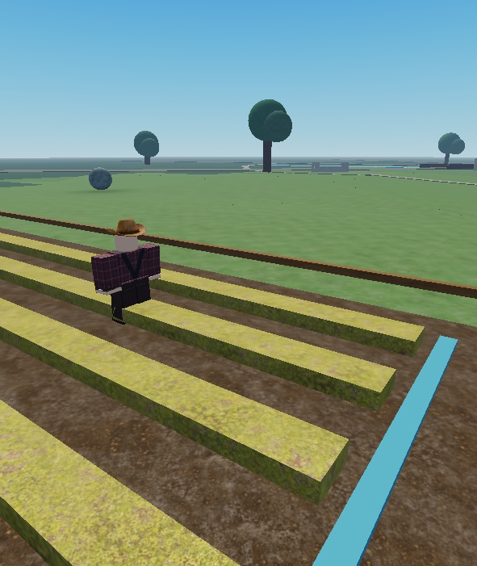
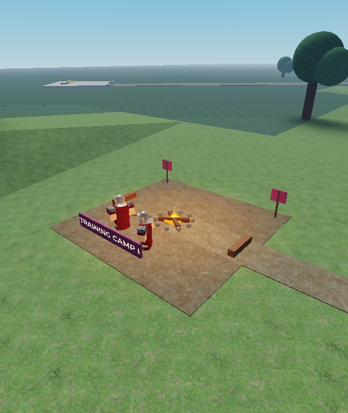
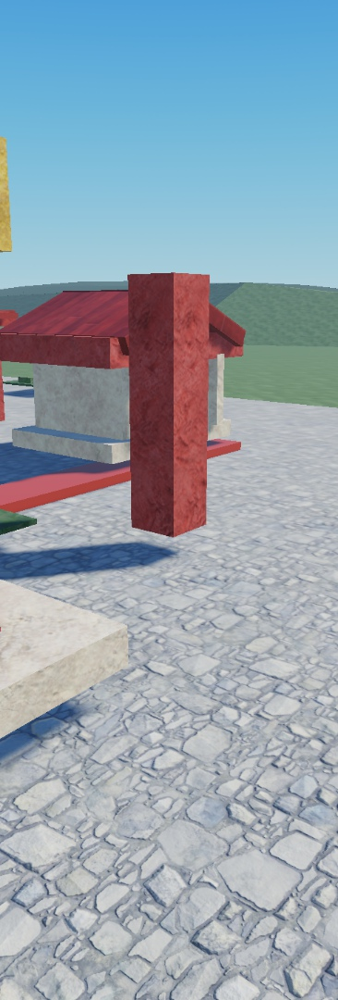
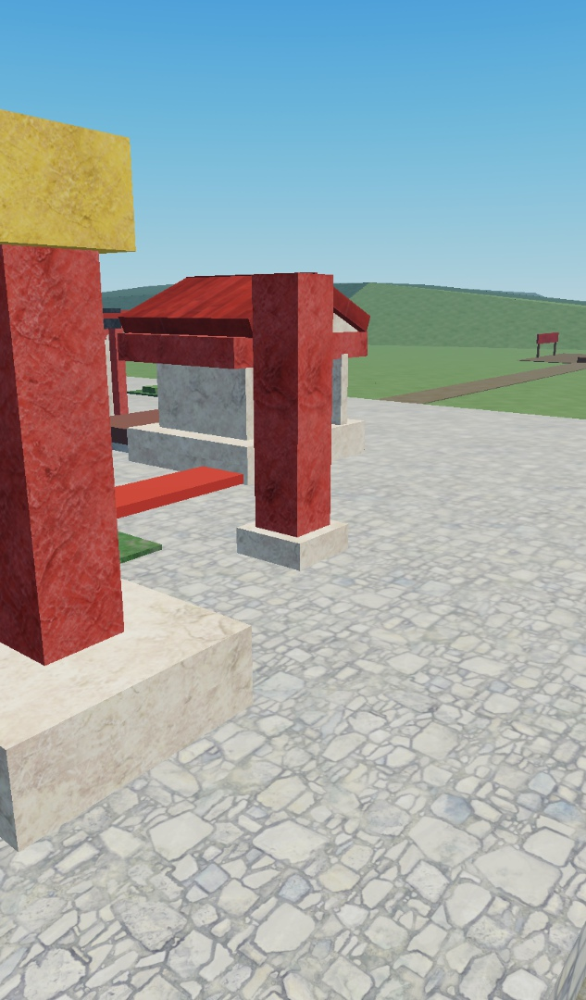
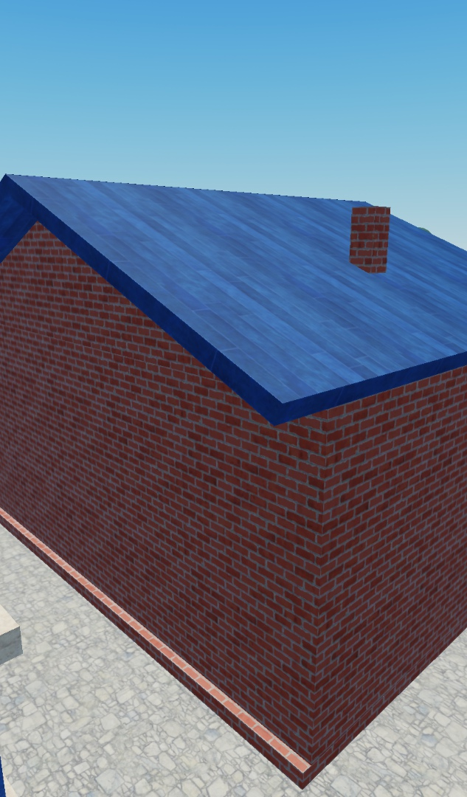
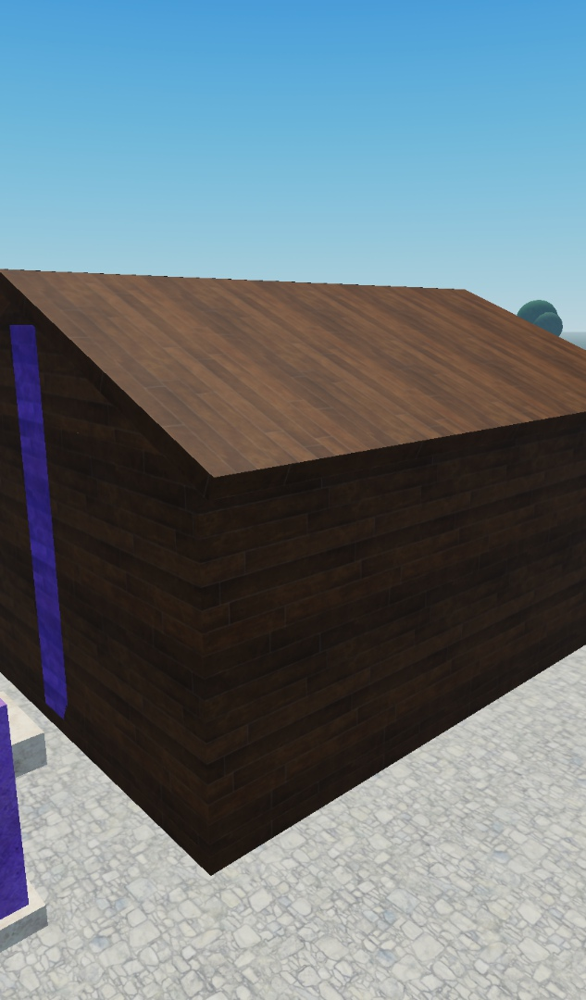
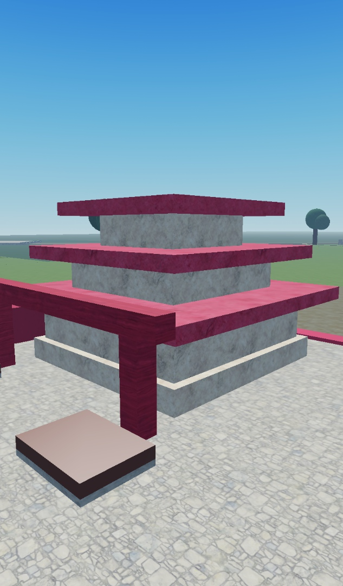
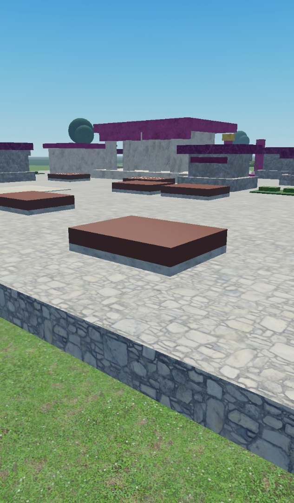

# Civilization tycoon prototype

Connect Rojo to Studio and press Play. The map is generated at runtime inside
`Workspace.CivilizationPrototype`; it disappears when Play stops. Existing
Workspace objects are preserved. Large existing objects may cover the prototype.

1. Wait for your saved profiles to load, then choose an available civilization.
   Your character moves to a numbered settlement. Its themed main building shows
   your civilization and display name; the HUD shows your plot and restored progress.
2. Reset your character. You should return to the same plot with the same HUD.
3. Use one Studio Play window for ordinary progression checks. Exclusive-claim
   races require a separate focused multiplayer check: two players choosing
   Sparta must produce one owner; the other can choose Britain.
4. In that multiplayer check, disconnect the Spartan owner. A new client can
   select Sparta and reuse its plot. Close owned test windows before another run.
5. Click the gold ground button or use its prompt: each accepted activation adds
   one coin. Use E while armed, or unequip the weapon before mouse clicking.
   At level one only coin and settlement pads exist. Expand to level two
   to reveal weapon, armor, and barracks upgrade pads. Each track is capped by
   the settlement level.
6. Walk onto an affordable upgrade pad, stay on it, then exit and re-enter.
   Standing should not buy multiple upgrades.
7. Reset after upgrading. Coins, upgrade/building levels, farm reserve, armor, the equipped
   weapon and living troop identities should remain intact.
8. Try a phone viewport and a controller. The selector scrolls; the HUD displays
   progress and provides a Change civ control. Currency and purchases still use
   ground buttons and their prompts.
9. Upgrade the settlement to stage 2. A barracks appears and deploys one melee
   warrior automatically. Watch it walk to the central arena.
10. Buy separate weapon and armor upgrades. Your living warrior should receive
    the matching civilization gear, damage tier, and armor health in place.
11. With a second civilization active, bring the warriors into the arena. They
    should fight each other and hostile players. Owners and anyone outside the
    arena are protected. Barracks I replaces a dead warrior after 15 seconds.
    A gear purchase during the wait should preserve its existing deadline.
12. Expand the settlement and gear through level 50. Each settlement level adds
    land and a lasting themed feature; completed capitals occupy 256-stud plots.
    Before entering level 10, buy Training Yard I, Farm I, Worker Camp I and
    Barracks IV. Missing requirements appear at the main hall; locked pads stay hidden.
    Barracks II–IV reduce future replacement delays to 14.5,
    14 and 13.5 seconds. V unlocks at settlement 8 for 200 coins and reduces
    future waits to 13 seconds; VI unlocks at 14 for 300 coins and reaches 12.5 seconds.
    Barracks IV deploys one melee warrior and one ranged troop with independent
    death and replacement timers. Owner gear upgrades apply to both.
13. Use Change civ to view your saved progress and select another free civilization.
    The same plot should rebuild with that civilization's separate coins and levels.
    Selecting an occupied civilization must preserve your current settlement.
    Switch back to verify the earlier progress returns.
14. Leave and rejoin with the same account, then select the earlier civilization
    when available. Its saved settlement, gear and troop capacity should return;
    troop identities, current health and pending timers are rebuilt for the session.
    Failed loads must block selection and progression rather than start fresh.
15. Buy Training Yard I at level 5 and test Advance, Hold and Regroup. Hold should
    stop pursuit; Regroup should walk troops to the campfire yard on the plot's
    left side, then slowly stroll and pause within that yard. Its purchase pad
    is outside the main foundation beside the future site. Advance restores
    normal walking speed; Hold stops a stroll. Opening Change civ should hide
    the command panel behind the selector.
16. At level 7 buy Farm I, then Worker Camp I at their rural sites. The reserve
    grows by one coin per five active seconds, or two with workers, up to 60.
    Watch the supplied farmer walk through all five crop rows, pause to tend them
    and turn back along the field edge. Worker Camp I adds a farmer in the other
    field. Collect beside the farm; switching away or leaving must not earn offline coins.
17. At level 10 buy Army Camp I. Choose its third troop's melee/ranged class in
    the army panel. A living troop should keep its health and class; the choice
    takes effect on its next replacement without resetting that death timer.
18. At level 12 buy Farm II for 180 coins, then Worker Camp II for 140. Production
    should rise from two to three, then four reserved coins per five seconds;
    three passive farmers should walk staggered seven-row routines with visible
    limb motion and short tending pauses. Reserve ticks must preserve their identities.
19. At level 13 buy the Blacksmith and Armorer for 150 coins each. Each discounts
    its own gear track by 5%, rounded upward; a base 42-coin upgrade becomes 40.
    Combat stats and the other track's price should remain unchanged.
20. At level 16 buy Storehouse I for 140 coins. The reserve cap rises from 60 to
    180; buying while full must wait a fresh interval before producing above 60.
    Switch away and back to check separate building tiers and earned reserves.
21. Visit the battlefield center in solo Play. Two gray neutral melee fighters
    and one neutral archer provide shared opponents for every civilization.
    Fight with your equipped weapon or let your troops advance. Each defeated
    neutral replaces independently ten seconds after death; valid final hits
    award the usual ten coins. They fight back inside the arena and return
    toward their center positions when idle.

The prototype has 13 choices, eight plots and independent saved civilization
profiles. The generated map does not configure Roblox's server player limit;
selection and switching happen inside the current server. A separate lobby,
server routing, formations and abilities remain future changes. Progress autosaves
and receives a final save attempt on departure or shutdown. Studio uses the
separate StudioDevelopment storage scope; live servers use Live. Real-storage
Studio checks require API access; the automated test place uses an injected fake
store. Equipped player weapons attack in melee. NPC attacks use the owner's
weapon damage and armor tiers. See [prices and equipment](ECONOMY.md) and
[barracks and warriors](ARMY.md).

Keep only one Studio playtest open at a time. Solo checks cover progression,
native controls, interface layout, imported NPC movement and one owner's troop
lifecycle and neutral opponent combat. Multiple connected owners, claim races
and combat between different owners need their own focused multiplayer evidence;
owner-interface doubles cannot replace connected players for the shared combat
authority.

## Farmer routine verification — October 15, 2026

The supplied R15 farmer keeps its mesh body, plaid clothes and brown hat. All
**231 module checks across 42 suites passed**, including source immutability,
unsafe descendant removal, appearance-only Humanoid settings, grounded articulated
poses, continuous bounded routes for both tiers and all three worker indices,
all thirteen civilizations, moved plots, reserve identity and release cleanup.
Existing economy, profiles, army, combat and landscape checks also passed.

The user approved a disabled Humanoid solely for classic clothing rendering.
It has no state machine, autorotation or movement, and farmers remain outside
combat registration. Visual comparison in Studio caught two issues that property
checks alone missed: native classic clothing requires a Humanoid, and Rojo's
live plugin left first-inserted MeshContent empty. The XML asset preserves all
fifteen mesh URLs; native deserialization of both the asset and the Rojo-built
model confirmed the body and hat IDs. The existing Studio template was imported
from that XML without modifying the original Workspace rig.

The final fake-store solo run passed **two live routine checks**: Farm I's one
farmer visited all five rows in 95.27 seconds, and all three Farm II farmers
visited all seven rows in 125.63 seconds. Normal Heartbeat animation retained
worker identities across real reserve updates, kept roots within their fields,
articulated limbs and excluded farmers from registered combat actors. Reserves
reached 19 and the existing 60-coin cap respectively. Original appearance was
visually checked against the supplied Workspace model. Production/test Rojo
builds, native deserialization of the built farmer asset, strict OpenSpec
validation (15 items) and diff whitespace checks passed.



To repeat in an isolated test place, run
`npm run build:test-project -- --solo --farmers`, build
`.cache/solo-test.project.json` with Rojo, and press Play once. The runner injects
an in-memory profile store, runs all module suites, then observes a full Farm I
cycle and a full Farm II cycle using normal server Heartbeat updates. Inspect
`FarmTenderVerificationPhase`, `FarmTenderUnitCases` and
`FarmTenderVerificationResult` on the DataModel. No automated fixture opens
player data. The original Workspace farmer and source templates stay unchanged.

## Neutral opponent verification — October 15, 2026

- Observed the missing-feature failure in Studio before implementation:
  the neutral combat fixture could not call `registerNeutral`.
- All **215 module checks across 37 suites passed** in solo Studio Play,
  including neutral combat/rig tests and existing combat, projectile, equipment,
  profile, economy, landscape and army regressions.
- The repeatable `--solo --neutral` runner passed **nine runtime checks** with
  one connected owner and an injected fake profile store. Player melee and
  genuinely registered owned troops damaged the enemies for all thirteen
  civilizations. Native melee pursuit and visible arrow flight dealt the basic
  10/8 damage; neutral final hits awarded exactly ten coins once.
- Staggered melee/ranged deaths retained separate deadlines. In the final run,
  replacements were observed 0.215 and 0.248 seconds after their ten-second
  deadlines, with no early replacement, duplicate fighter or retained corpse.
  The surviving melee fighter kept its identity. Owner switches, gear changes
  and advance/hold/regroup orders preserved neutral identities, health and
  pending deadlines; owner capacity remained three.
- Disabled startup produced no fighters. Removing the generated world cleaned
  its neutral resources; stopping the service canceled pending replacements,
  checked after waiting beyond the full ten-second interval.
- An actual virtual mouse click activated the equipped player Tool once and
  reduced a neutral warrior from 100 to 90 health through the production remote.
  A persistent client camera view showed the three generic center opponents.
- Review mutation: allowing neutral-to-neutral hostility made the real neutral
  combat spec fail. The mutated module was an isolated clone and was destroyed.
- `npm run check` passed all 13 specification items. Rojo built both
  `default.project.json` and the generated solo neutral test project. Automated
  checks never accessed real player storage. No teleport or published-client
  behavior changes are involved; multiplayer stress was not repeated here.

## Repeatable engine tests

### Campfire yard verification — October 15, 2026

- Missing-feature failures were observed in Studio before implementation:
  the training pad was inside the final foundation, resting movement was absent,
  and arrived troops retained normal speed in fixed-rally mode.
- **223 checks across 39 module suites passed**, including the new camp layout
  and resting-state fixtures, all civilization appearances, eight plot sites,
  levels 5/20/50, moved/rotated worlds and existing neutral/combat/profile checks.
- The isolated `--solo --training` native runner passed **seven runtime checks**
  with one connected owner and fake storage. Normal prompt input bought training
  outside the plot for exactly 50 coins; all three troops then walked from the
  barracks to the camp in 11.45 seconds. An 18-second observation verified slow
  walking, pauses, fire clearance, stable health and bounded positions.
- Native Hold stopped strolling; Advance restored speed 12; repeating Regroup
  retained resting behavior. Gear and settlement upgrades retained identities,
  health deficits and the camp slot's existing replacement deadline. Its new
  troop walked to the yard before resting. Switching restored the purchased
  camp with normal transient-order reset and no extra charge.
- Level-20 and level-50 native return paths crossed the side gate in 8.60 and
  3.60 seconds. Separate path computations found the clear camp entrance from
  all eight plots. Interior ring destinations exposed engine NoPath results
  despite clear collision space; the implemented return uses the clear entrance
  and bounded native Humanoid walks for the short legs inside the yard.
- A review mutation restoring normal speed during resting made the actual
  ArmyRest fixture fail. Only a temporary module clone was mutated and removed.
- Removing the generated world destroyed its resting troops and canceled a
  pending replacement, checked again after fourteen seconds. Developer geometry
  was preserved.
- Specification validation passed all 14 items. Production and isolated test
  Rojo builds succeeded after the navigation correction. No automated fixture
  accessed real player storage; multiplayer stress and public-client testing
  were not repeated for this visual/movement change.
- Final Studio cleanup restored normal startup, left no owned test fixtures and
  verified all 45 managed script sources exactly matched the repository. The
  five original NPC templates remained present.



### Campfire training yard

Run `npm run build:test-project -- --solo --training`, build
`.cache/solo-test.project.json` with Rojo and press Play in the existing Studio
window. This runs the module suite and one connected owner's native-input
campfire checks against fake profiles. Read `TrainingCampVerificationResult`
on `game` for results, `TrainingCampPhase` for the current behavior check and
`TrainingCampVerificationPhase` for native input progress. It verifies the
exterior purchase, three actual return paths, slow resting cycles, Hold/Advance,
health and respawn preservation, level-20/50 side gates and civilization switches.

### Neutral battlefield opponents

Run `npm run build:test-project -- --solo --neutral`, then build
`.cache/solo-test.project.json` with Rojo. Open that test place in the existing
Studio window and press Play once. The runner executes the module specs and
`tests/runtime/NeutralOpponents.luau` with one connected player and fake storage.
Read the JSON `NeutralRuntimeResult` attribute on `game` for the result and
`NeutralTestPhase` for progress. It checks all thirteen civilizations, owned
troop damage, basic retaliation, staggered respawns, army commands, gear changes,
disabled startup and cleanup. The fixture deliberately destroys its neutral
service at the end to verify pending replacements cannot run after shutdown.

### Settlement economic expansion

```bash
npm run build:test-project -- --solo --expansion
```

Build `.cache/solo-test.project.json` with Rojo, open it in the existing Studio
window and press ordinary **Play**. This runner injects a fake profile store and
runs module suites followed by native economic purchases, collection, switching
and real Barracks V/VI replacement timers. It seeds level-13 and level-16 fixtures; it does
not measure full progression pacing. `--expansion` requires `--solo` and cannot
be combined with `--development`.

Poll `EconomyExpansionPhase`, `EconomyExpansionUnitCases` and the JSON attribute
`EconomyExpansionResult` on `game` in the Server context. The result separates
module and runtime cases. Stop Play after checking it; never publish a test place.

### Settlement development milestone

Use the current building/farming/army check in one existing Studio window:

```bash
npm run build:test-project -- --solo --development
```

Build `.cache/solo-test.project.json` with the installed Windows Rojo executable,
open that generated place in the existing window, and press ordinary **Play**.
The bootstrap injects an in-memory profile store. The runner executes module
suites followed by native floor entry, E prompts, GUI commands, real five-second
farm ticks, collection, the level-10 checkpoint, three-slot movement and real
replacement timers. It never opens more clients or accesses real player storage.

Poll `game:GetAttribute("DevelopmentVerificationPhase")` in the Server context.
`DevelopmentVerificationResult` contains JSON with separate `units`, runtime
`cases`, evidence and `ok`. The focused fixture seeds levels 5 and 9; it does
not claim to test earning the entire level-50 progression or measure session pace.
After reading the result, stop Play. Use the production place for normal gameplay;
never publish a generated test place.

### Earlier world-growth harness

In WSL at the repository root:

```bash
npm run check
npm run build:test-project -- --solo
```

In Windows PowerShell at the repository root:

```powershell
$rojo = 'C:\Users\smitl\Downloads\rojo-7.7.1-windows-x86_64\rojo.exe'
& $rojo build default.project.json --output build\civilization-prototype.rbxlx
& $rojo build .cache\solo-test.project.json --output build\civilization-solo-tests.rbxlx
```

Disconnect a Rojo connection serving the normal project before opening the test
place, so its test-only bootstrap stays in place. Open the solo test place in
the existing Studio window and start ordinary **Play**.
Its Studio-only bootstrap injects a fresh in-memory store; the sole server
harness automatically runs the module suites, native repeated-pad purchases,
five imported models' physical navigation, one real owner's automatic troop
lifecycle, native civilization switching and the completed-profile HUD.
It does not call `ExecuteMultiplayerTestAsync` or create additional clients.

In the **Server** context, inspect `game:GetAttribute("SoloVerificationPhase")`
or run `tests/RunSoloWorldGrowth.luau` to poll the structured result. The complete
JSON evidence is in `ServerStorage.SoloVerificationResult.Value`; unit cases and
runtime cases are reported separately. Native input capability failures are
failures, rather than simulated signal activations. The maximum settlement
remains available for up to ten minutes of inspection. Finish inspection with:

```lua
game:SetAttribute("FinishWorldGrowthInspection", true)
```

Wait for `SOLO_TEST_RESULT` in Output, then stop Play before starting another
run. `SoloVerificationPassed` is set only after inspection and the fake-store
shutdown complete. The result explicitly lists multi-owner gameplay that the
single-client run cannot verify. Never publish either generated test place.

Before stopping Play, separate slope and ranged engine fixtures can run in the
Server context without changing the real player's profile. The slope fixture
uses one actual Humanoid; the ranged fixture uses two explicitly simulated
owners and actual NPCs/projectiles:

```lua
require(game.ServerStorage.RuntimeTests.TopographyWalk)()
require(game.ServerStorage.RuntimeTests.SoloRangedGrowth)()
```

Their two slope cases and five ranged cases are reported separately from the
solo runner's 23 cases. They do not verify connected multi-owner identity or
networking and do not launch more clients.

The imported-equipment ownership regression needs an ordinary server **Script**
in the fake-store test place, with the real player's character ready:

```lua
local player=game:GetService("Players"):GetPlayers()[1]
print(require(game.ServerStorage.RuntimeTests.ImportedEquipmentOwnership)(player))
```

It reports one separate case, creates and destroys its own nearby NPC/platform,
and checks manual server ownership after replacing imported gear and stepping
physics. Do not substitute an inspection bridge's execution context for this
server Script or repair ownership inside the test. Remove the temporary Script
after the check; it is not a production startup script.

For a behavior that specifically requires multiple real players, stop the solo
run first and generate the separate multiplayer configuration:

```bash
npm run build:test-project
```

```powershell
& $rojo build .cache\test.project.json --output build\civilization-tests.rbxlx
```

The normal place excludes test scripts. The generated test place includes test
modules and multiplayer helpers; multiplayer helpers stay idle unless a test
explicitly requests the `civilization-claims`, `warrior-combat`, `army-progression`,
`civilization-profiles`, `world-growth`, or `civilization-full-server` suite. Its bootstrap injects
an in-memory profile store; normal regression runs cannot touch production profiles.
Never publish the test place.

Use a freshly synced test place for module checks so cached modules cannot hide
source changes. Run module checks in a fresh Server Play context or through
Studio's RunScript CLI. Launch multiplayer runners from the **Edit** DataModel
after stopping Play:

```lua
-- Module tests
-- Execute the contents of tests/RunTests.luau.
-- Expected: TEST_RESULT: PASS (see current verification record for the case count)

-- Separate multiplayer run
-- Execute the contents of tests/RunMultiplayer.luau.
-- Expected: MULTIPLAYER_TEST_RESULT: PASS (see current verification record for the case count)

-- Separate army run
-- Execute the contents of tests/RunArmyMultiplayer.luau.
-- Expected: ARMY_TEST_RESULT: PASS; includes actual navigation and two 15-second waits.

-- Progression and imported models (three clients)
-- Execute tests/RunProgressionMultiplayer.luau.
-- Verifies final-hit rewards, player melee, projectiles, real respawn timing,
-- and all five imported models physically walking into the arena.

-- Persistence and switching (two clients per independent server)
-- Execute tests/RunPersistenceMultiplayer.luau.
-- Expected: PERSISTENCE_TEST_RESULT: PASS (20 cases).
-- Covers native pads, independent profiles, periodic/final saves, a fresh
-- Studio server with the flushed fake snapshot, failed loads and retry bounds.

-- Eight-player run (deferred; canceled in the current scope)
-- Execute tests/RunFullServer.luau (or use staged=true with two initial clients).
-- The full-server suite still waits for eight real clients before gameplay checks.
```

The multiplayer run opens two clients, races their real selection requests,
checks distinct plots, throttling, and respawning, removes the winning client,
then adds a new client to reclaim the released civilization. The expanded suite
also runs controller boundary checks and actual virtual input for earning,
walk-on purchase/exit/reentry, weapon clicks, and armor prompts. Client startup has
a 45-second allowance; failed gameplay assertions remain failures.

The persistence runner starts three separate two-client servers: initial progress
and switching, restoration for matching Studio test UserIds, then locked/invalid
load isolation. A short settling gap separates server teardown and startup. This
runner verifies the injected store and session reconstruction; use the normal
production bootstrap in StudioDevelopment for a separate real-storage restart
check. Published Live-scope restoration requires its own Roblox client check.

For the command line, use your installed `RobloxStudioBeta.exe` path:

```powershell
# Replace this path with your installed Studio version directory.
$studio = "$env:LOCALAPPDATA\Roblox\Versions\<version>\RobloxStudioBeta.exe"
$repo = (Get-Location).Path
& $studio --task RunScript --localPlaceFile "$repo\build\civilization-tests.rbxlx" --runScriptFile "$repo\tests\RunTests.luau" --outputFile "$repo\build\unit-results.txt" --quitAfterExecution
& $studio --task RunScript --localPlaceFile "$repo\build\civilization-tests.rbxlx" --runScriptFile "$repo\tests\RunMultiplayer.luau" --outputFile "$repo\build\multiplayer-results.txt" --quitAfterExecution
```

References: [Studio MCP](https://create.roblox.com/docs/studio/mcp),
[client/server remotes](https://create.roblox.com/docs/scripting/events/remote).

## Verification record — October 13, 2026

- Claim tests: 8 passed in Studio; the initial missing implementation failed.
- Map tests: 5 passed in Studio; the initial missing implementation failed.
- Multiplayer: 6 passed using real Studio clients. Earlier attempts timed out
  while starting three simultaneous clients; the harness now starts two and
  adds the third after departure.
- Solo client: real selection confirmed ownership, moved the character to its
  plot, and displayed the claimed HUD. A final Britain selection and character
  reset retained Plot 01 and the HUD with the selector hidden.
- UI: the menu and HUD were visually checked in a narrow phone viewport
  (319 pixels wide, Sensor orientation, portrait simulation). The menu scrolls
  to reach its lower controls. Device simulation was stopped after testing.
- UI response fixtures: a nine-second response delay produced pending feedback,
  then timeout guidance with controls enabled. A claimed-civilization broadcast
  disabled Sparta while leaving Britain available; a successful refresh restored
  Sparta. These fixtures ran only in a temporary Play session.
- Strict `npm run check`: 2 items passed. Both documented Rojo builds passed;
  local documentation links and `git diff --check` passed.
- Review: server identity and supported IDs determine claims, claim allocation
  does not yield, generated changes stay inside the owned model, and no new
  dependencies were added. Inverting the conflict guard in an isolated copy
  caused the claim tests to fail as expected; the real source was unchanged.
- Outstanding: physical touch/controller activation. The simulated ButtonA
  input did not activate a button, so alternate-input support is not yet verified.
  See the active [OpenSpec checklist](../openspec/changes/civilization-selection-prototype/tasks.md).

These were local Studio checks for the earlier two-choice milestone. The record
below covers the expanded roster and physical tycoon milestone.

## Verification record — October 14, 2026

- Studio module suite: 54 cases passed (claims 8, economy 14, roster/themes 15,
  base map 5, moved/rotated map 4, equipment 4, physical pad geometry 4).
- Centering regression checks cover every civilization on all eight moved and
  rotated plots: Citadel corners stay inside the 84-stud foundation, perimeter
  centers coincide, respawns follow current foundations, and pad/input instances
  survive upgrades and release.
- Selection UI: the final Ming choice was reachable and active at a 319-pixel
  portrait viewport and a 705×338 landscape viewport; real selection claimed
  Ming China. Additional bottom scroll space keeps the last choices above mobile
  movement controls. Physical touch/controller hardware remains unverified.
- Both production and isolated test Rojo builds passed. Strict OpenSpec validation
  passed for all three items. Documentation links and whitespace checks passed.
- Independent developer, tester, and reviewer agents collaborated. The review
  caught and resolved a short-landscape layout collapse, overlapping placeholder
  buildings, and a debounce that blocked different upgrade pads.
- The first expanded multiplayer run passed all 12 server controller checks,
  claims, gear initialization, and read-only HUD checks, then the physical input
  helper hung waiting for the legacy PlayerModule. The test helper now uses
  actual Humanoid movement without that dependency. A second run passed the first
  100 clicks and settlement entry/standing/reentry, then exposed a test-only
  teleport/freeze replication race. Walking between all pads removed that race.
- Final multiplayer suite: **30 cases passed**, including 130 actual virtual mouse
  clicks with exactly one coin each, real Humanoid walk-on purchases, two seconds
  of standing with 75 coins available without another charge, full exit/reentry,
  separate weapon mouse and armor keyboard-prompt purchases, and upgraded tiers
  after respawn (settlement 3, weapon 2, armor 2, damage setting 15, MaxHealth 120).
  Departure/reclaim starts a new account and first-tier gear.
- Maximum-level HUD rendering passed with an explicitly temporary server-response
  fixture: all three tracks displayed MAX. This did not modify any saved data.
- Removing the owner-plot check in an isolated cloned controller made the foreign
  pad test fail; the actual controller source was unchanged. Temporary test
  scripts, modules, runtime objects, and response fixtures were removed/stopped.
- Read-only reviewer found no outstanding required source findings. The current
  [change checklist](../openspec/changes/civilization-clicker-upgrades/tasks.md)
  records the delivered implementation and verification.

No Marketplace models or scripts were imported. Player weapon attacks, saving, public
Roblox client testing, and eight-human-player load testing remain future work.

## Barracks and warrior verification — October 14, 2026

- Studio module checks passed: 69 cases. New coverage includes transformed arena
  bounds, hostile ownership and range, all 13 melee warriors at all four gear
  tiers, articulated rigs, live health-deficit preservation, armor downgrades,
  stage-two barracks, spawn clearance, and separate troop containers.
- Two-client army suite passed: 14 cases. Real server-owned warriors walked from
  Village and Citadel settlements into the arena without teleporting, exchanged
  ten-point melee hits with a one-second cooldown until death, and damaged a
  claimed enemy player only after a line-of-sight blocker was removed. Owners,
  unclaimed players, and a target outside the arena but within melee reach were
  protected. Actual character resets preserved living identity and dead-state
  replacement deadlines.
- Lifecycle tests waited through two real 15-second intervals. Live gear updates
  retained the same unit, weapon upgrades did not heal, and armor preserved
  missing health. Purchases during the wait preserved its deadline; the replacement
  used the latest damage and health tiers. Corpses disappeared and release/reclaim
  prevented stale callbacks from duplicating a new unit.
- Runtime inspection caught a competing automatic weapon grip. NPC tools now
  use one explicit attachment, while player equipment keeps its normal grip.
  The runtime lifecycle check verifies the competing grip is absent.
- The expanded two-client economy/claims suite passed 34 cases, including actual
  coin clicks and ground upgrades, production warrior gear inheritance (15 damage,
  120 MaxHealth), unchanged warrior identity after player reset, and departure cleanup.
- Removing the hostile-owner check in an isolated cloned combat module caused
  the friendly-owner assertion to fail. Production source was unchanged. Final
  module verification passed all 69 cases against fresh cloned gameplay modules.
- Both final Rojo builds passed. The production place contains 20 gameplay
  scripts/modules and no test scripts; the separate test place contains 39.
  Strict OpenSpec validation passed all four items.
- The user reported a successful manual three-player NPC playtest. This is
  separate from the automated suites above.
- Eight-client automation is not yet verified. Simultaneous startup hit a
  Roblox Direct3D device-removed error (0x887a0005). Staged startup reached three
  connected players and timed out waiting for the fourth; a subsequent retry
  timed out with one automated client while a separate manual session was open.
  A confirmed orphaned test client was removed. Temporary quality changes were
  restored to Automatic. These are startup failures, not passed gameplay cases.
- The user then chose to stop further eight-player testing and continue
  development. The reusable eight-client harness remains available for a later
  run. Do not treat its 47 planned cases or the optional eight-owner fixture as
  passing runtime evidence. New HUD layout/device checks are also outstanding.

These are local Studio checks with two clients. Public Roblox client behavior,
physical mobile/controller input, and a full eight-player load remain unverified.

## Progression, combat and imported models — October 14, 2026

- **92 module cases passed** in Studio, including settlement-level caps on all
  three upgrade tracks, actual pad creation/retirement, all 13 civilizations at
  four settlement stages, facade ownership/rebuild/release and longhouse support
  clearance, shared balance,
  five actual custom asset clones and their tier gear, and original preservation.
- **31 focused runtime cases passed with three real clients:** seven final-hit
  reward cases, eight player-melee server cases, seven real-flight projectile
  cases, six independent barracks-slot/timer cases, and three imported-model
  movement cases. All five custom rigs physically walked from walled settlements
  into the arena under server-owned Humanoid physics and retained upgraded gear.
  Respawn tests used the actual 14.5/14/13.5-second delays and waited past a
  canceled deadline after owner release.
- Initial reward LOS fixture overlapped the imported British rig's arm. Moving
  the blocker between the ray origin and the nearest target body surface retained
  the obstruction assertion; the complete runtime suite then passed.
- Building identity uses SurfaceGuis attached to existing main-hall parts, with
  separate arena/courtyard labels and 13 themes. Spartan and Mongol facade
  screenshots were inspected; Mongol orientation was verified on both faces.
- Eight-player testing remains canceled at the user's request. Published-client,
  hardware touch/controller, and persistence validation remain outside this
  milestone. Progress is still session-only.

- **43 multiplayer/native-input cases passed with two live clients and an owner
  replacement:** claim races, separate accounts, respawn/reclaim, 18 controller
  boundary cases, 130 actual coin clicks, settlement entry latches, weapon mouse
  purchase, armor keyboard prompt, and an actual player melee kill with exactly
  one attack intent and +10-coin HUD feedback. A tool whose GeneratedBy attribute
  arrived after equip was first rejected while unmarked, then correctly activated
  once marked. Gear approaches route around neighboring barracks pads, with
  pre-input balance assertions proving movement did not make a purchase.
- Seneca/Viking side-bay nameplates were reviewed and the Seneca facade inspected
  in Studio after fixing central-post occlusion. Final production and isolated
  test builds passed; both include all five templates and only the test place
  includes test harnesses. Strict OpenSpec validation passed. Temporary test and
  preview instances were removed; original placed models and templates remain.
- Follow-up: inspect the level-IV two-slot HUD and countdown layouts on device
  viewports. Server timing and slot behavior passed; those specific client layouts
  have not been visually verified.

## Civilization profiles and switching — October 14, 2026

- **128 module cases passed across 21 suites** in a fresh Studio Server context.
  The 19 profile-service cases include missing versus failed/invalid loads,
  independent civilization fields, session contention and expiry, stale-writer
  fencing during and after replacement ownership, ordered concurrent saves,
  changes arriving during a save, uncertain backend outcomes, bounded retries,
  departure during load, periodic saves and finalization. Schema, imported
  economy state, mutation freezes, retained switch rate limits and atomic claims
  are also covered.
- **20 persistence runtime cases passed using two real Studio clients.** The
  initial 14 cases checked private saved previews, an established level-IV
  settlement and gear, two troop slots, occupied-switch protection, independent
  progress after 55 actual coin clicks and ground purchases, character reset,
  a real-time periodic save and final flush. Four cases in a fresh Studio server
  restored the flushed snapshot for matching test UserIds. Two failure cases
  checked locked/unsupported profiles, no default writes, bounded retry traffic
  and recovery after an eligible retry.
- These automated persistence runs use the injected in-memory store and the
  test-only bootstrap. Carrying its snapshot into another Studio server verifies
  session reconstruction; it does **not** demonstrate published DataStore
  restoration or a public-client rejoin.
- Native GUI input opened the civilization switcher, scrolled to and selected
  Ming with level-II progress and 23 coins, and selected an unstarted Sparta
  profile at level I with zero coins. This exercises the actual selector controls
  rather than firing GUI signals. The final inspection also switched natively
  from Ming II/23 coins to the established Sparta IV/417 coins while retaining
  Plot 01. Native Cancel hid the selector and restored the HUD.
- Actual HUD bounds checks passed at desktop **1180 × 504.8**, compact landscape
  **634.4 × 320.8**, and tall **634.4 × 683.2** client viewports. All three MAX
  fields fit their labels, rows did not overlap, and Change civ was the only HUD
  button. Screenshots from all three viewports were viewed; the tall view showed
  restored Sparta IV, 417 coins and 2/2 troops.
- **Independent countdown layout checks passed on desktop and compact landscape.**
  After staggered troop deaths, the actual HUD helper observed warrior 6s/ranged
  9s against separate deadlines 3.016 seconds apart. Viewed desktop and compact
  screenshots later showed warrior 4s/ranged 7s. These observations complete the
  earlier level-IV HUD/countdown follow-up. The final inspection fixture passed
  separately; its checks are not added to the 20 persistence cases above.
- **Real DataStore restoration passed in StudioDevelopment** using the normal
  production bootstrap and `CivilizationProfilesV1`. Native GUI input selected
  Sparta; 25 actual coin activations bought settlement II, followed by 12 more
  coins. Stopping Play performed the final flush. A fresh Play session read back
  12 coins, settlement II and weapon/armor/barracks I. Native selection restored
  those values, Spartan tier-I equipment and one automatically deployed warrior
  using the custom template.
- The real-store run's physical-input helper timed out on activation 38 after a
  missed coin activation. Its full 55-click flow is **not** counted as passing.
  The successful 37 activations, settlement purchase, final flush and fresh-session
  restoration above are the narrower observed result. The complete 55-click
  flow passed separately against the injected fake store. This real storage check
  uses the isolated StudioDevelopment scope; published Live-scope restoration and
  a public Roblox client rejoin remain unverified.

- **43 multiplayer/native-input regression cases passed again with profiles
  enabled:** claims, respawn/reclaim, isolated accounts, controller authorization,
  actual coin clicks and ground purchases, entry latches, gear input and native
  melee rewards. This run used the isolated fake-store bootstrap.

Physical mobile/controller input, published Live-scope restoration and a public
Roblox client rejoin remain unverified. Earlier verification records above
describe the builds tested at those times; their session-only limitations do not
describe the new profile implementation.

## Expanded world and gradual settlement growth — October 14, 2026

- **144 module cases passed across 25 suites** in fresh Studio Play before the
  final facade follow-ups. The level-50 progression and saved-profile tests first
  failed against the previous implementation, then passed with the new curves.
  Settlement checks cover all 13 civilizations through every level, retained
  feature instances, moved/rotated foundations, footprint bounds, spawn and exit
  clearances, and independent 50/50/50/4 progression limits. The geometry suites
  passed again after correcting feature retention across garbage collection.
- Engine checks confirmed a 560-stud plot ring, 250-stud combat radius, five
  biome folders, dry crossings and lane reservations. Completed settlement
  fixtures contained 203–272 static BaseParts per civilization. The landscape
  contained 423 parts; an eight-capital geometry fixture contained 2,466 parts.
  The measured construction/sample-build operation took about 0.142 seconds on
  that Studio server. These are fixture measurements, not eight-player, mobile
  performance or frame-rate results.
- **147 module cases passed across all 25 suites** in the updated single-window
  solo run, including final grand-facade obstruction regressions, level-50
  save/release/reload and fractional melee/ranged lethal-hit fixtures. The
  fractional engine fixture checks nonpositive health after overkill, exactly
  10 coins for the final hit and no duplicate reward; its controlled actor
  interface does not demonstrate connected multi-owner gameplay.
- **23 runtime checks passed in one ordinary Studio Play window with one real
  client and the injected fake store.** These comprise native initial selection
  (1), advanced ground pads (6), five imported-rig movement checks (3), the real
  owner's automatic warrior lifecycle (6), native switching/Cancel (3), and the
  maximum-profile HUD (4). The inspection completion flag was set and
  `SoloVerificationPassed` became true after final fake-store shutdown.
- Stable weapon/armor pads survived repeated purchases through levels four,
  five and six. Standing retained the contact latch even with affordable next
  levels; full exit/re-entry allowed the next purchase. Settlement caps rejected
  purchases, actual mouse/key input bought gear, and the seeded 1,000-coin
  fixture ended at exactly 743 coins after the specified purchases.
- All five actual imported models physically walked from settlements at levels
  **2/25/50/25/50** into the expanded arena. Arrival times were Sparta **25.403s**,
  Britain **25.565s**, Japan **25.979s**, Seneca **29.126s**, and Maurya **26.689s**.
  Recorded entry displacements were **299.627–302.329 studs**, against a minimum
  derived from spawn and arena geometry of about **299.524 studs**. Checks retained
  server network ownership, animated walking poses and upgraded health; these
  are actual NPC movement results, not teleported arrivals.
- The one-owner fixture passed real 15-second replacement waits, gear updates
  without duplicate troops, corpse cleanup and cancellation of stale callbacks
  after release/reclaim. Native GUI controls switched to Ming II with 23 coins,
  restored Sparta level 50 with 417 coins on the same plot, then canceled back
  to the HUD. Actual HUD bounds/text checks passed at **472.8 × 560.8**, including
  all three level-50 MAX fields and the separate barracks-IV two-slot status.
- A separate **four-case ranged engine fixture passed in that same Play session**.
  Its two owners were explicitly simulated through a private actor interface;
  production connected-player validation was unchanged. Real ranged NPCs walked
  from level-25 Sparta and level-50 Britain settlements, covering **317.878** and
  **317.849 studs** in **28.650s** and **28.595s**. Actual projectile frames and
  raycast impacts dealt **11.134693877551023** and **14.4** damage. Each simulated
  owner received exactly 10 coins for one lethal hit; duplicates and nearby
  outside-arena launches were rejected. These four cases are separate from the
  base 23 and do not demonstrate connected multi-owner gameplay.
- Supplemental HUD helpers passed four checks each for early Ming II/23 coins
  on the desktop viewport and level-50 MAX on **750 × 381** iPhone 17 Pro
  landscape emulation. Desktop MAX, early Ming and compact MAX screenshots were
  viewed. Device orientation used Sensor and GUI safe insets/clipping stayed
  enabled. These supplemental checks do not change the base 23-case count.
- The expanded world and eight-capital gallery screenshot was viewed. The
  gallery contained seven static settlement fixtures and one real claimed
  plot, rather than eight players. Local inspection fog was removed and the
  lighting clock set to 14 for the overview capture. Matching Britain level
  1/25/50 captures and a ground-level dry crossing/cover view were inspected;
  see [the saved illustrations](WORLD.md#earlier-growth-illustrations). Close-up completed
  British and Spartan hall facades showed the incorporated identity panels clear
  of roofs, windows and columns. Automated obstruction regressions cover all
  thirteen civilizations. Captures required the Client tab; Server-tab captures
  returned a Studio bridge error rather than an image.
- Normal, multiplayer-test and solo-test Rojo builds completed, and strict
  OpenSpec validation passed all seven items. An independent XML review found
  duplicate server bootstraps in the test-project generator. After correction,
  rebuilt multiplayer/solo XML each contained exactly one fake server bootstrap;
  the actual solo Play context independently contained exactly one fake bootstrap.
  Production/test isolation checks passed. All solo checks used one Studio
  process and did not launch additional clients.
- Final cleanup stopped Play, removed injected fixtures and restored all 33
  gameplay scripts plus the exact normal bootstrap. Edit inspection found one
  normal startup script, no tagged test fixtures, no multiplayer launchers and
  no generated play-world leftovers. Device simulation was stopped; the single
  existing Studio window returned to its normal size. Independent review
  approved source, fixture isolation, documentation and saved scene captures.

The new single-client run does not verify connected multi-owner combat, claim
races or multiplayer networking. The historical 43-case multiplayer and 20-case
persistence results above describe the earlier build; they were not rerun
against level-50 progression. Level-50 restoration here uses fake-store session
boundaries and seeded native switches. The earlier real StudioDevelopment
restart demonstrated level-II restoration; level-50 real-store restoration,
published Live-scope/public-client behavior and hardware touch/controller input
remain unverified. No eight-client run was performed.

## Natural asymmetric topography — October 14, 2026

- **153 module cases passed across 26 suites** in fresh solo Studio Play. The
  missing-topography regression first failed against the previous map. Six new
  terrain cases verify deterministic generated triangles, asymmetric relief and
  warped biome boundaries, field height/slope limits, flat finished plots and
  full-width corridors, owned cleanup, and transformed collision geometry.
  Actual raycasts check plot/road edges, off-grid heights/normals, original
  triangle edges and internal half-wedge joins; metadata alone is insufficient.
- The complete landscape measured **1,929 static BaseParts**, including **1,472
  terrain parts**, within the 2,000-part limit. A ten-stud scan measured maximum
  heights of approximately **3.931 studs inside the arena** and **46.718 studs
  outside it**. The field design limits remain six studs and fifteen-degree
  slopes. Twenty continuous river segments and three 28-stud road-aligned dry
  crossings passed checks, alongside scenery anchors on the rendered ground.
  These counts are geometry measurements, not hardware frame-rate results.
- **All 23 base solo runtime checks passed**, and `SoloVerificationPassed`
  became true after inspection completion and the fake-store shutdown. Native
  floor-pad purchases and entry latches, five imported melee models' actual
  marches, the real owner's automatic lifecycle/15-second replacement, native
  civilization switches, and the level-50 HUD were exercised in one Play window.
- **Two separate slope traversal cases passed.** A real server-owned Humanoid
  walked 40 horizontal studs from local **(-200, -40, height 0.15)** to
  **(-200, -80, height 3.9311)**, gaining **3.6149 studs** in **3.6834s**, then
  returned downhill in **5.1842s**. Supported feet, healthy state, animated
  movement, server ownership and unchanged arena-height eligibility passed.
  The fixture did not pivot the character after spawning it.
- **Five separate ranged engine cases passed with simulated owners.** Real
  level-25 Spartan and level-50 British ranged NPCs walked **317.870** and
  **317.909 studs** in **28.480s** and **28.157s**. Real projectile frames and
  raycast impacts preserved damage of approximately **11.1347** and **14.4**;
  each accepted final hit credited exactly 10 coins once. Nearby outside-arena
  launches were rejected. The private actor-interface doubles do not verify
  connected-player identity or multiplayer networking.
- The former off-road damage-test sightline was genuinely blocked by the new
  `Desert.Scenery53.Cactus`. The final fixture explicitly verifies that blocked
  launch causes no damage or reward, then tests projectile damage over a clear
  grounded radial route at least 35 studs long. Combat protection was retained;
  no production authority change was needed for the fixture's old assumption.
- **Total runtime evidence is 30 cases: 23 base + 2 slope + 5 ranged.** One earlier
  native attempt timed out while entering the settlement pad, with no activation
  feedback and an empty touching-parts result. Its cause remains unconfirmed;
  the fresh unchanged run passed. Installing a read-only observer produced no
  saved trace, so it is not evidence of a particular contact failure. No
  production fix or relaxed purchase assertion is claimed for that timeout.
- Four saved terrain screenshots were viewed and independently reviewed: the
  overview, snowy ridge, winding river/crossings and battlefield slope. See
  [the inspected terrain](WORLD.md#inspected-terrain). They show one actual
  claimed Sparta level-50 settlement and seven unclaimed starter plots, with
  no static-capital gallery. Inspection-only settings removed local fog, set
  the clock to 14 and kept the world streamed in. The faceted native geometry
  is intentional; normal play retains its usual lighting/streaming settings.
- Final production, multiplayer-test and solo-test Rojo builds passed with the
  final source and helpers. XML isolation checks confirmed exactly one fake
  server bootstrap in each test place and the normal production bootstrap in
  the production place. Final strict OpenSpec validation passed all eight items;
  `git diff --check` passed.
- Cleanup stopped Play, removed owned fixtures and synchronized all 34
  production scripts. Final Edit checks found no tagged fixtures/probes,
  multiplayer launchers or generated play-world leftovers, and exactly one
  normal bootstrap whose source matched the repository. Topography source also
  matched exactly. The client inspection binding was removed, GUI/camera and
  original window dimensions were restored, and device simulation stopped.
  Only the one existing Studio process remained.

All new automated checks used the fake store and a single Studio Play window. Actual
connected multi-owner combat/networking, eight-client load, hardware touch or
controller input, published-client performance and Live-scope level-50 storage
restoration remain unverified; earlier results remain historical evidence.

## Imported equipment visuals — October 14, 2026

- **160 module cases passed across 28 suites** in a fresh fake-store solo Play.
  The new import suite first failed for the missing implementation. Seven new
  cases cover inert cloned geometry, removal of scripts/forces/external links
  and imported gameplay attributes, unchanged source assets, all eleven mapped
  equipment models, role-specific selection, rigid nested geometry, duplicate
  prevention and the existing damage/health curve. Player module fixtures cover
  R6/R15 body names; these are separate from the real avatar inspection below.
  The five custom melee models retain their original cosmetic instances,
  placement and appearance through all fifty upgrade levels.
- Shield fitting was followed by **23 affected module checks**, and katana hilt
  calibration by **seven affected checks**. These are reruns of existing cases,
  rather than additional unique module cases. After the ownership correction,
  the **23 affected module cases passed again**, with the same 160 unique-case
  total. The imported skins retain the
  generated authoritative Tool and stats; native procedural fallback remains
  available. See the [equipment mapping and captures](../assets/README.md#imported-equipment-visuals).
- **All 23 base solo runtime checks passed** on the fresh retry. An earlier
  attempt timed out entering a floor pad with 1,000 coins still present. Its
  initial contact was not observed, so its cause remains unconfirmed. The next
  unchanged run passed with contact events recorded by a read-only observer;
  this does not establish what caused the first failure. Production pad code
  and purchase assertions were unchanged. That run completed its gameplay
  checks, but diagnosis and photography exceeded the 600-second inspection
  wait: its overall `SoloVerificationPassed` was false from the completion
  timeout. The subsequent **final fresh run passed all 160 module cases and
  all 23 base runtime cases**, accepted the inspection finish flag, shut down
  the fake store and reported `SoloVerificationPassed=true`, phase `Passed`.
  It used the final source and saved katana grip.
- **Five ranged engine cases passed with simulated owners** on the new gear.
  The Spartan level-25 troop walked **317.8363 studs in 28.1964s**, retaining
  approximately **11.1347 damage**; the British level-50 troop walked
  **317.7273 studs in 27.5432s**, retaining **14.4 damage**. Real projectile
  flight/impact, blocked sightlines, outside-arena protection and exactly one
  10-coin final-hit credit passed. These private actor-boundary fixtures do not
  establish connected multi-owner gameplay.
- One additional real-client native mouse activation produced **one
  `Tool.Activated` and one attack intent received by the server**. This checks
  the imported player's normal tool input path, rather than a simulated signal
  or a claim of a hostile-player hit. A separate eight-rig cohort physically
  walked toward twelve-stud goals with exactly one manual weapon grip per rig;
  these are NPC fixtures in one window, not eight connected players.
- The nearby-player ownership regression reproduced a real assembly issue in
  an ordinary server Script: after imported gear replacement, the NPC's owner
  was initially the server but **automatic ownership had become true**.
  `WarriorRig.update` now explicitly retains server ownership after rebuilding
  live NPC gear. The focused regression also checks subsequent physics frames,
  the katana's rigid attachment, missing health and actual Humanoid walking.
  The same ordinary-Script regression then **passed** with a genuine nearby
  player: owner remained the server and automatic ownership remained false
  throughout the subsequent physics and walking checks. No player ownership
  override or repeated repair was injected by the test. The ownership fixture
  also passed again in the final fresh Play session.
- Seven saved equipment captures show the actual solo R15 avatar wearing
  Spartan, British, Japanese, Seneca and Egyptian gear, plus custom and
  generated troop fixtures. Equipment was applied for visual inspection while
  the fake profile remained claimed as Sparta. The Japanese katana is held at
  its calibrated hilt; the custom melee headwear is retained. See the
  [earlier equipment inspection](../assets/README.md#earlier-equipment-inspection).
- Final production, multiplayer-test and solo-test Rojo builds passed. XML
  checks matched the exact Equipment, EquipmentVisuals and WarriorRig sources,
  included eleven inert imported assets, and confirmed one normal/fake
  bootstrap as appropriate with production/test isolation. Strict OpenSpec
  validation passed all nine items; `git diff --check` passed.
- Cleanup stopped Play and restored the normal bootstrap, synchronized all
  **35 production script sources** exactly to the repository, and left exactly
  one normal server bootstrap. Edit checks found eleven inert equipment
  templates with no scripts, Tools or old joints, the saved katana hilt grip,
  no owned fixtures/launchers and no generated play world. The inspection
  camera binding had been removed and device simulation stopped; the final
  fresh run used no inspection override. The normal window dimensions were
  restored, with only the existing Studio process remaining.

**Total equipment runtime evidence is 31 cases: 23 base + 5 ranged + 1 native
tool input + 1 eight-NPC movement cohort + 1 ownership regression.** No
eight-client performance test, published-client asset-permission check or new
connected multi-owner combat verification is claimed.

## Civilization outfits and complete weapon coverage — October 14, 2026

- **169 module cases passed across 29 suites** in fresh fake-store solo Play.
  Eight outfit cases cover all thirteen exported outfits, clean body-cosmetic
  clones, R6/R15 fitting, mapped-headwear precedence, original avatar instances,
  independent template/tint/body-color restoration, later external wardrobe
  edits, late-added clothing, destroyed originals, and separate character
  snapshots. A further equipment case verifies forced same-tier application
  after late appearance loading. Existing tests retain all fifty upgrade levels,
  fractional ranged damage, one grip and the five custom melee appearances.
- The first run exposed a fixture assumption: `Rig.create` now supplies a shirt,
  so appending a second synthetic shirt made a class lookup ambiguous. The
  fixture now uses one explicitly named `FixtureShirt` and checks its exact
  template plus the unchanged original. This was a fixture correction rather
  than a clothing-preservation assertion being removed.
- Visual inspection found floating Ottoman headwear. A regression first failed
  on its actual fitted geometry, then passed after correcting and re-exporting
  the asset. It checks the visible head-piece bounding-box center relative to
  the actual head, excluding invisible handles and including mesh offsets and
  scale. Final Ottoman, Persian and Mauryan headwear corrections were included
  in the fresh 169-case rerun. Source geometry/counts remain unchanged by fitting.
- **All 23 base solo runtime checks passed** in the final fresh run, which
  completed with `SoloVerificationPassed=true` and 169 module cases. The
  earlier full run also completed successfully. Native
  pad purchases, five imported melee marches, automatic troop lifecycle,
  civilization switches and the completed-profile HUD remain covered.
- **Three real-avatar appearance cases passed** from an ordinary server Script.
  A genuine `LoadCharacterAsync` produced `CharacterAppearanceLoaded`, and the
  production hook reapplied the selected Spartan outfit. Production switches
  through Rome, Egypt and Ming then restored the exact original garment
  instances, templates, tints and body colors when cleared, preserving unrelated
  avatar items. Forced reapplication and return to Sparta restored the completed
  profile without changing coins, any upgrade track or the saved states of the
  other civilizations. This used the writable injected fake store throughout.
- **One 26-NPC movement cohort passed** with the final assets: all thirteen
  melee and all thirteen ranged variants physically walked toward twelve-stud
  goals over two seconds, with minimum displacement **11.4585 studs**. Real
  Humanoids retained rigid outfit/weapon welds, exactly one manual grip, the
  expected damage/health and explicit server ownership. These are isolated NPC
  fixtures, not connected players or a full-server performance measurement.
- **Five simulated-owner ranged engine cases passed** with the new outfits and
  weapons. Spartan level-25 and British level-50 NPCs physically marched roughly
  317 studs and used actual projectile flight/raycast impacts, retaining about
  **11.1347** and **14.4 damage**, respectively. Exactly one 10-coin lethal credit,
  cactus sightline rejection and outside-arena protection passed. Simulated
  actor boundaries do not establish connected multi-owner authority/networking.
- **One nearby-real-player ownership case passed** after Japanese imported gear
  replacement: owner stayed the server and automatic ownership stayed false,
  with one grip and rigid geometry during real walking. **One native virtual
  mouse input case** produced exactly one `Tool.Activated` and one attack intent
  at the server. No hostile-player hit is claimed from that input observation.
- Thirteen saved civilization captures were inspected, covering **39 display
  roles**: ranged on the left, melee in the center and an R15 player body on the
  right. The final Ottoman, Persian and Mauryan images were updated after their
  hat corrections. Captures: [Sparta](assets/outfits/sparta.png),
  [Britain](assets/outfits/britain.png), [Seneca](assets/outfits/seneca.png),
  [Mongols](assets/outfits/mongols.png), [Vikings](assets/outfits/vikings.png),
  [Persia](assets/outfits/persia.png), [Japan](assets/outfits/japan.png),
  [Maurya](assets/outfits/maurya.png), [Spain](assets/outfits/spain.png),
  [Egypt](assets/outfits/egypt.png), [Rome](assets/outfits/rome.png),
  [Ottomans](assets/outfits/ottomans.png) and [Ming](assets/outfits/ming.png).
  Original user-provided melee clothing and headwear remain intact. See
  [asset provenance](MARKETPLACE_ASSETS.md) for dated free-price checks and the
  [normalized outfit contract](../assets/README.md#civilization-outfits).
- Production, solo-test and standard multiplayer-test Rojo builds passed,
  including **13 outfit models and 19 equipment models** with inert visual
  whitelists. Isolation checks verified the exact normal production bootstrap
  and no production test folders. Strict OpenSpec validation passed all ten
  items; `git diff --check` passed.
- Final cleanup stopped Play and restored the normal bootstrap. Edit inspection
  matched all **36 production script sources** exactly to the repository and
  confirmed thirteen inert outfit models and nineteen inert equipment models.
  No owned playtest fixtures, staging imports, galleries or previews remained.
  The normal window dimensions were restored, and only the existing Studio
  process remained open.

**Total outfit runtime evidence is 34 cases: 23 base + 3 appearance + 1
26-NPC movement cohort + 5 ranged + 1 ownership + 1 native tool input.** Reruns
are not additional unique cases. One real R15 avatar body was tested; other avatar
proportions, hardware/mobile input, published asset permissions and connected
multiplayer behavior remain unverified.

### Rounded troop head follow-up — October 14, 2026

- Reproduced the missing head mesh before the fix: the new regression failed
  with `Rectangular troop head: sparta / ranged`. The five custom melee templates
  already had Head meshes (scale 1.25, Britain 1.3) and remain unchanged.
- Generated troops now use the built-in Head mesh at 1.25 scale and built-in
  face texture. All 26 melee/ranged variants retain their head mesh/face through
  level-50 gear upgrades. The new fixture initially exposed shared cleanup-array
  indexing in the older melee test; a dedicated melee-rig table corrected it.
- Fresh module run: **170 cases across 29 suites passed**. A separate actual
  26-NPC movement cohort passed: every rig moved at least **11.4585 studs** in
  about two seconds, keeping rigid cosmetics, one manual weapon grip, unchanged
  stats and explicit server ownership.
- Native Studio views confirm rounded faces and retained hats:
  [Vikings](assets/outfits/vikings-rounded-heads.png),
  [Maurya](assets/outfits/maurya-rounded-heads.png), and
  [Ottomans](assets/outfits/ottomans-rounded-heads.png).
- The broader solo harness did **not** complete in this follow-up. After its
  initial native selection check, AdvancedPads timed out at `settlement six
  coins=955` during native contact checks. Floor-pad timeouts were recorded
  before this change; this run does not establish their cause. The earlier
  169/23 full solo pass above remains earlier evidence, not a claim for this run.
- Production build, strict OpenSpec validation and diff checks passed. Play was
  stopped; all 36 managed sources matched the repository, normal startup was
  restored, zero owned fixtures remained, and only one Studio window stayed open.

### Civilization troop skin and warrior-face follow-up — October 14, 2026

- Reproduced missing behavior before implementation: the new suite failed with
  `Civilization troop skin and warrior faces are not implemented`.
- Fresh focused single-window Play used the injected fake solo store, with the
  broader floor-pad harness removed before Play. **173 module cases across 30
  suites passed**. Three new cases cover all thirteen civilizations and both
  troop classes at spawn/levels 25/50; consistent body colors; one warrior Front
  face; same-tier appearance repair without healing; preserved other-side decals;
  unchanged source models, head meshes, clothes and player avatar behavior.
- The actual 26-NPC movement cohort passed with a minimum **11.4067 studs** in
  about two seconds, rigid cosmetics, one manual grip and explicit server
  ownership. Workspace inspection separately verified the configured body tint
  and exactly one warrior face on all 26 gallery troops after engine updates.
- Native views checked the visibly different NPC palettes and angry expression
  against player avatars: [Britain](assets/outfits/britain-warrior-palette.png),
  [Seneca](assets/outfits/seneca-warrior-palette.png), and
  [Maurya](assets/outfits/maurya-warrior-palette.png). Helmets, masks and clothing
  remain in place. Skin painted into opaque clothing textures remains original.
- Production, solo and standard test builds passed. Strict OpenSpec validation
  and diff checks passed. Cleanup restored normal startup and all **37 managed
  sources** exactly; Edit retained thirteen outfits/nineteen equipment models,
  zero owned fixtures and one Studio window. This focused run does not reverify
  native floor-pad contact, multiplayer or published asset loading.

## Settlement buildings, farming and army orders — October 14, 2026

- Missing-feature RED was observed in Studio before implementation: stable army
  slots and the settlement-development policy were absent. A cloned checkpoint
  mutation moving the gate from 9 to 8 was detected without altering production.
- A fresh ordinary single-window Play passed **195 module cases across 33 suites**.
  Coverage includes the level-10 prerequisites, precise purchase charges,
  legacy additive defaults and malformed-field rejection, all thirteen
  civilizations' eleven saved fields through fake-store release/reload, online
  farm intervals and capacity, blocked authority, wallet overflow, selected class,
  hidden pads, all eight capital farm reservations and moved-farmer animation.
- A separate native-only follow-up passed **seven development cases** with one
  real client and the injected fake store: early-tier replacement/standing/exit;
  building purchases and real five-second reserve production; checkpoint 10 and
  the third slot; farm collection; actual Hold/Advance/Regroup; independent main
  and camp respawns; and per-civilization restoration without inactive income.
  Three real troops walked back to their protected rally in **45.12 seconds**.
  Collection transferred **14 coins** exactly. Camp selection preserved its
  living melee rig, pending deadline and the other slots; the real replacement
  became ranged after the **13.5-second** wait and inherited Regroup.
- The initial native mouse attempt reproduced equipped-Tool input priority:
  Tool.Activated fired and ClickDetector did not. The same mouse input succeeded
  after unequipping. The successful building loop used actual E prompts while
  armed, retaining equipment and checking that farm ticks do not recreate it.
- A final follow-up passed **six updated AdvancedPads cases**, preserving the
  exact 1,000 → 743 coin flow, fractional armor, touch latches, cap-pad removal
  and recreation, real unequipped mouse input and armed E interaction. Four
  additional GUI clicks rechecked Hold, Advance, Regroup and camp selection
  after lifting the command panel clear of Roblox's tool hotbar. These repeated
  command checks are separate from the thirteen distinct gameplay cases above.
- Inspection used fake saved level-10 Britain with both fields and worker camp;
  local camera/lighting overrides were temporary. [Settlement and rural layout](assets/settlement-development/britain-level10-overview.png)
  and [tending farmers](assets/settlement-development/britain-farm-workers.png)
  are one-client views, not an eight-player performance test.
- The new repeatable full runner is `npm run build:test-project -- --solo
  --development`. The seven-case follow-up and final ten-check follow-up omitted
  the already-passed module loop; they are not claimed as fresh module reruns.
- Not reverified here: connected multi-owner combat/networking, a full eight-client
  server, live Roblox storage with the extended fields, native command rejection
  after an actual lease loss, phone/controller input, published assets or measured
  level-50 session pacing. The older full world-growth harness was not rerun;
  its updated AdvancedPads component was run separately. An unrelated original
  Workspace hat helper still logs an Accessory.Touched error; generated assets
  remain sanitized and those original objects were preserved.
- Final production, development-solo and standard test Rojo builds passed;
  strict OpenSpec validation passed all eleven items. Stopped Play, restored
  normal production startup and verified **41 exact managed sources**, zero
  owned fixtures and one existing Studio window. Source templates were unchanged.

## Settlement economic expansion — October 14, 2026

- Observed missing-feature RED before implementation (`Second farm tier is not
  implemented`). A native construction check later exposed an actual clearance
  issue: a workshop/storehouse could appear around an inner prompt user. The new
  regression reproduced `Purchase encloses its inner prompt user` before moving
  workshop controls to z51 and the Storehouse control beside its building at
  (20,45). Pads fit their unlock foundations; seven- and 9.5-stud inner approaches
  now clear colliders for all thirteen civilizations at levels 13/16/50.
- A fresh ordinary single-window Play passed **209 module cases across 35 suites**
  and **five native expansion cases** in the same run. The runner used injected
  fake profiles, level-13/16 preconditions, real walking and armed E prompts.
  Production and test code never accessed real player storage for these checks.
- Native purchases charged Farm II 180, Worker Camp II 140, Blacksmith and Armorer
  150 each, Storehouse 140, and Barracks V/VI 200/300. Real production advanced
  through two, three and four coins per five-second interval, settling completed
  purchase intervals at the old rate. Separate discounted gear pads displayed
  and charged **40 rather than 42 coins**, preserving the original combat curves.
- A full reserve stayed at 60 before storage; after buying, its first new growth
  was observed **5.218 seconds** later. Collection transferred **72 coins** exactly.
  Barracks VI preserved a pending **13-second** replacement; the next death used
  a real **12.5-second** delay, with the other living slots and three-unit capacity
  intact. All fourteen fields survived fake-backend save and civilization
  switching; an inactive civilization earned nothing.
- Test navigation initially collected nine coins while crossing the real farm
  collection pad. Tracing confirmed the correct 140-coin Worker II charge; rural
  routes now avoid other pads. Later approach checks reject occupied standing
  points and roof shortcuts; E input uses the character's eye view so the real
  line-of-sight rule remains in effect. Exact balance assertions were retained.
- Not reverified here: real-storage restoration with fourteen fields, connected
  multi-owner combat, eight-client performance, phone/controller hardware,
  published assets or measured session/endgame pacing. The preexisting original
  Workspace hat-helper Accessory.Touched error remains separate from sanitized
  generated equipment. Previous full first-milestone/world-growth native suites
  were not rerun; their module regressions were included.
- Independent review found no remaining blockers. Production, expansion-solo,
  retained development-solo and standard test Rojo mappings built successfully;
  strict OpenSpec validation passed twelve items. Stopped Play and restored normal
  startup: **41 managed sources matched exactly**, zero owned fixtures remained,
  all five original NPC templates were preserved, and one existing Studio window
  remained open.


## Tactical NPC combat — October 15, 2026

- The coordinator/developer/tester/reviewer workflow implemented shared target
  selection, melee engagement reservations, overlap escapes, bounded ranged
  repositioning and windup/contact/recovery attacks. Missing-module RED and an
  isolated mutation removing the windup contact guard were detected in Studio.
- A fresh ordinary solo Play passed **270 module cases across 46 suites** and
  **four native cases** using production services and explicitly injected fake
  profiles. No regression fixture accessed player storage. The repeatable runner
  is `npm run build:test-project -- --solo --combat`.
- In a twelve-second encounter, all six unanchored NPCs physically moved and
  showed windup, contact and recovery. **37 damage events** matched published accepted
  attacks; the earliest observed contact was **0.200185 seconds** after windup
  began. After the initial separation grace, minimum root separation was
  **3.652 studs**, with **zero sustained torso overlap**. This is a six-NPC
  observation, not a guarantee that transient crowd crossings never occur.
- A target escaping a held melee windup received no damage, and the attacker
  stayed in place. An archer pressured near the arena edge physically retreated
  **17.399 studs** within three seconds without leaving the battlefield. Hold
  remained stationary; Regroup stopped contacts while preserving reinforcement
  capacity and the camp timer. Focused tests additionally cover line of sight,
  lease loss, fixed targets, cadence, six-slot overflow and cleanup of 27 actors.
- Native tests exposed two movement defects during development: overlapping
  travellers needed a short separation step before pursuit, and changing root
  facing after `MoveTo` cancelled the new movement request. They also exposed
  an edge retreat with no legal backward candidate; tangent alternatives now
  remain inside the same distance/time/speed guards. Original assertions were
  retained through these fixes.
- Visual review caught a doubled grip rotation that tipped spear/barrel axes
  upright. Contact geometry regressions now require forward spear/barrel axes
  and upright bows. Imported, neutral and procedural fallback bows retain
  separate grip bases. The gallery shows isolated, anchored, unregistered pose
  previews using production animation code: [melee preparation](assets/tactical-combat/melee-windup.png),
  [melee contact](assets/tactical-combat/melee-contact.png),
  [ranged preparation](assets/tactical-combat/ranged-windup.png) and
  [ranged contact](assets/tactical-combat/ranged-contact.png).
  Movement and damage evidence comes from the unanchored encounters above.
- A separate focused test used **two genuine Roblox clients** and passed three
  checks: owner-isolated orders, server-owned NPC physics, and replicated
  movement/poses/damage. Both clients observed six moving troops, all six showing every attack
  phase, six distinct visible attack poses and **32 damage updates**;
  maximum rendered arm displacement between preparation/contact was **1.710
  studs** on both clients. Test windows closed before cleanup. Detailed results
  are in [verification.json](assets/tactical-combat/verification.json).
- This run does not verify an eight-client load, long-session performance,
  published asset availability, live storage or player teleport behavior.
  Combat stats, reward amounts and respawn delays were preserved; formations,
  additional abilities and ranged player attacks remain planned.
- Independent reviewer and tester approved the final implementation and
  evidence. Strict OpenSpec validation passed all sixteen items; production,
  combat-solo and standard test Rojo builds passed. Stopped tests and restored
  normal startup: **50 managed sources matched exactly**, zero owned fixtures,
  all five NPC templates, nineteen equipment models and thirteen outfits
  remained. The original 147-descendant Farmer and its template mesh IDs were
  preserved. One original Studio window remained in Edit mode.


## Settlement geometry — reproduction, October 15, 2026

- Native inspection of an isolated Sparta level-12 settlement measured a
  **one-stud gap** below processional pillars and dwelling podiums: their
  foundation-local bottoms were 2 while the foundation top was 1.
- Four independent native regressions failed before production edits: Sparta
  supports, Japan's first tower tier, wide civic walls protruding through roofs,
  and the Seneca grand longhouse intersecting the level-30 arena perimeter.
- A separate pad regression reproduced the unsupported starter earning/upgrade
  pads before their construction changed. Testing uses isolated geometry or
  injected fake profiles, never player storage.
- [Sparta level-12 before repair](assets/settlement-geometry/sparta12-before.png)
  records the visible pillar gap.

## Settlement geometry — verification, October 15, 2026

- The full Studio module suite passed **275 cases across 47 suites**, including
  the five focused geometry regressions and existing growth, identity, farming,
  economy, asset-preservation and combat checks.
- The native matrix passed **1,300 variants**: all thirteen civilizations at
  all fifty levels, once translated and once translated/rotated. It inspected
  **337,564 architectural parts**, **22,064 roof corners**, **33,096 native attic
  volume samples**, and **29,822 visible pads and their support undersides**.
  There were zero unsupported components, roof-volume failures, unintended
  independent-building overlaps, obstructed spawns/exits, pad standing-room
  failures or footprint violations. The largest settlement had **340 parts**,
  below the 400-part settlement-only limit; infrastructure and landscape are
  counted separately.
- Both purchased and offered infrastructure states were inspected, including
  both farm tiers and alternate worker offers. Pad supports have no input
  handlers, preserve the full configured pad transform, and meet actual ground
  independently of the pad they support. Original farmer routine and identity
  assertions remain intact; their standalone fixture now supplies the Ground
  and Foundation context used by production grounding.
- **Sixteen native access cases passed** in the same solo fake-store session:
  six existing touch/mouse/E gear and settlement purchase checks; Blacksmith,
  Armorer and Storehouse purchases charging exactly 150, 150 and 140 coins;
  and seven training-yard checks covering exterior purchase, real troop returns,
  an 18-second walking/pause observation, Hold/Advance interruption, unchanged
  health deficits/replacement deadlines and civilization switching. Three troops
  returned in approximately 11.8 seconds. Side entrances at levels 20 and 50
  were crossed in approximately 8.5 and 3.4 seconds in the seeded path fixtures.
  Exact purchase-ledger tests isolate incidental combat rewards; these timings
  describe the measured solo fixture rather than general performance.
- The matrix uses Plot1 in two transformed worlds. Existing world/development
  suites cover other plot locations. It covers eligible infrastructure and
  offered-pad states rather than every saved-field combination; passive farmer
  anatomy is excluded from its architectural contact graph. Native contacts
  allow 0.05-stud joints, and roof probes sample actual engine volumes. This is
  geometry evidence, not an eight-client performance test or a published
  Roblox-client test.
- Repeat the isolated fake-store geometry and access runner with
  `npm run build:test-project -- --solo --geometry`, build the generated
  `.cache/solo-test.project.json` with Rojo, and run one ordinary Studio Play
  session. `SettlementGeometryMatrixEvidence` and
  `SettlementGeometryVerificationResult` expose the counts and final outcome.

Rendered inspection used the same isolated generated geometry after the native
checks, with a temporary camera, daytime lighting and reduced fog. Sparta's
pillars now meet physical bases; grand pitched roofs close their attic/ridge
joins; the starter tower has a footing; and purchase pads meet their supports.

| Sparta level 12 before | Sparta level 12 after |
| --- | --- |
|  |  |

| Britain level 30 | Seneca level 30 |
| --- | --- |
|  |  |

| Japan level 1 | Rome level 16 pad |
| --- | --- |
|  |  |

Independent developer, tester and reviewer passes completed; the reviewer
inspected all six captures and approved the final implementation and evidence.
Strict OpenSpec validation passed all seventeen items. Production, geometry-solo
and standard test Rojo builds passed. Normal startup and the inspection camera
were restored in the original Studio window, in Edit mode: **51 managed sources
matched exactly**, with no owned fixtures or generated test world remaining.
The five NPC, nineteen equipment, thirteen outfit and one farmer template assets
remained, as did the original 147-descendant Workspace Farmer. Asset files and the
original `clash-of-civilizations.rbxl` binary were unchanged.

## Weapon-family skills — implementation verification, October 15, 2026

Branch: `feature/troop-weapon-skills`. Repository implementation includes player
R/gamepad Y/touch activation and automatic owned-troop skills, paid skill tiers
at weapon 10/20/30/40/50, a training-camp skill pad, and fifteen-field profile
preservation. Mounts remain deferred. The existing local `.rbxl` change was not
edited by this implementation.

Executed outside Studio:

- `npm run check:skills`: 81 deterministic Luau logic cases passed using explicit
  actor, geometry and event doubles. Includes all thirteen melee families,
  ranged axe/javelin eligibility, prices, workshop exclusion, authority fencing,
  legacy defaults, independent fifteen-field copies, injected fake-store release/
  reload, action cancellation, cooldown persistence, per-life combo contacts,
  spin caps, bounded dash logic, NPC network ownership and exactly-once kill
  credit through the production damage path. Existing economy and profile
  progression suites also passed in this isolated runner.
- Luau CLI 0.740 compiled all 164 files in src/ and tests/ successfully.
- Rojo built `build/weapon-skills-game.rbxlx` and the dedicated
  `build/weapon-skills-tests.rbxlx` from the generated `--solo --skills` project.

Executed in Studio through its enabled MCP server, using one real solo client
and an explicitly injected FakeProfileStore:

- All **307 engine module cases and 13 native gameplay cases** passed, including pad geometry/gating, all
  thirteen NPC weapon families, immutable source templates, joints and grips,
  save round trips, authority fencing and existing combat regressions. The
  action unit cases still use explicit doubles; the native cases below exercise
  actual characters, collision geometry, damage and client input.
- Native camp-pad prompts purchased tiers I and II for exactly 300 coins.
  Living troop identity/health, the independent camp slot and a pending ranged
  respawn deadline were preserved.
- Native **R** activated sword, axe and spear attacks. Tier-II, weapon-50 damage
  measured 27, 16.2 and 25.2 respectively; cooldowns were 9, 12 and 8 seconds.
  Immediate repeat input was rejected without extra damage.
- Actual dash movement stopped before a wall and inside the combat boundary;
  activation outside the battlefield was rejected. A target escaping after
  the first sword contact avoided the second. A spin killed three enemies for
  exactly 30 coins while preserving a fourth target, a wall-obscured target
  and a friendly troop. Owned melee troops activated skills automatically. Spartan/Roman javelin troops
  dealt 20.16 damage and Viking axe throwers dealt 12.96 at tier II; their skills
  had no overlapping projectile damage during recovery and retained server
  network ownership.

Detailed successful solo evidence is in
[solo-verification.json](assets/weapon-skills/solo-verification.json). Harness
failures during expansion involved command timing: Hold permits ordinary ranged
shots, so the ranged fixture must issue Advance before introducing its hostile.
These setup failures are not counted as passing acceptance checks.

Still pending: a focused two-player skill replication session, measured tier-I/V
multi-unit time-to-kill, native touch/gamepad input, visual R15 animation review,
published clients and real StudioDevelopment tier restoration. Automated tests
never used player stores. Real storage checks must remain separate; the current
unpublished place cannot establish persistent storage acceptance.

The generated `--solo --skills` test project reproduces the automated run.
Inspect `WeaponSkillsVerificationPhase` and `WeaponSkillsVerificationResult`
after one ordinary Play session. Mounts remain deferred.

Cleanup completed: Play stopped, the original Bootstrap was re-enabled, seven
temporary verification roots were removed, and zero tagged fixtures remained.
All managed source scripts matched the repository after cleanup. The temporary
test Rojo server on port 34873 stopped; the original Rojo connection was retained.
The place was not saved or published by this verification.

Follow-up startup diagnosis: the normal Studio place has PlaceId/GameId zero.
Saved-profile startup therefore cannot run there. Bootstrap now reports the
unpublished-place requirement explicitly; the selector displays it immediately
instead of attributing every missing remote to Rojo. Verified the replicated
error and actual client label in solo Studio, then stopped Play. No fallback
profile was created and no real store was accessed.

At the user’s request, a Studio-only `ServerScriptService.LocalPlaytest` override
was installed from `tests/LocalPlaytest.server.luau` and the injected in-memory
FakeProfileStore. Normal Game.Bootstrap is disabled while this explicit override
exists. The HUD labels progress as temporary; each Play starts a fresh store.
To restore saved-profile startup in Edit mode, restore Game.Bootstrap.Enabled
from LocalPlaytest.OriginalBootstrapEnabled and remove only the generated
LocalPlaytest folder. Do this before testing real persistence or publishing.

The local-only bootstrap now seeds every civilization with 3,000 coins for
manual tests, as requested. This seed lives only in the explicit Studio override;
production default profiles and the normal published startup remain unchanged.

## Weapon skills and settlement alignment — merge verification, October 16, 2026

Merged `feature/troop-weapon-skills` with the settlement alignment work on `main`.
Both playtest histories and both `--solo --geometry` / `--solo --skills` runners
were retained. Alignment fixtures now preserve all fifteen saved fields,
including the missing-only zero default for `skillLevel`.

- The combined geometry session passed **313 module cases** and **21 runtime
  cases**: the 1,300-variant matrix and sixteen native purchase/movement checks.
  The matrix included **1,066 eligible skill-pad checks**, **26 final-tier pad
  cleanups**, and **35,204 total pad/support checks**, with zero geometry failures.
  Maximum settlement-only geometry remained 340 parts. Both world transforms,
  all thirteen civilizations and all fifty levels were covered.
- Review reproduced two incoming NPC issues in native Studio geometry: spear
  skills pointed their shaft nearly vertically, and ordinary motion released
  the skill's AutoRotate lock. NPC animation now preserves its existing forward
  weapon grip while translating the thrust; skill movement/facing ownership
  survives stale ordinary plans and returns to ordinary routing on cancellation.
  Player/shared poses and equipment grips remain unchanged.
- A fresh final skill session passed **322 module cases across 52 suites** and
  **all thirteen native weapon-skill cases**. Five parented native weapon-axis
  regressions and four motion/cancellation checks cover the repairs. Isolated
  pre-fix module clones failed the expected spear-axis and facing-lock assertions;
  no managed production script or source template was mutated for those checks.
  Native tier purchases, player R, dash collision/bounds, combo escape,
  multi-target rewards, owned melee/ranged activation and projectile exclusion
  passed. Detailed results are in
  [merge-verification.json](assets/weapon-skills/merge-verification.json).
- Strict OpenSpec validation passed all eighteen items; final production and
  skill-test Rojo builds passed, as did the merged geometry-test mapping. The
  launcher passed 46 mode/guard checks under pinned Node 24.21.0. The standalone
  `check:skills` command could not run on this workstation because the Luau CLI
  is absent; its logic modules were exercised in the native module suite.
- Independent review approved the integration and evidence. Tests used one
  Studio client and injected fake profiles. Multiplayer skill replication,
  native touch/gamepad, player R15 visual review, published clients and real
  profile storage remain outside this merge verification; mounts remain deferred.
- Cleanup restored the original enabled production Bootstrap and left one Studio
  window in Edit mode. **55 managed sources matched exactly**, with zero owned
  fixtures or generated worlds. Original template counts and the 147-descendant
  Workspace Farmer were preserved. Asset files and the original `.rbxl` binary
  remained unchanged.

## Weapon skill responsiveness correction — October 16, 2026

The user reported startup/recovery pauses, a slow/short dash, restrained sword
animation and player cooldown starting without visible animation. This correction
removes configured windup/recovery, changes dash travel to 12 studs over 0.20s,
spin duration to 0.35s and slash separation/action duration to 0.24s. Damage and
family cooldowns remain unchanged. NPC routing replans on the skill's completion
heartbeat; local ordinary attacks use the action deadline instead of waiting for
the active attribute to clear over the network.

Player animation now overrides the ordinary Animator pose through
[Motor6D.Transform](https://create.roblox.com/docs/reference/engine/classes/Motor6D)
in PreSimulation, converting shared torso-space poses through each rest joint's
rotation. It preserves C0/C1 and grips and restores ordinary animation immediately.
The acceptance response carries the actor life and action timing for local
playback while attributes replicate. This addresses the reported symptom but its
native visual cause and the new appearance have **not** been confirmed in Studio.
Client startup also waits for replicated skill modules/remotes without permanently
abandoning the controls after a short timeout.

Verification completed in WSL under pinned Node 24.21.0:

- `npm run check:skills`: **93 standalone logic cases passed** using official
  Luau 0.740 downloaded to `/tmp`; all storage is explicitly fake. New cases
  cover immediate contacts, full dash travel, release at action completion,
  cancellation, stalled-cycle suppression, ordinary attacks after the combo,
  and animation takeover/restoration for both R6/R15 naming conventions.
  CLI rotation doubles do not establish real joint-axis or visual correctness.
- Two temporary mutations were caught: removing immediate activation processing
  failed the startup regression, and removing Transform application failed the
  animation takeover regression. Both production files were restored afterward.
- Every Luau file under `src/` and `tests/` compiled successfully with
  `luau-compile --null`.
- `npm run check`: **18 items passed**, with no validation failures.
- Production and isolated solo skill Rojo builds passed:
  `build/weapon-skills-responsive.rbxlx` and
  `build/weapon-skills-responsive-tests.rbxlx`.
- The native R fixture now requires actual matching animated frames and unchanged
  rest joints. The existing engine harness separately measures each family's
  damage, contact protections and cooldowns. A started cooldown alone cannot
  satisfy the new player-animation check.

No Studio automation connector is available in this session, so **no new Studio
run was performed**. Native player R6/R15 appearance, NPC animation/route resumption,
dash collision/grounding at the new speed, immediate movement/normal attacks and
observer replication remain pending. Stop Play, allow Rojo to sync the new shared
animation module and both client scripts, then restart Play; editing a running
client script is not acceptance evidence. Use one solo fake-store test place at
a time. No player stores, source assets or original place files were modified.

## Forward spear dash and 3,000-coin manual test build — October 16, 2026

The spear pose now leans forward 0.40–0.52 radians, extends the hand along the
thrust and uses a leading/trailing leg stance with counter-rotated gaze. The
spear arm counter-rotates the torso tilt so the normalized forward grip remains
level; R15 waist/elbow/wrist/ankle animation is held neutral during this pose.
NPC hit-flinch tilt cannot deflect the spear while dashing. Grips and original
models remain untouched. A short tapered Trail on the equipped tip emphasizes
travel and is removed with its two owned attachments on completion/cancellation;
it adds no BaseParts, collision, damage or physical force.

The existing 3,000-coin temporary-profile seed is now wired into an explicit
manual test project: `npm run build:test-project -- --local-playtest`.
`build/local-playtest.rbxlx` contains that Studio-only bootstrap and FakeProfileStore
without automated runners. Every civilization starts with 3,000 coins in this
manual place; each Play session resets temporary progress. Production defaults
and existing saved balances are unchanged. This build must be opened to use this
manual mode; ordinary production Rojo sync does not enable it.

Verification completed:

- **94 standalone logic cases passed**, including a regression that failed on
  the prior backward-leaning spear pose. The checks cover forward pose invariants
  throughout the dash and all owned player-joint takeover/restoration. They do
  not simulate native joint/weapon physics.
- Luau compilation and strict OpenSpec validation passed (18 items).
- Local-playtest mapping, fake-store injection, omitted automated clients/runners,
  nine mixed-mode rejection guards and four existing launch modes passed checks.
- Rojo built `build/spear-dash-game.rbxlx`, `build/spear-dash-tests.rbxlx` and
  `build/local-playtest.rbxlx` successfully.
- Native fixtures were strengthened to check signed forward tip alignment at
  multiple NPC pose samples and player PostSimulation frames, including Persian
  spear troops and overlapping NPC hit-flinch presentation. A native effect
  fixture checks tip placement, absence of added parts and complete cleanup.

No Studio run was available in this session. The new native fixtures, actual
player R6/R15 and NPC spear alignment, driving silhouette, Trail appearance and
cleanup, and visible 3,000-coin starting balance still require one isolated Studio
Play run. Open the manual place in the existing Studio window after stopping any
current Play session, or use the isolated skill place for automated checks. No
real profiles or source assets were edited.

## Player skill playback and late replication — October 16, 2026

After the user reported that NPC dash poses work but player poses remain absent,
a deterministic reproduction isolated an animation-loss case in the player
renderer: both attributes and acknowledgement used the short server deadline
as the visual cutoff. A spear start at time 10.0, ending at 10.2, produced zero
player animation frames when its acknowledgement reached the client at 10.3.
The previous acceptance fallback still used that expired cutoff.

Player inputs now begin an eligible cosmetic preview immediately. Acknowledgement
preserves that preview's local timeline rather than restarting or extending it.
The server also sends reliable accepted visual-start messages to observing clients
through the existing Skill RemoteEvent. An observer plays the full local duration
even if the action finished on the server before its start arrived. Timestamp
identity deduplicates acknowledgement/broadcast/attribute fallback, and rig life,
civilization, death and observed cancellation release stale poses. Rejection
releases a preview immediately. Cosmetic clocks never authorize movement, attack
locks, cooldowns, damage or rewards; those remain server-owned.

The native input fixture now measures the rendered local visual family/elapsed
diagnostics and the applied joint Transform rather than requiring the server's
short active attributes to still exist. It filters visual broadcasts from actual
request responses and still checks spear alignment and final pose cleanup.

Completed checks:

- **102 standalone logic cases passed**, including eight playback cases for late
  starts, input before acknowledgement, no late replay/duplicate, rejection and
  life/civilization/cancellation isolation. The original expired-cutoff behavior
  failed the new late-response regression. Temporarily reintroducing a server-time
  cutoff also failed that regression; the mutation was restored.
- Strict OpenSpec validation passed all 18 items; Luau compilation passed.
- Rojo rebuilt `build/local-playtest.rbxlx` (3,000 temporary coins),
  `build/player-skill-playback-tests.rbxlx` and
  `build/player-skill-playback-game.rbxlx` successfully.

No new Studio runtime check was possible without a Studio automation connector.
The deterministic case establishes a timing defect; it does not prove that this
was the only cause of the user's native symptom. Player R6/R15 appearance,
physical spear alignment and delayed observer replication remain pending. Stop
Play and reopen the rebuilt manual test place, or allow all new shared/client/server
scripts to sync before restarting Play. Native results must be recorded separately.

## Hospital and medic implementation — 2026-10-16

Branch: `feature/hospital-and-medics`. No published player storage was used.
Windows Studio 0.743 opened generated local test places; bootstrap inspection
confirmed the injected FakeProfileStore before each run. The WSL Codex profile
now registers Studio's existing MCP launcher. A persistent stdio connection was
needed to let Studio finish connecting; the original short connection probes
could return an empty instance list before that happened.

Completed isolated solo evidence:

- 473 native module cases passed, including the hospital geometry matrix (eight
  plots, thirteen civilization variants, levels 5–50, moved/rotated world),
  existing combat/economy/profile/camp/geometry regressions, medic appearance and
  immutable source/outfit checks. Landscape <=2,000 and settlement fixture
  <=400 BasePart assertions passed.
- All eight live medical scenarios passed. Hospital charged exactly 200 coins
  (1,000 → 800), preserved the wounded fighter at 60 HP and retained its ranged
  replacement deadline. Four-slot counts were correct.
- During Hold, the fighter's health changed 50 → 62 while it dealt 18 damage to
  the nearby opponent (1,000 → 982); an actual bandage was observed and the medic
  remained at its held position. Direct medic attacks, damaging projectiles and
  weapon skills rejected; healing awarded no coins.
- Moving patients and a mid-flight wall left the patient at 40 HP and retained
  the spent cooldown. Regroup removed all pending bandages without refunding it.
- All four troops recovered to current MaxHealth in the yard. Recovery continued
  after medic death; leaving the yard held the fighter at 55 HP. Medic replacement
  waited its independent 15-second deadline, including a Barracks VI purchase
  during that wait; the fighter and original deadline remained intact.
- Hospital deployment reached the battlefield and retreated 16.015 studs from a
  close threat within the 18-stud bound. All four troops physically returned to
  the yard and healed while resting. Level-ten hospital deployment without Army
  Camp also reached the army and returned. Civilization switching destroyed the
  old medic and restored hospital ownership with a new rig.

The first solo attempt exposed a test-helper assertion that assumed a level-one
civilization had an army; the corrected run passed. Follow-up movement checks
used actual unanchored rigs. This evidence does not establish earlier player
weapon-animation acceptance, which retains its separate verification boundary.

Standalone checks: 125 logic cases passed using explicit engine doubles; all
190 repository/test Luau files compiled; all nineteen OpenSpec items validated.
Production, medical solo, multiplayer and 3,000-coin manual test builds succeeded.
Medical-mode guard checks rejected missing `--solo`, mixed modes and mixing with
`--local-playtest`. Real StudioDevelopment hospital restoration remains unverified:
these places have PlaceId 0, and no authorized published test experience was used.

Focused two-owner evidence, after closing solo Play:

- `ExecuteMultiplayerTestAsync(2, {suite="medical-support"})` passed all five
  scenarios against injected fake profiles. Each client observed two medics,
  visible bandage flights, four replicated healing events and rendered arm
  displacement above 0.52 studs (0.525945 and 0.529300).
- First bandages healed only their own patients (50 → 62 and 20 → 32) despite a
  more wounded foreign patient in range. Currency stayed at 1,000 for each owner.
  Both unanchored medics stayed within 0.05 studs under an actual Hold command.
- A wounded troop remained at 50 HP in the other owner's yard and recovered to
  55 in its own. Civilization switching destroyed the old medic and cancelled
  its flight without affecting the other owner. A fake lease takeover blocked
  further mutation and cancelled the second owner's pending bandage at 40 HP.
- Fixture setup was corrected to measure Hold after actual commands and initial
  physics settling, and to restage medics after their real Regroup walks before
  testing in-flight cancellation. The final complete two-client run passed.
- `EndTest` closed the simulated clients/server; the owned parent Studio window
  was closed after verification. No other user's Studio window was modified.

The implementation has seventeen of eighteen OpenSpec tasks complete. The only
remaining task is separate real StudioDevelopment restoration in an authorized
published test experience; fake-store round trips do not establish that result.

## Hospital and medic acceptance follow-up — 2026-10-16

The user requested continued implementation and verification of the complete
feature. This pass used Windows Studio 0.743, ordinary solo Play followed by one
focused two-owner test, and injected FakeProfileStore throughout. No published
experience, StudioDevelopment record or Live record was accessed.

- Reproduced a patient-selection defect: an obstructed critically wounded troop
  stopped the medic from considering another visible patient. Filtering current
  registration/life and visibility before health ranking fixes that starvation.
  The new regression failed before the fix; 127 standalone cases then passed.
  Inverting the eligibility filter was also detected by the suite and restored.
- 475 module cases and all eleven solo medical scenarios passed. In the new
  native obstacle case, the blocked warrior stayed at 10 HP while the visible
  ranged troop healed 40 → 52. Existing hospital charge, four independent slots,
  moving/blocked misses, retained cooldowns, Hold attacks/heals, full yard recovery,
  civilization switching and level-10/50 deployment/return checks passed again.
  The unanchored medic's measured retreat displacement was 10.081 studs, within
  the existing 18-stud limit. All four troops physically returned to their yard.

Four approximately 12-second native encounters measured healing without changing
the initial tuning. The level-50 fighter and medic were held and anchored to
isolate medical influence; native neutral melee opponents moved and attacked
through the production encounter system. Other owned fighters were held away.
The baseline medic was outside healing range; the comparison medic was in range.

| Opponents | Medic in range | Damage taken | Actual healing | Fighter HP after 12s |
| --- | --- | --- | --- | --- |
| 1 | No | 120 | 0 | 20 |
| 1 | Yes | 120 | 46 across four contacts | 66 |
| 3 | No | 140 | 0 | 0 |
| 3 | Yes | 180 | 40 across four contacts | 0 |

Healing remained clamped and at most one bandage was active. These measurements
show useful support in this fixture and continued vulnerability to concentrated
attacks; they do not establish full-server balance. A separate native three-enemy
encounter killed the non-retaliating medic naturally. Its HUD showed 3/4 troops
and `Hospital · Medic 15s`; replacement respected that exact independent deadline,
retained Hold and preserved all three fighter identities.

UI follow-up reproduced a command panel extending above the short landscape
viewport, then an overlap at a narrower size because Roblox's top inset reduces
usable ScreenGui height. Hospital status now has its own line. Responsive commands
and the skill button use separate space. In a fresh fake-store Play session, actual
text-fit, containment, army-total and non-overlap checks passed at camera viewports
1694.4 × 644.8 (desktop), 694.4 × 284 (short landscape), 554.4 × 354.4 (narrow),
and 454.4 × 694.4 (portrait). Native compact clicks changed Camp to ranged and
issued Regroup; the subsequent UI check passed. This is viewport/layout acceptance,
not physical phone/controller input or renewed weapon-animation acceptance.

Viewed screenshots: [desktop HUD](assets/hospital/desktop-hud.png),
[short landscape](assets/hospital/compact-hud.png),
[narrow HUD](assets/hospital/narrow-hud.png),
[portrait HUD](assets/hospital/portrait-hud.png).

After closing solo Play, all five focused two-owner scenarios passed again with
the updated patient filtering. Both clients saw two medics, bandage flights, four
healing events and rendered arm displacement of 0.527583/0.564348 studs. Ownership,
stationary Hold, foreign-yard exclusion, switching and fake lease-loss cancellation
remained intact. `EndTest` closed the simulated clients/server.

Review covered authoritative purchase/profile paths, source/target lifecycle,
healing bounds, backline/retreat/order integration, geometry, presentation and
bounded per-medic work. No unresolved implementation finding remains from this
pass. Luau compilation and strict specification checks passed; production, solo,
two-owner and 3,000-coin manual builds were refreshed. Owned Studio windows were
closed after verification. The only remaining tracked acceptance task is real
hospital save/restart restoration in an identified authorized published test
experience. The local places have PlaceId 0; fake-store evidence cannot complete
that task.

## Patient-first medic movement — 2026-10-17

The user reported that a fresh fighter replacement could pull the medic away
from wounded troops. The old Advance planner averaged all living fighters,
including replacements still at the settlement. The new planner first heals a
visible owned patient in range or seeks a safe visible healing position. It uses
backline/rally movement as a fallback, while retaining threat-first retreat and
stationary Hold. Healing amounts, cooldowns, ownership and respawn delays are
unchanged.

- The distant healthy replacement regression failed before implementation.
  All 135 standalone logic cases then passed, including eight additional cases
  for patient priority, safe side approaches, rejected routes, foreign/stale/full
  patients, threat-first retreat and a safe rally when the backline is unavailable.
  Removing in-range patient priority in a generated test-harness mutation failed
  the regression; repository sources were not mutated for that check.
- One isolated fake-store Studio session passed 483 native module cases and all
  twelve medical runtime scenarios. The new unanchored movement case started the
  medic 90 studs from an injured fighter, killed the ranged fighter and observed
  its actual independent replacement. The medic approached healing range and
  restored the front fighter from 20 to 32 HP.
- At replacement, the new healthy ranged troop was 549.721 studs from the front.
  The original medic remained at most 43.185 studs from its patient and again
  healed 20 → 32 instead of following the army centroid. A new enemy eight studs
  away interrupted patient support and caused actual retreat movement beyond ten
  studs of separation. The medic retained its original life.
- Existing Hold attack/heal, blocked/moving flights, cooldown retention, Regroup,
  yard recovery, hospital purchase, level-10/50 deployment/return and native combat
  replacement scenarios passed. Strict validation passed all nineteen items;
  Luau compilation and production/manual/solo builds passed.

The test used PlaceId 0 and an explicitly injected FakeProfileStore. The already
open published Studio window stayed in Edit mode and was not used for gameplay
or profile checks. Only the owned local test window was played and closed. These
results establish the patient-first movement change; real storage restoration
and full-server balance retain their separate verification boundaries.


## Medic withdrawal, critical recovery and bandage proximity — 2026-10-17

The new Advance behavior continuously withdraws an isolated medic toward current
reinforcements or its own barracks. Fighters begin medic recovery at 25% health
and resume engagement at 60%. Bandages retain fixed visible arcs, with a
three-stud swept proximity contact healing one nearest eligible owned launch life.

- Standalone checks passed 145 cases. Red fixtures reproduced missing proximity,
  isolated withdrawal and critical recovery before their respective fixes.
  Mutations removing the radius, recovery hysteresis or isolation trigger were
  caught. All 196 Luau sources compiled; strict specification checks passed 19/19.
- One fake-store solo Studio run passed 492 native module cases and 16 medical
  runtime scenarios, including the complete earlier hospital/yard/combat suite.
  A focused repeat with current sources passed 493 module cases and five survival
  scenarios, adding an actual pending ranged-shot cancellation check.
- The near-miss fixture moved the original patient 12 studs sideways after
  launch. A troop two studs from the path healed 60→72; a farther troop remained
  at 60 and the original patient remained at 20. One bandage was consumed and
  its launch cooldown remained spent. Existing native wall and distant-miss
  checks also passed.
- A native fighter started at 20/140 HP, spent its spear skill cooldown, withdrew
  from 73.048 studs away to the medic, healed to 92/140 and resumed Advance
  (`Guarding`). The spent skill deadline remained unchanged. Hold then retained
  the fighter's position instead of automatically retreating.
- A critically wounded ranged troop cancelled an actual in-flight javelin on
  recovery entry, began retreating and left the target at its original 100 HP.
- With all three fighters dead, the unanchored medic moved 51.471 studs homeward
  over five seconds, remained in withdrawal past the old burst timeout, exited
  the arena through its owned approach corridor and rejoined the actual fresh
  replacements. The original medic life survived. Corridor bounds passed for
  all eight rotated plots.

All automated runs inject FakeProfileStore. Real storage restoration remains the
separate existing acceptance boundary; these tests never access player data.

The separate two-owner fake-store Studio run passed all six scenarios. A wounded
foreign troop closer to the flight path received no heal while the nearby owned
camp troop healed 60→72. Both real clients observed two medics, bandage flights,
throw-arm motion and four replicated heal events. Foreign-yard rejection,
civilization-switch cancellation and lease-loss cancellation also passed. The
two simulated clients/server ended normally; owned test windows were closed.
Production, solo, multiplayer and temporary-coin manual Rojo builds passed.
Review found no remaining implementation issue; actor snapshots are shared
within a flight update, and no new client medical input or saved combat state
was introduced.


## Stable medic escort and active critical combat — 2026-10-17

This follow-up replaces the preceding withdrawal latch/army centroid and
25%/60% defensive recovery behavior. With no reachable patient, the medic now
follows one living owned fighter closest to the battlefield center, then the next
fighter when that life dies. All dead fighters send it toward barracks until a
replacement is available. Critical fighters enter a visible 45-stud healing-range
restriction at 20% health and leave it at 40%, retaining ordinary attacks.

- Standalone logic passed 147 cases. New escort/threshold/range regressions failed
  before the changes; mutations replacing the escort, restoring old thresholds
  or forcing an extra inward retreat were caught.
- The initial native combat regression reproduced pursuit outside healing range.
  The focused fixed run passed 499 module cases and seven survival scenarios.
  A separate native combat review passed 23 encounter cases, including one new
  ranged-boundary check; removing that movement guard made the check fail.
  All review models/modules were temporary and removed.
- An unanchored healthy medic advanced with its front fighter in 50/50 velocity
  samples, with zero backward steps, then physically turned toward the next
  living fighter when the original died. Distant healthy replacements did not
  change the escort anchor in the logic fixtures.
- A critical melee fighter attacked while within healing range, stayed at most
  40.001 studs from its medic while restricted, released the restriction at
  56/140 HP (40%), and resumed pursuit beyond 50 studs. A second fighter closed
  an actual 70.953-stud gap only to healing range and released at 56/140 without
  refreshing its spent skill cooldown. Hold remained stationary.
- A ranged fighter retained its actual in-flight javelin on entering critical
  support, hit its target and fired again; the target fell from 100 to 71.2 HP.
  The earlier defensive behavior's automatic shot cancellation is removed.
- With all fighters dead, the medic moved 47.024 studs toward its barracks in five
  seconds and followed real replacements. Owned-route bounds and proximity
  bandage healing remained valid.

Fixtures use FakeProfileStore only. The previous real-storage restoration
boundary remains separate from these gameplay checks.

A broader run completed all twelve earlier hospital runtime scenarios before the
updated survival checks. Its new critical-hit fixture initially counted a Hold
hit from before critical support activated; the fixture now waits for that state
and then a subsequent hit. The final focused repeat passed 500 module cases and
all seven updated survival scenarios, with 50/50 moving escort samples and no
backsteps. No production change was needed for that fixture timing correction.
Strict specifications passed 19/19, all 196 Luau files compiled, and production,
solo and temporary-coin manual Rojo builds passed. Owned Play/window cleanup was
completed. This follow-up did not rerun the separate two-owner isolation
suite; its prior evidence remains in the preceding sections.


## Stateless battlefield medic support — 2026-10-17

The user replaced escort/patient-chase/retreat movement with direct battlefield
travel and troop-average support. Healing now runs independently from movement.
Only actual enemy avoidance or Regroup can authorize backward travel. Rearward
averages are projected laterally onto the medic's current advance plane, so
fresh replacements and missing fighters cannot pull it toward barracks.

- The obsolete escort/retreat planner cases were replaced with twelve scenarios
  for the requested policy, retaining medical eligibility, patient ranking,
  bandage authority and yard recovery checks. Standalone logic passed 145 cases;
  the first isolated native run passed 498 module cases and eight survival cases.
- During deployment the medic moved in 30/30 samples without a backward step,
  despite the entire army being behind it. On the battlefield it moved to within
  11.812 studs of the three-fighter average and healed a patient behind it 20→32
  without chasing that patient backward.
- After all fighters died and actually respawned behind it, the original medic
  stayed on the battlefield. Maximum measured reverse drift was 0.001763 studs,
  consistent with native position rounding rather than a return route.
- A moving registered enemy kept threatening the medic for 4.5 seconds. The
  medic avoided it for 51.271 studs, including 18.968 studs after the former
  three-second timeout, and stopped backtracking when the enemy disappeared.
- Existing critical melee/ranged combat remained active, released support at
  56/140 HP and retained pending ranged shots. The near-miss bandage still healed
  one nearby owned life 60→72 while the distant original patient remained at 20.
- Mutations removing forward-only movement, averaging division or real-enemy
  avoidance were caught. Strict specifications passed 19/19 and all 196 Luau
  files compiled. No medical client input, saved fields or healing rates changed.

All automated checks inject FakeProfileStore and do not access player storage.
The prior real-storage restoration acceptance boundary remains separate.

Final coverage and asynchronous-check follow-up passed 146 standalone cases,
499 native module cases and all eight updated survival scenarios. A new coverage
regression caught the earlier choice of a nearer point that left one fighter
outside 45 studs even though a lateral point could cover the whole group. Clear
positions now maximize covered fighters before minimizing travel.

The final unanchored medic moved in 30/30 samples with zero backsteps while a
ready bandage healed a rear patient during deployment. It settled 11.818 studs
from the army average, retained its field position through actual replacements
(maximum reverse drift 0.001762), and moved 49.957 studs under an actual moving
threat, including 18.100 studs beyond three seconds. It stopped backing up after
the next AI update cleared the removed enemy.

The broader run completed the twelve existing hospital scenarios, including
actual hospital deployment, four troop yard arrivals, full healing and the
hospital without an Army Camp. An existing ranged follow-up initially waited for
second-impact damage rather than a second shot; moving closer can put that
impact inside the separate damage cooldown. The corrected fixture independently
checks a new shot release while critical and a later valid impact. Another
fixture now waits for the next avoidance plan before measuring stop drift, and
the moving-cast fixture waits for the preserved bandage cooldown rather than
resetting it. These changes preserve the tested gameplay requirements.

Production and manual builds were refreshed. Two-owner and real-storage checks
were not rerun for this movement-only follow-up; previous evidence and the
outstanding real-storage boundary remain separately recorded.
