# World and settlement growth

Eight settlement plots surround one shared battlefield. Players can choose any
available civilization; the terrain belongs to the world rather than reserving
a biome for a particular civilization. Settlement interiors remain protected.

## Space and landscape

The default world is 1,600 × 1,600 studs. Plot centers sit on a 560-stud circle,
and the combat field has a 250-stud radius. Each starter settlement is 60 studs
wide; 49 upgrades add four studs each, finishing at 256 studs wide. The final
square footprints remain separated even when rotated around the circle.
Twenty-eight-stud approach roads lead toward the shared central plaza.

Five biome regions use different ground materials and scenery: open grassland,
woodland, sand and cactus desert, snowy highlands and pines, and muddy wetlands
with reeds. Their boundaries bend across connected irregular ground. Unequal
outer ridges, rolling battlefield slopes and scattered ruined courts break the
earlier radial pattern. A shallow winding river uses twenty connected segments
and three 28-stud dry bridges aligned to the affected approaches. Its water is
decorative geometry above supported ground; swimming is not required.

The combat cylinder is an invisible server boundary. A low stone ring marks its
edge, and landscape ground remains separate from damage rules. Critical roads,
finished plot reservations, barracks exits, spawn areas and floor controls stay
clear of scenery. Battlefield ground stays between 0.15 and six studs high,
with gradients below fifteen degrees; taller relief stays outside the field.
Existing height, ownership and line-of-sight combat checks
still apply. NPCs continue toward their shared central rally; longer travel times
must be measured in play, including wall exits and replacement journeys.

All generated landscape lives under `Workspace.CivilizationPrototype` and moves
with that model. Nothing clears global Terrain or deletes foreign Workspace
objects. Stopping Play removes the generated world as before.

## Asymmetric topography

[Topography](../src/server/Topography.luau) creates deterministic connected
collision surfaces. Coordinate intervals are forty studs near the field and
160 farther out. Shared triangle vertices supply the same height and normal
samples used to place scenery, avoiding floating props and mismatched visible
slopes. Native wedge faces, solid cell fills and boundary skirts form the ground;
small coplanar overlaps seal floating-point seams, including after a world moves
or rotates. This uses ordinary generated parts rather than modifying global
Roblox Terrain.

Plot footprints, rural farming sites, full-width roads, the entry, plaza and crossing reservations
flatten intersecting triangles before construction. Gentle transitions lead
into taller land. Biome boundaries and landforms use fixed noise and unequal
offsets, while scenery and cover use a fixed seed. A fresh world has the same
terrain instead of rearranging geography when players switch civilizations.

Before adding the rural reservations, the complete landscape measured **1,929 static BaseParts**, below its
2,000-part limit. That includes terrain collision, vegetation, water, bridges
and cover. Part counts are geometry measurements, not frame-rate guarantees.

The terrain accounts for 1,472 of those parts. A ten-stud sampling scan measured
a highest battlefield point of approximately 3.93 studs and an outer ridge point
of 46.72 studs; the six-stud field bound remains the design limit. A real NPC
walked forty horizontal studs uphill, gaining about 3.61 studs in 3.68 seconds,
then returned downhill in 5.18 seconds while remaining supported and eligible
for battlefield combat. These are single-window engine measurements.

## Inspected terrain

These October 14 captures show one claimed completed settlement and seven
unclaimed starter plots. Inspection-only settings removed local fog, used a
14:00 clock and temporarily kept the generated world streamed in for the
overview. Normal play retains its usual lighting and streaming settings.

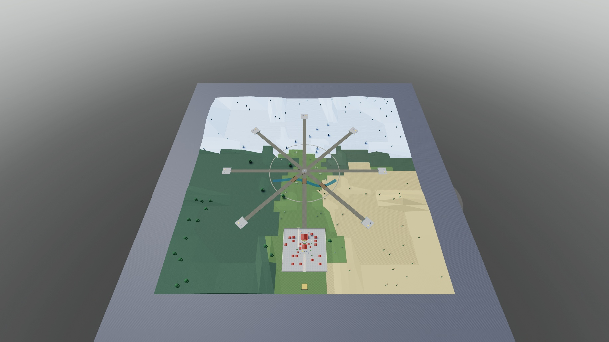

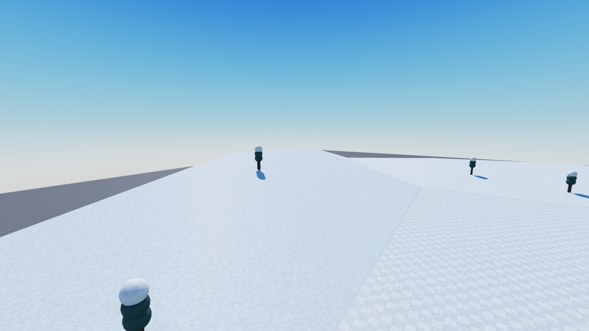

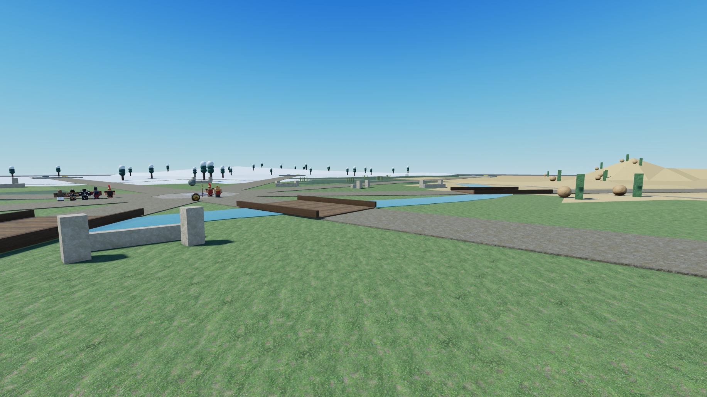

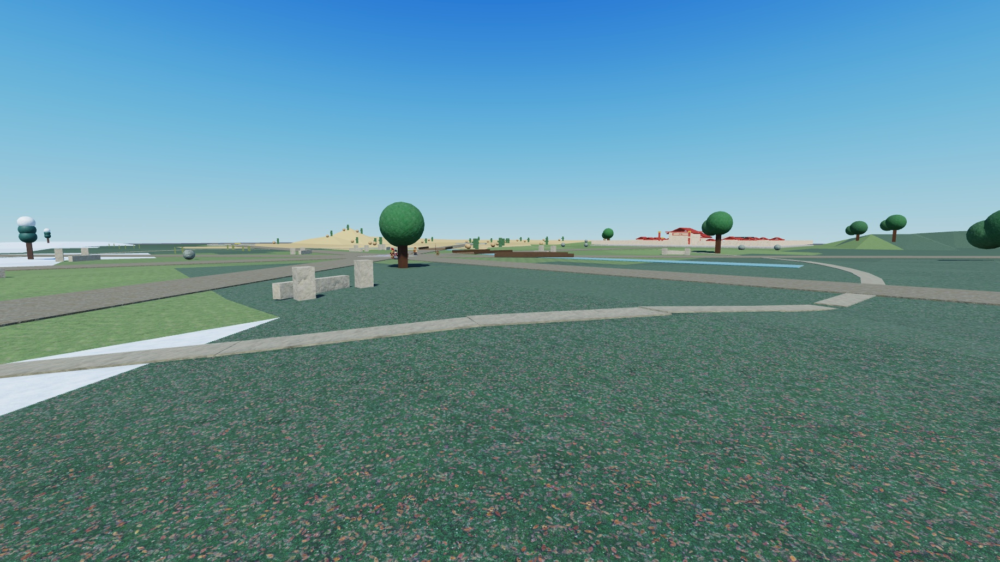

## Fifty gradual settlement levels

Every accepted upgrade adds a lasting feature and a four-stud strip of land.
Early additions include a barracks at level two, a dwelling, storehouse, garden,
workshop, orchard and craft hall. Later levels add district buildings, avenues,
carvings and larger ceremonial structures. Consecutive growth retains existing
geometry; switching civilization or rebuilding a transformed plot reconstructs
the same unlocked features deterministically.

| Milestone | Added detail |
| --- | --- |
| 10 | Civilization-themed civic monument |
| 20 | Ceremonial entrance and growing perimeter |
| 30 | Grand hall with incorporated civilization/owner identity |
| 40 | Ceremonial wings |
| 50 | Final ceremonial monuments completing the settlement |

The architecture follows each civilization: Spartan sanctuaries, Georgian brick
avenues, Seneca longhouses and council village, Mongol yurts and khan's pavilion,
Norse carved halls, Persian palace terraces, Sengoku castle courts, Mauryan stupa
precincts, Spanish arcades, Egyptian pylon temples, Roman civic basilicas, Ottoman
domed courtyards and Ming palace courts. These are stylized generated references,
not complete historical reconstructions. Egyptian growth uses the chosen New
Kingdom temple reference rather than adding a pyramid as its default landmark.

The forecourt remains usable throughout growth. Only the next eligible weapon,
armor and barracks pads appear; settlement-capped, completed and prerequisite-
locked purchases are absent. Available but unaffordable pads stay visible with
prices. A logical contact latch survives replacement of a tier pad, so standing
on its site cannot buy the following tier. The barracks has six levels and
two original troop slots; Army Camp I adds a third slot. See [economy](ECONOMY.md) and
[army rules](ARMY.md).

## Purchased building sites

Generated architecture uses the foundation's local top at y 1. District buildings
keep their existing floor heights and meet the foundation through physical
footings; processional pillars and monuments have their own bases. Shared pitched
roofs cover both outer wall corners and the ridge at their lower and upper faces,
with filled attic wedges closing the space above the walls. Flat roofs, starter
towers, terrace risers and gate posts meet their supporting surfaces.

Grand Seneca and Viking halls have a 38-stud depth and inset end posts. Their
ceremonial entrance sits at local z −34, leaving room between the hall, entrance
and level-30 perimeter. Arena exits and training-yard side openings retain their
clear approach lanes. The settlement-only geometry budget remains 400 BaseParts.

Every visible earning, upgrade and farm-collection pad has a child support from
its underside to the foundation or sampled exterior terrain. Supports stay
within the pad's footprint and carry no touch handler, action or prompt. Pad
positions, prices, eligibility and interaction zones remain unchanged.

The first development milestone adds an armory automatically at settlement 2,
a purchasable training yard at 5, farmland and worker camp at 7, and army camp at
10. Training Yard I, Farm I, Worker Camp I and Barracks IV are prerequisites for
entering settlement 10. Missing requirements appear on the armory facade and HUD.
Older saved settlements already beyond this checkpoint keep their levels.

Weapon and armor controls sit beside the armory in the right courtyard. Barracks
controls sit outside its arena-facing door. The army camp has its own forecourt;
the training yard occupies a separate exterior campfire site. Purchased structures use the same civilization
architecture and colors as surrounding districts, and update independently of
settlement growth. Roads, entrances and standing room stay clear.

Training Yard I is an open 28 × 28-stud campfire yard at local (-148, -12),
beside the plot's left side. Its level-five, 50-coin construction pad is at
(-148, 14), outside the main foundation even at level 50. A stone fire ring,
logs, warm flame and light, seats and civilization-colored banners mark the
site. The fire is decorative. Flat terrain and a clear approach at local
z −12 connect it to the settlement; later west walls leave a side gate there.
Districts and scenery reserve the approach, yard and pad standing space.
Regrouped troops gather here and slowly stroll within the yard between pauses.

Two rural fields sit on either side of the approach, centered at settlement-local
x ±60, z −172. Their 56 × 40-stud beds lie beyond the final 128-stud settlement
half-width and outside the central battlefield. Farm upgrades sit at x −48,
z −145, separate from collection at x −24, z −145; the worker camp sits at
x 60, z −144. Terrain and scenery reserve these
areas before generation. The 28-stud road remains clear through the fields.

Rural worker-camp footings and field-fence posts sample the same native terrain
triangles as the landscape. Soil extends down to that ground while retaining its
existing crop surface and farmer routes. Crop rows meet the soil, training signs
have posts, and building labels mount to physical facade surfaces. Workshop
furniture and storehouse crates stand beyond both walls and raised footings.

Farm II at settlement 12 increases each field from five to seven crop rows, adding irrigation details and
greater production. Worker Camp I adds a second farmer to the initial one;
Worker Camp II at 12 adds a third and requires Farm II. Tenders use the supplied
R15 farmer's body, clothing and hat. They walk at four studs per second through
each crop row, pause for two seconds to tend it, turn at row ends and return
along the field margin. The second tender works the other field; the third
shares the first field with a staggered routine. Anchored server poses animate
the limbs without pathfinding, collision or combat registration. A fresh disabled
Humanoid renders the supplied classic clothes; it never drives movement or combat.
Routes follow the current foundation even after moving or rotating the world.
Reserve updates preserve the live farmers and their routine timing; rebuilds
start fresh transient routines. Farming income, collection and saving are described in
[economy](ECONOMY.md).

Settlement 13 offers separate themed Blacksmith and Armorer buildings at local
(-42, 34) and (42, 34), with controls at z 51. Forge/anvil and display-armor
details distinguish their roles. Storehouse I at 16 sits at (0, 45), with its
control beside it at (20, 45), visible stored goods and 180-coin reserve capacity. Pads fit
their unlock-stage foundations, and inner prompt positions remain outside newly built walls. District
lots reserve these sites through level 50, including moving the earlier garden.
Infrastructure cache keys include all purchased tiers; reserve changes update
labels without rebuilding buildings or controls. Later farm tiers at 20/30/42,
Storehouse II and further capacity upgrades remain planned.

These earlier first-milestone level-10 Britain views show the still-small settlement, separate
building controls, clear approach road and rural land reserved beyond the future
capital footprint. They use one client and temporary inspection camera settings.

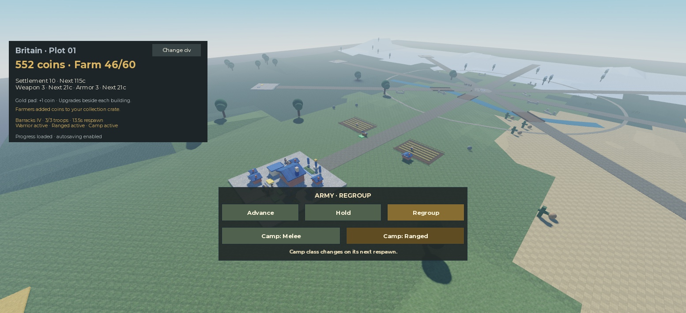

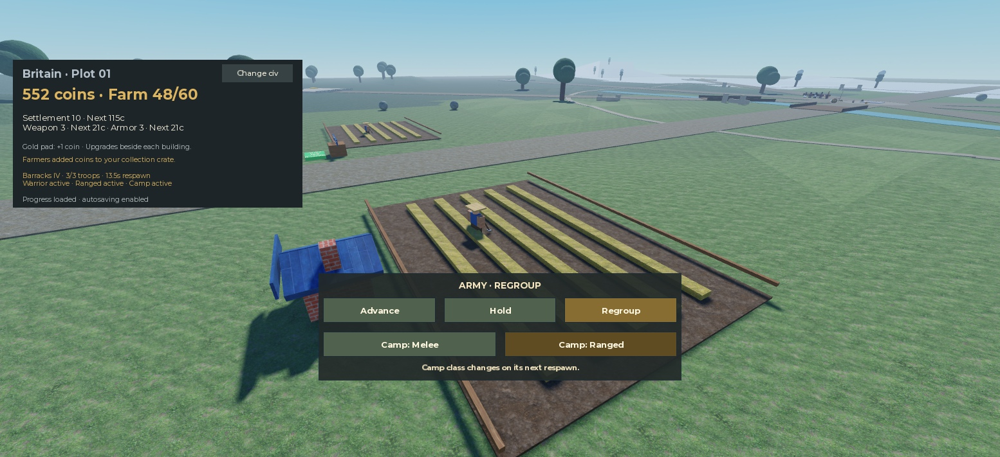

## Configuration and saved progress

[ProgressionConfig](../src/shared/ProgressionConfig.luau) controls the current
50-level cap, initial width, width increment, stat endpoints and price increments.
[WorldConfig](../src/shared/WorldConfig.luau) derives final footprint reservations,
plot radius, ground extent and combat radius from the progression, so increasing
the cap cannot silently overlap plots. Future cap changes still need new art,
route, economy and performance verification.

Existing saves keep their coins and numeric levels. A previously saved level
four becomes level four on the new visual and combat curve; it is not reset or
automatically granted level 50. Profile keys, scopes and schema stay unchanged.
The normal game restores each civilization independently. See
[saved profiles](PROFILES.md).

## Verification boundaries

Module checks verify all 13 civilizations at every level, retained features,
structural bounds, forecourt/barracks exits, transformed rebuilds, independent
upgrade caps, final plot separation and generated-world cleanup. Earlier
settlement-only builds measured 203–272 static BaseParts each. Before the topography change,
one eight-capital geometry fixture contained 2,466 BaseParts, including 423
landscape parts. Those earlier counts and captures below describe the previous
flat landscape, not the new terrain or an eight-player performance test.

Actual navigation, native purchases, visual inspections, saved restoration and
hardware/public-client limitations are recorded in [playtest evidence](PLAYTEST.md).

## Earlier growth illustrations

These earlier October 14 Studio captures use generated geometry and inspection cameras.
The overview contains one claimed plot and seven static visual fixtures, with
local fog removed and a 14:00 clock for visibility. It is not an eight-client test.

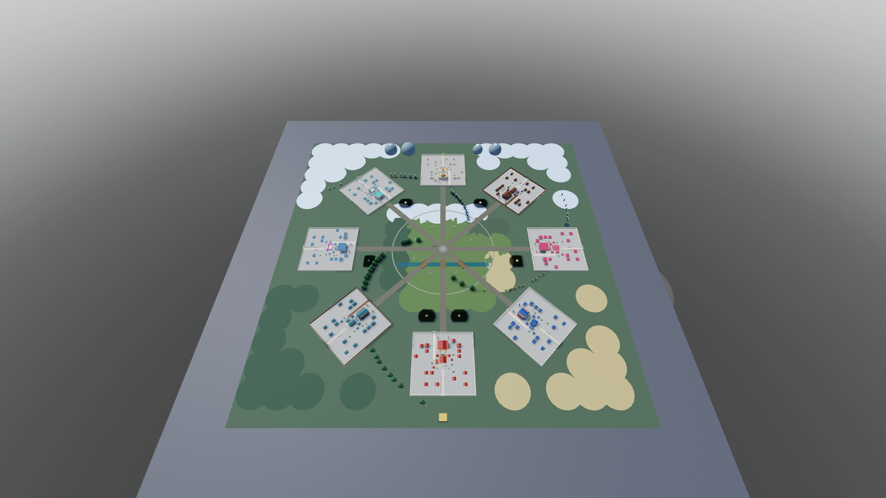

The same camera compares Britain's level 1, 25 and 50 footprints: 60, 156 and
256 studs. The starter manor remains while districts, perimeter and grand hall
appear. These are static builder illustrations, separate from the native
upgrade and saved-restoration checks.

| Level 1 | Level 25 | Level 50 |
| --- | --- | --- |
| 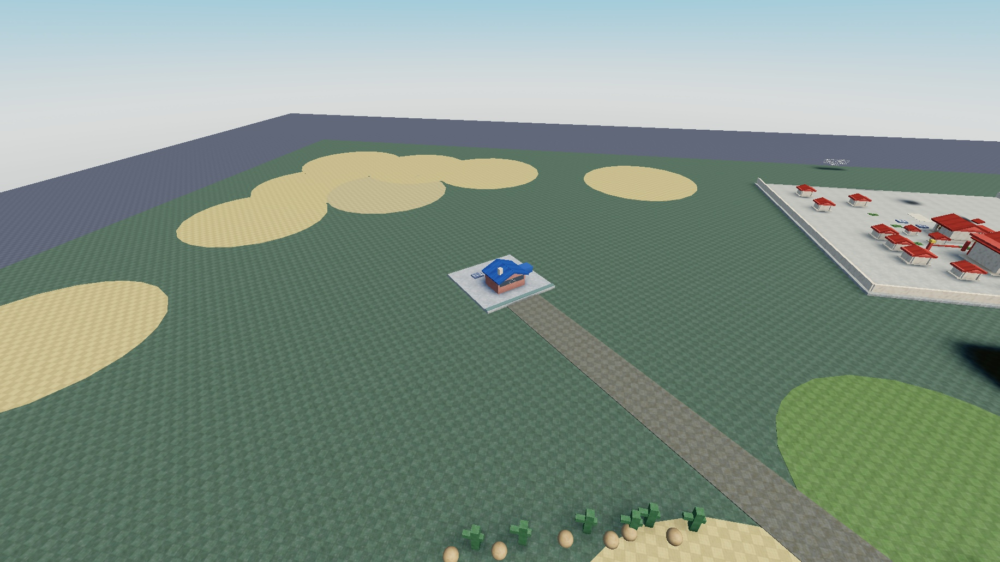 | 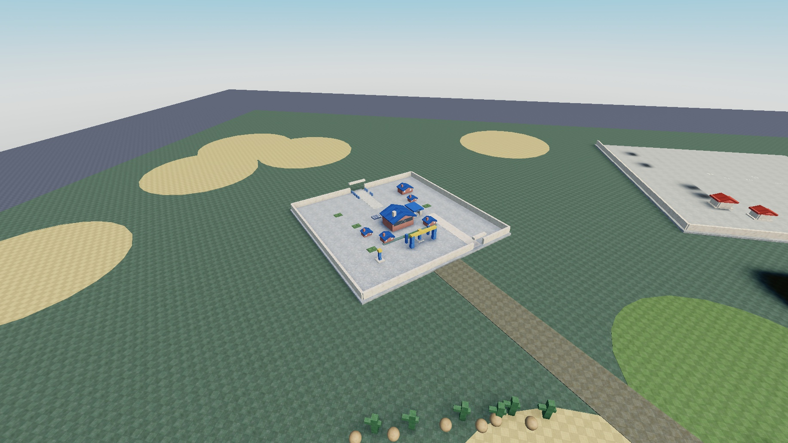 | 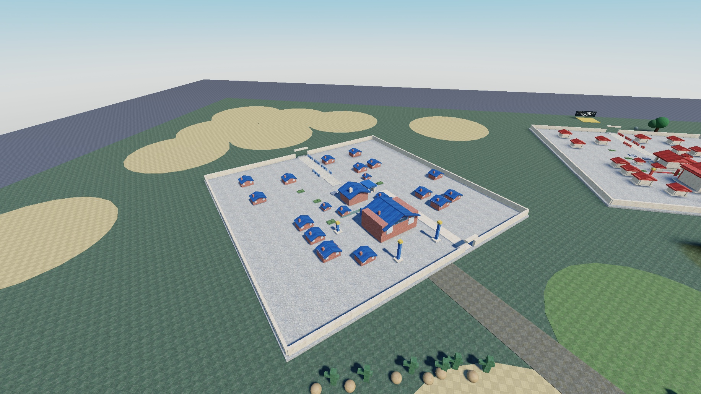 |

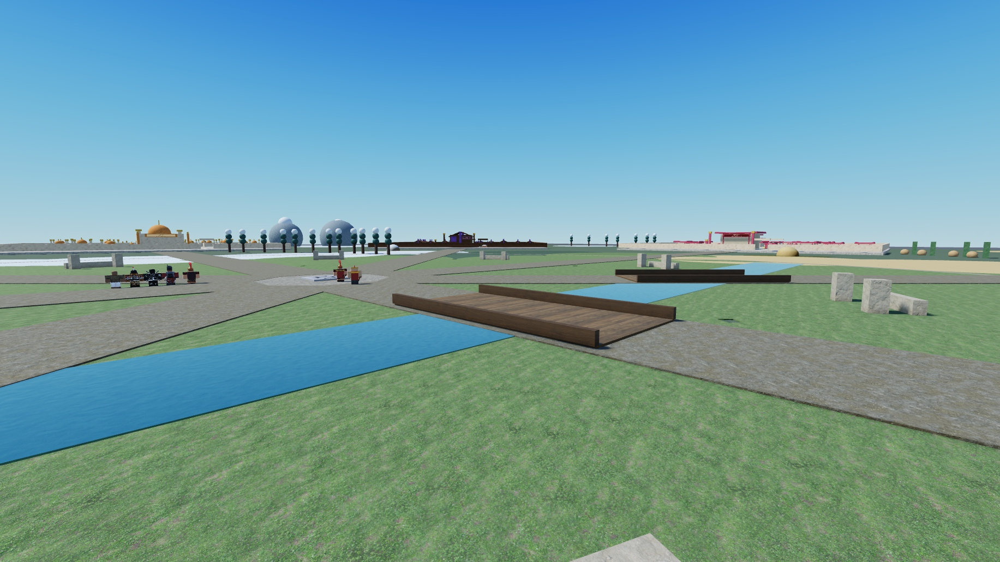

Imported melee models entered the arena after approximately 25–29 seconds from
levels 2/25/50. Separate ranged fixtures walked from levels 25 and 50 to points
inside the field in about 28.6 seconds and verified actual projectile impacts.
The latter use simulated owner identities; neither those timings nor the
overview prove connected multi-owner combat or hardware frame rates.
