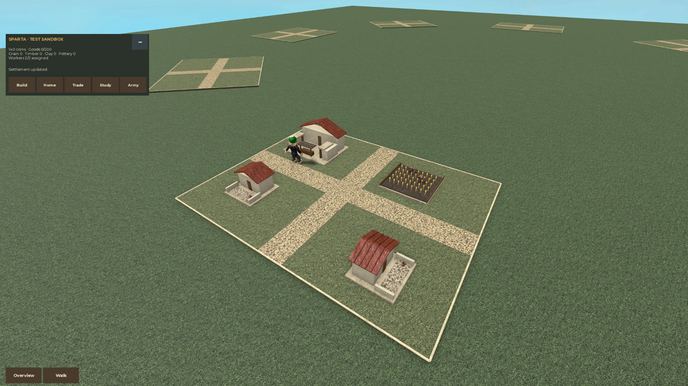
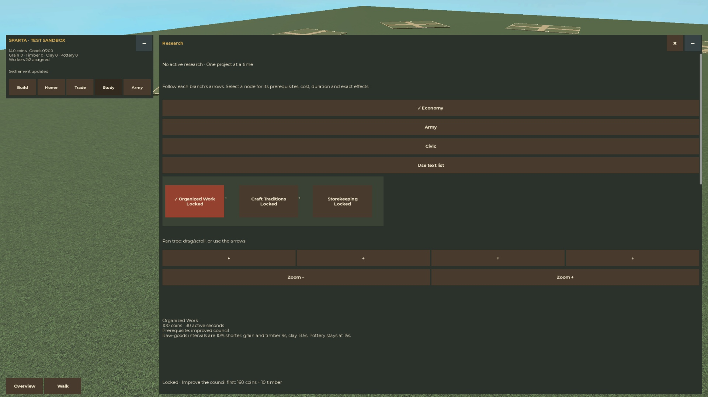

# Miniature redesign implementation log

Implementation began October 28 and continues October 29, 2026.

[Design and economy](Miniature%20Civilization%20Redesign.md) ·
[Historical building/army brief](Civilization%20Building%20and%20Army%20Reference.md) ·
[Spartan model evidence](Spartan%20Sandbox%20Art.md) ·
[Economy implementation](Miniature%20Economy%20Implementation.md) ·
[Launch and verification instructions](../MINIATURE_GAMEPLAY.md) ·
[Authoritative task checklist](../../openspec/changes/miniature-civilization-redesign/tasks.md)

## Current delivery

All thirteen prototype building kits are available in the fake-store sandbox,
with nine building roles and three passive military/support candidates each.
Placement, production, collection, trade, research, workforce presets and optional
Porter/Trade services are implemented. The 54-case miniature logic suite and
native checks below record their verification. Respawn W movement is fixed and
the full new-life check passes. Combat, healing, conquest, real storage and
published/physical-device acceptance remain outside this delivery.

See the [native evidence sheets](Miniature%20Civilization%20Evidence%20Sheets.md)
and [launch guide](../MINIATURE_GAMEPLAY.md). Sections below retain the milestone
history; outstanding work described in early milestones was checked later.

## Verified foundation

- Separate `miniature-playtest.project.json` and generated native test place;
  production, dated backup and clean scale preview remain separate.
- Injected fake storage, validated miniature state and isolated per-player,
  per-civilization progress. Eight exclusive plot claims support the thirteen
  existing faction identities at the state layer.
- Lease expiry/takeover, failed-load protection, serialized profile closing,
  copied snapshots and guarded bounded request handling have logic regressions.
- Windows Rojo built the original preview and new sandbox/test projects. The
  owned Studio test returned `MiniatureIsolationResult = passed`; the user's
  recovered preview Play was left untouched. The owned verification Play stopped.
- The foundation milestone passed 16 miniature logic cases; the subsequent
  economy and timing work reached 50 cases, then 54 after final review. Native
  gameplay, simulated multi-owner and complete prototype-kit evidence follows.

OpenSpec tasks 1.1–1.3 and 2.1–2.3 are complete; the native graph/input work
also completes UI task 6.2. Private merchant and owned placement tasks 3.1/3.2
are complete after the last-stock race and independent structure-cap regressions. No real DataStore, publication or legacy
profile migration is involved. Fake progress resets when the Play server stops.

## First playable Spartan slice verified

The separate fake-store sandbox now renders the civic/trade courtyard, house,
farm and two miniature tending workers. The native scene fixture passed with
nine inert building thumbnails, four housing places, two moving workers observed
for 14 seconds, five independently configured role presentations and unchanged
source-template fingerprints. Normal-sized commanders remain unarmed. An engine
initialization issue that enabled worker torso collision was corrected by
sanitizing the completed parented clone; the 14-second flag check passed.

The native Client fixture passed a complete collect-ten/sell-ten loop, ordinary
W-key walking, Walk/Overview and wheel zoom, independent HUD/Trade minimization,
hidden out-of-range revalidation, retained quantity drafts, and four bounded UI
layouts (320×360, 320×568, 640×360 and 1024×768). Native mouse input selected the
farm; physical relocation between interaction sites was fixture setup. This is
not phone/controller or full walking-route acceptance.

The 200-Coin starter sold ten Grain at two Coins each, reaching 220 Coins with
those ten goods removed, then bought an 80-Coin house plan, leaving 140 Coins.
Cancel retained the plan; rotate-and-confirm placed the house at local (12,10),
90 degrees, consuming exactly one plan. The screenshot below records that result.
Receipt evidence recorded the farm buffer at **12 → 2**, collected Grain at
**0 → 10 → 0**, and Coins at **200 → 220 → 140** after the house purchase.
The separate logic cases prove the initial 48-Coin/minute theoretical sale value,
partial/full inventory collection, competing sales, bounded active-only batches,
lease loss and zero-wallet recovery; this is not a measured steady-state native
income rate.

The 50-case deterministic suite also covers private shop stock, placement,
workforce, pottery, research, roster/preset and automation ledgers. Integration
review added regressions for selection receipt replay, death/switch time
boundaries, unlock-next-cycle ordering and cancellation of an in-flight load.
At this milestone, advanced crafting/research and multi-owner checks remained;
their later passing runs are recorded below.
The Studio log had no first-party script errors on the passing run; one supplied
farmer asset produced an asset-type warning, retained as an appearance limitation.

## UI milestone

The client exposes Build, Settlement, Trade, Research and Army views. The latter
configures inert figures only; combat/healing are not part of this sandbox.
The extended native research presentation fixture also passed all four layouts:
nine exact costs/effects/prerequisites, all four status labels, pan/zoom, branch
selection memory and equivalent graph/list input. Its mixed research states were
isolated local render fixtures, not completed server research.

[Recorded fixture results](../assets/miniature-native-2026-10-29.json) preserve
the native output. At this milestone, advanced management received its funded
fake fixture and the first additional kits were delegated. All thirteen kits
were subsequently delivered with their own evidence cards and native sheets.

The [Spartan](Spartan%20Sandbox%20Art.md) evidence note identifies provisional
worker clothing and unsourced role details. A native scene pass does not finish
the full archaeological/historical acceptance of that kit.

## Continuing record

Update this note after each verified milestone with what changed, the test
results, the available build and any native checks still outstanding. Keep
design decisions in the linked design notes and task completion in OpenSpec.

## Additional native integration evidence

Native geometry contracts now pass for Rome (333 building parts), Persia, Egypt
(254), Maurya (309), Vikings (405), Seneca, Mongols (508) and Ming. Each contract
checks all nine roles, cardinal footprints, inert figures and distinct kit forms;
these results do not establish historical reconstruction accuracy or a claimed
plot walk-through. See their linked source cards in the vault index.

An isolated native geometry/pose stress fixture built eight settlements with
96 buildings, 64 workers and 40 passive figures: 5,469 BaseParts across seven kit
varieties. During its three-second observation, server Heartbeat median was
16.90 ms, p95 18.93 ms and maximum 59.65 ms, with 53 pose updates. It allowed a
repeated civilization only inside this separate geometry fixture, never in the
claim registry. This short desktop observation is not a phone performance budget
or an eight-client test. Temporary models were destroyed and source fingerprints
were unchanged.

The native simulated two-owner fake-store fixture also passed exclusive claims,
private stock, foreign-session rejection, independent civilization restoration
and return on a reassigned physical plot. It used three simulated identities,
two concurrent claims: the returning owner's 120 Coins, one house plan and one
remaining stock restored on plot 3 after originally occupying plot 1. Every fake
lease was released. This is not a physical multi-client or real-storage test.

Advanced native testing found a stale-revision window after passive production.
The runtime now pushes snapshots immediately at passive revision changes;
revisions/authority guards remain enforced. Test-only retries explicitly click
again only after stale-revision refusals, with a maximum of three attempts.
Pottery sale text entry uses Roblox's native SendTextInput API; caret selection
is fixture setup. A resumed sale passed 1 pottery → 15 Coins (4015 → 4030), and
the full updated funded management run subsequently passed every step.

October 29 reference addition: the user supplied the [Mini War community wiki](https://mini-war-roblox.fandom.com/wiki/Home). It is now linked in [Mini Wars References](Mini%20Wars%20References.md); direct fetching received HTTP402/robots restrictions, but indexed summaries were accessible. The reference note now links technology, housing, special buildings and game-system pages, and records the distinct stock/market timers without changing our prototype balance.

## Advanced management pass — real native timers

The full funded fake-store run completed all 20 accepted UI transactions, each
on its first submission after the snapshot correction. It bought/placed/moved a
house and returned the same building to one plan without changing its 4,920-Coin
post-purchase wallet; hired a third worker for 25 Coins; reassigned a farm worker
to clay; observed one clay batch after **15.57 seconds**; and collected it.
Council improvement charged 160 Coins and ten Timber. Organized Work completed
in **30.43 seconds**, followed by Craft Traditions in **60.63 seconds**. The
workshop appeared only at its next real merchant cycle, then one assigned potter
consumed clay, produced one pottery, and sold it for 15 Coins (**4,015 → 4,030**).
All timers were real; the 5,000-Coin/80-Timber/20-Material starting funding was
explicit test setup. See [the exact receipts](../assets/miniature-advanced-native-2026-10-29.json).

This completed native move/unpack and clay-to-pottery flow tasks 3.3/4.2. Timber,
Storehouse/role-capacity effects and full kit tours passed in the later checks
below. The ordinary build still starts with 200 Coins.

## Pre-unlocked services effects pass

The separate services fixture seeded completed research explicitly; it does not
claim to have natively completed all nine nodes. Its 30 UI submissions passed
with one stale-revision refusal followed by a fresh explicit placement retry,
without duplicate resource consumption. Storehouse purchase/placement displayed
**400** goods capacity. One newly hired worker produced Timber after **9.65s**.
A **3 melee / 1 ranged / 1 medic** passive roster appeared while all three worker
instances remained intact. Assignment preset save/unassign/restore passed.

Porter collection transferred twelve food; Trade sold exactly two above the
configured ten-food reserve for four Coins. Manual sale and the manual collection
control remained available with both services enabled. Toggles were restored off
and producing assignments restored. See the [services evidence](../assets/miniature-services-native-2026-10-29.json).
These observed effects complement the real research-timer run; they are separate
from combat/healing, published clients and player storage.

## Thirteen-civilization live UI tour passed

All **13/13** available civilizations passed actual chooser selection, retained
plot1, civilization-specific house labels and three correct role previews,
quarter-scale owned world models, native farm world inspection, a normal-sized
unarmed commander, and horizontal W-key walks of **16.00–16.27 studs** with zero
vertical change. Each new civilization had its independent 200-Coin starter.
Returning to Sparta restored its seven buildings, three workers, roster, goods,
settings, all seeded research and exact4,171-Coin balance. These were real server
snapshots, not local render-state injections. See the [tour receipts](../assets/miniature-kit-tour-native-2026-10-29.json).

The all-thirteen tour passed before the respawn test. Respawn preserved the
session/claim progression, cleared a valid uncommitted house ghost and old
confirmation, restored Walk camera with the new Humanoid, and kept the commander
normal-sized and unarmed. Its final automated W-key assertion reported zero
movement despite key-down state, enabled default controls, current Humanoid and
valid default movement bindings. This was the failing pre-fix run, retained as
evidence. The same native W sequence passed for every civilization before death;
the default-binding repair and full lifecycle retest are recorded below.

Final review also found and fixed two bounded-state issues: sparse saved arrays
now fail validation without overwriting their records, and accepted mutations
prune deleted/non-producing clock IDs. The **54-case** logic suite includes100
place/unpack cycles plus sparse building/worker restore regressions.

The user then confirmed physical W also failed on the respawned commander.
This is treated as a real input recovery bug, not dismissed as virtual input.
A narrow default-controller rebind on fresh character initialization was then
implemented and retested without custom movement bindings or stat edits.

## Respawn movement fixed and verified

The default controller still appeared enabled after death, but its abstract
movement bindings did not move the new life. The sandbox now waits for the fresh
Humanoid/root/default PlayerModule and refreshes those existing bindings once.
It adds no custom WASD actions and changes no speed, health, physics or server
authority. A causal native check changed W movement from zero to16 studs.

The full second-death lifecycle check then passed automatically: new-life W
movement **15.99976 studs**, zero vertical change, current Humanoid movement
(0,0,-1), Walk camera bound to that new Humanoid, unchanged4,920 Coins and one
held house plan, unchanged buildings, cleared ghost and inert former Confirm
location. Claim epoch advanced5→8 in the same session/plot. See the
[before-fix failure](../assets/miniature-lifecycle-red-2026-10-29.json) and
[after-fix pass](../assets/miniature-lifecycle-green-2026-10-29.json).

## Native research pause/switch pass

A fresh funded run improved the council, paid once for Organized Work, selected
Rome while that project was active, stayed there over three seconds, and returned
to Sparta. Project remaining time lost only the measured active chooser time;
it retained an inactive lower bound of4.28 seconds. Completion took34.90 seconds
of wall time for30 seconds of active work, occurred once, and preserved the
4,740-Coin wallet without another charge. The new Main automatically initialized
the movement adapter (one binding refresh). See the [research-switch evidence](../assets/miniature-research-switch-native-2026-10-29.json).

After that solo Play stopped, the isolated simulated two-owner fake-store check
was repeated in Edit and passed again, with all fake leases cleaned up. An
additional explicit capacity fixture subsequently passed an actual transfer
above200 into the purchased400-capacity Storehouse; its seed is test setup.

## Complete prototype art delivery and clean capacity rerun

All thirteen native factory contracts and the live UI tour passed. The
[evidence sheets](Miniature%20Civilization%20Evidence%20Sheets.md) now contain
117 building-role models and39 passive role candidates in their established
periods. Native overview/close-up review found distinct architectural families,
function props and held equipment; source cards retain all declared historical
uncertainties. This completes prototype kit delivery, not scholarly certification
of hypothetical buildings or every costume detail.

The final services/capacity run used exactly **one Bootstrap**, passed isolation,
and had no first-party script errors. Starting inventory200 and a farm buffer60
were explicit fake setup; paid building purchases and actual Porter collection
then reached **201 goods**, proving the old200 limit was exceeded within the
purchased400 capacity. Trade sold50 food above reserve10 for100 Coins. See the
[clean capacity evidence](../assets/miniature-capacity-native-2026-10-29.json).

The test generator now enumerates server source files: Rojo's additive directory
mapping had otherwise created a second same-name Bootstrap in funded modes.
Node regressions and a built XML check prove each mode selects exactly one;
the native isolation fixture enforces it too. The ordinary build was unaffected.

## Final integrated acceptance

One clean Play session passed the full native management flow, then all thirteen
civilization switches, then all four bounded UI layouts. All 20 management
transactions succeeded on their first submission. Clay first appeared after
15.58 seconds; Organized Work took30.48 seconds and Craft Traditions60.50 seconds.
The workshop waited for its real merchant cycle; the produced pottery sold once
for15 Coins (4,015→4,030). The tour restored that same Spartan state after the
other twelve civilizations. See the [single-session evidence](../assets/miniature-integrated-native-2026-10-29.json).
This funded run uses declared fake starting resources and native virtual input;
interaction-site relocation remains fixture setup.

The final bounded stress run built **eight distinct kits**,96 buildings,64
workers and40 passive figures, totaling5,472 BaseParts. Its three-second desktop
observation recorded Heartbeat median25.46ms, p9562.70ms and maximum145.33ms with48
pose updates. This was slower than the earlier seven-variety run: frame-time
spikes are a performance limit requiring profiling before more actors or combat.
It is neither an eight-client test nor a phone-performance result. Temporary
stress models were destroyed. Source fingerprints stayed exactly
`13546:4088439198`; isolation and all native kit contracts passed with one
Bootstrap. No first-party script errors appeared; the supplied farmer's
asset-type warning remains. See the [final server evidence](../assets/miniature-final-server-native-2026-10-29.json).

After stopping solo Play, the isolated simulated two-owner check ran again in
Edit. It passed exclusive claims, private stock, foreign-session rejection and
restoration of120 Coins/one plan/one remaining stock on plot3 after original
plot1. All fake leases were released. See the [separate ownership evidence](../assets/miniature-ownership-native-2026-10-29.json).
The temporary photography gallery was removed and both owned verification
windows were closed after evidence capture.

Final `npm run check:dev` exited0:28 OpenSpec items, zero-warning changed-file
Selene/StyLua checks, four Node tooling regressions,325 Luau syntax compilations,
244 existing logic cases and54 miniature logic cases passed. Launch builds were
regenerated for the ordinary200-Coin sandbox, native test place and preserved
scale preview. Built XML confirms exactly one Bootstrap in normal, test and
services modes. All217 local links checked across26 vault/guide files resolve.

The four capability contracts were reviewed against these records. New behavior
remains in the active OpenSpec change pending review/archive. Production mapping,
production scripts/assets, legacy ProfileData V1 and the dated backup are
unchanged; no published experience or real player storage was touched. Physical
phone/controller, published clients, real-storage integration, functioning
combat/healing, conquest and further historical refinement remain separate work.

The ordinary build also received a user-confirmed physical keyboard check.
Following a game-view focus event, physical W drove the default controller and
moved the commander about9.87 studs; release stopped movement. The user confirmed
movement was working. This diagnostic changed no movement code or bindings; see
the [physical keyboard trace](../assets/miniature-physical-keyboard-2026-10-29.json)
and the UI note for the observed focus sequence. The user's Play remains open.

## Inventory/shared-stall interaction revision

The user replaced manual management with inventory building items and a hotbar,
a Destroy Hammer, automatically employed housed civilians and direct E collection.
Subsequent steering made purchases Coin-only, added a shared Sell All shop and
specified exactly three top travel buttons: Buy / Civilization / Sell. The saved
Mini War gameplay images were viewed directly for their top navigation and bottom
item-strip hierarchy. See [current interaction decisions](Miniature%20Inventory%20and%20Shared%20Shops.md).

Backend regressions now cover65 cases. Houses automatically provide four
civilians, capped at eight; existing valid jobs remain and idle civilians fill
open slots. The ledger conserves output during hammer reclamation and protects
full inventory, storage/roster dependencies, civic and last-house sites. All
purchases use Coins; clay remains a pottery ingredient. Explicit test production
is ten times faster with ordinary research/restock clocks.

The first current native flow passed E collection of60grain, Sell All for120Coins
(200→320), an80-Coin house item (320→240), inventory selection/cancellation,
placement without another charge and population4→8. It then reproduced a real
hammer bug: clicking the overlapping producer prompt collected instead of
reclaiming. The [failure record](../assets/miniature-inventory-red-2026-10-29.json)
is retained. Main now prioritizes the selected hammer for owned prompt/detector
activation and updates its prompt text. Full native re-verification is underway.

A separate run refused a travel intent at a stale revision during fast production;
no acceptance or charge occurred. The fixture now records up to three explicit
new UI presses solely after a fresh stale-revision refusal snapshot. The game
client still performs no automatic action retries. VirtualInput refuses key1 as
permanently CoreGui-bound; fixtures exercise slot1 by click and other numeric keys
for text-focus guards instead of bypassing that restriction. Physical numeric
hotkeys, phone/controller and published-client checks remain separate.

### Final inventory revision accepted

The [final run](../assets/miniature-inventory-final-2026-10-29.json) passed the
complete inventory/stall loop and four bounded layouts, actual Rome→Sparta
preservation, independent minimization, and real death/respawn. Reclamation
returned48grain and one farm item; replacing it cost no Coins and automatically
restored two farm jobs. Death retained160 Coins,48grain,one house item,eight
civilians and four buildings, cleared the ghost/selection and advanced claim4→7.
The new life walked16.2664 horizontal studs;0.4 vertical was the raised-plot step.

Movement investigation separated two problems. Tool-context PlayerModule requires
created competing controller singletons; fixtures now forbid those requires.
Separately, the ordinary controller could be enabled without selecting an active
device. An actual-game UpdateMovementMode refresh restored native movement and
the user confirmed physical W worked. InputReadiness now listens for device and
character readiness in the same game context. Earlier reset/key-patch candidates
were removed; no forced enable, custom key bindings or private Keyboard patch
ships. [Readiness proof](../assets/miniature-input-readiness-2026-10-29.json) and
[controller-context proof](../assets/miniature-controller-context-2026-10-29.json)
record the distinction.

Final development gates exited0:28 OpenSpec items, five Node tooling regressions,
330 Luau syntax compilations,244 existing logic cases and65 miniature cases;
changed-file Selene/StyLua passed. Native isolation passed with one Bootstrap,
unchanged source templates and retired manual remotes absent. Shared-stall
out-of-range and malformed-destination protocol probes refused without changing
Coins. Physical number1, phones/controllers, published clients and real storage
remain separate evidence. See the current interaction note and screenshot.

The verification Play was stopped and its owned window closed after evidence
capture. The final ordinary `build/miniature-playtest.rbxlx` and reusable native
test place were rebuilt; the ordinary sandbox was opened for user review. No
production/preview source, published experience or dated backup was changed.
All244 local links checked across27 vault/guide files resolve.

### Simple shop, automatic troops and spaced map

The next revision follows the user's shop screenshot: Homes, Production and
Military tabs, scrolling structure thumbnails, Coin prices and short summaries.
Travel popups and the HUD are compact; Inspect, manual recruitment/roster,
research and hall-upgrade pages are removed. All building types are eligible
without research. Military stock is two per restock; older fake records upgrade
without refilling spent stock. Inventory, hammer reclamation, automatic civilian
jobs, E collection and the shared Sell All stall remain the interaction loop.

Each melee building supplies two fighters, each ranged building two ranged troops,
and each medic building one medic. They allocate whole groups under a fixed
total of ten troops, including medics. Buildings never raise that maximum;
civilians are separate. Waiting groups fill released capacity, with unrelated
actors retained on reclaim. Research-based capacity increases remain later work.
These figures remain passive prototype actors: combat and healing are not yet
implemented in this sandbox.

All thirteen kits now have a distinct ranged-yard role, bringing the catalog to
130 models. The new [ranged-yard reference](Ranged%20Training%20Yards.md) links
the period source cards and distinguishes interpretation from historical claims.
The world is1200 studs square, with eight plot centers400 studs from the hub.
Current40×32 build areas are unchanged; disjoint160×128 reserves leave room for
later expansion, rather than granting that build area immediately.

The [native flow](../assets/miniature-simple-shop-native-2026-10-29.json) passed
E collection of60 grain, Sell All for120 Coins, buying and placing all three
military types, automatic2/2/1 groups, hammer reclaim/replacement, four bounded
layouts, Rome→Sparta restoration and an actual death/respawn. The new life walked
16.2664 horizontal studs. Its explicit fixture funding was5000 Coins only, with
zero goods and no research; normal starts remain200 Coins. The
[native server checks](../assets/miniature-simple-shop-server-2026-10-29.json)
passed source immutability, all thirteen ranged factories, cap10/backfill,
per-building actor cleanup, unrelated actor retention and expanded-map geometry.
The [compact shop screenshot](../assets/miniature-compact-shop-2026-10-29.jpg)
and [current controls note](Simple%20Shop%20and%20Automatic%20Troops.md) are saved
in the vault.

Development gates exited0:28 OpenSpec items, five Node tooling regressions,
336 Luau syntax compilations,244 existing logic cases and73 miniature cases.
Changed-file Selene/StyLua and whitespace checks passed. Physical phone/controller,
published multiplayer, live storage, combat/healing and research remain outside
this acceptance evidence. Production source, clean preview and dated backup are
preserved.

The owned shop verification Play was stopped and its window closed. The ordinary
build was rebuilt and copied identically to `build/miniature-simple-playtest.rbxlx`
for a distinct review window, with exactly one ordinary Bootstrap and no funded
shop Bootstrap. Studio completed an automatic application update while opening
this file; the new review window connected successfully. The final specification
check passed28/28, whitespace checks passed, and239 local links across28 current
vault/guide files resolved.

### Larger starting settlement follow-up

Playtest feedback asked for more building room immediately, with expansion
purchases left for later. Shared Config now gives every civilization an80×64
starting area instead of40×32: twice each side and four times the area. Geometry,
lane extents, borders and client/server placement all use these same dimensions.
Existing local building positions, the1200-stud world,400-stud plot radius,
160×128future reserves and troop/civilian/building limits remain unchanged.

The new placement regression failed against the old size, then passed with the
new size. It checks all four outer farm corners and rotations, purchase/placement
without expansion research, valid copied-state restoration, and unchanged-state
rejection beyond each boundary, over an existing building and inside a lane.
The previous out-of-bounds fixture now follows the configured edge.

The [native evidence](../assets/miniature-large-settlements-native-2026-10-29.json)
passed all eight plot/lane sizes, all thirteen civilizations' outer farm purchase,
placement/restoration through isolated State/Actions/World factories,3784 rendered
part corners inside the new bounds, source immutability and the existing native
scene suite. The verification place used the ordinary200-Coin fake bootstrap.
An initial verification run omitted the required Edit template fingerprint;
that fixture setup was corrected before restarting the passing run.

Full development checks passed28 OpenSpec items, five Node cases,336 syntax
compilations,244 existing logic cases and74 miniature cases, plus Selene/StyLua.
The first sandboxed Node workers failed with spawnSync EPERM; the same unmodified
gate passed with normal subprocess permissions. No checks were weakened.
The ordinary build was rebuilt as `build/miniature-large-settlements.rbxlx` and
the canonical `build/miniature-playtest.rbxlx`. The user's running earlier Play
was preserved; its dimensions update only when the rebuilt place is opened.
The owned larger-plot verification Play was stopped and its window closed after
the evidence capture; the current user playtest remains open.

### First miniature army combat and conquest

The separate [combat change](../../openspec/changes/miniature-outpost-combat/proposal.md)
implements one first-tier outpost per home line,110studs inward from each plot:
eight centers at radius290, each with a22-stud capture zone clear of all home
expansion reserves. Neutral defense is2melee/1ranged with8-second replacements.
Armies derive their building-owned2/2/1groups under the existing10total cap, use
server movement/contacts/shots/medic support and10-second building replacements.
Stable lives and deadlines survive synchronization. Release/switch/write loss
removes old armies; commander death alone does not heal them. No combat fields save.

As confirmed by the user, capture needs20clear occupied seconds; defender returns
pause it, hostile armies contest it and loss of attackers resets it. Capture
switches the game flag and stops neutral respawns, granting no extra garrison.
Default armies follow their own ordered line and guard the final current node;
actual E at any outpost center overrides the whole army, including replacements.
Only one native node per line exists now. Synthetic two-node advance and rival
recapture are covered independently; homes/commanders/civilians are excluded.

The [first native record](../assets/miniature-outpost-native-first-2026-10-29.json)
passed actual shop placement, automatic walking/fighting, bar/flag and E override,
plus isolated native simulated-team recapture, life rendering, immutable sources
and distant/home/client-progress/stale-life/foreign-session refusal probes.
The [final native flow](../assets/miniature-outpost-native-final-2026-10-29.json)
strengthened wave observation and passed again on the final source: seven
neutral life replacements, a0.2005-second measured pause at6.7383credited seconds,
then resumed capture after24.4486wall seconds. Its explicitly5000-Coin-only fake
start, zero goods and no research became4300Coins after700of military purchases;
all10intents passed first press and all five2/2/1troops were alive at the end.
No local state injection, local relocation or player-controller require was used.

The native adapter fixture separately captured for Sparta then recaptured for
Rome over44fake seconds. It is simulated rival evidence, not a real multi-client
or published test. A90-frame warm desktop sample with23combat models and the
user's other Play open measured16.6861ms median/18.0433ms p95, without establishing
phone, combat-storm or published performance. Only the known farmer asset-type
warning203785492 remained; no first-party script errors appeared.

MCP screenshots omitted all world billboards/default prompts even though their
objects were valid. An [OS capture of the owned Studio viewport](../assets/miniature-outpost-studio-2026-10-29.png)
confirmed the real health bars, capture label/bar and E prompt, so no game patch
was introduced for that tool limitation. The miniature simulation is intentionally
separate from the original full-scale formations/shields/skills/advanced movement;
those behaviors have not been ported and production source is unchanged.

Full gates passed29OpenSpec items, five Node tooling cases,345Luau syntax
compilations,244existing logic cases and98miniature cases (17battle,7new command
authority,74prior). Selene/StyLua passed after all agent sources were formatted;
the initial gate's in-progress formatting failures were corrected without
weakening checks. See [current combat controls](Miniature%20Combat%20and%20Outposts.md)
for balance, scope and the ordinary200-Coin launch.

Both owned verification Plays were stopped and their windows closed after
evidence capture. The ordinary `build/miniature-combat-playtest.rbxlx` was rebuilt
and opened in its own review Play, with the identical canonical
`build/miniature-playtest.rbxlx` copy. Its source has exactly one ordinary
fake-store Bootstrap, without Coin-only fixture funding. The user's original
`miniature-simple-playtest.rbxlx` session remained untouched. Production source,
clean preview mapping, dated backup and published experience remain unchanged.

### Original troop restoration, planted feet and miniature ranges

The user requested the original full-scale troops' models, outfits, animation and
behavior, plus slower movement and half ranged/medical distance. The separate
[original-army change](../../openspec/changes/miniature-original-army/proposal.md)
now reuses actual WarriorRig.create/createNeutral/animate, five custom melee
templates, all thirteen outfits, original equipment/grips and face/palette rules
at quarter scale. Fresh clones retain a disabled clothing Humanoid and inert
Tools. Original authored joint poses are scaled and solved kinematically; actual
posed sole corners fit sampled ground, raised plots and tagged outpost footings.
Player/other Humanoid geometry and invisible selection boxes cannot lift the feet.
The sole tolerance is0.005stud and whole-body hovering/bobbing is removed.

The original CombatEncounter/CombatTactics, CrowdMovement/TroopFootwork and medical
planners/MedicalService drive baseline movement, target reservations, spacing,
retreats, planted attack phases and healing. Numeric miniature lives/capture
remain authoritative. Virtual Instance life identities allow exact original
filter APIs; ranged flights bridge virtual decisions to bounded physical-map
coordinates with fresh range/visibility/life checks. Original projectile families
and bandages render at quarter scale. Progression-gated formations/shields/skills
remain later progression; no research/roster interface or production service loads.

Movement caps are6owned/4neutral studs per second. Ranged reach20→10owned and
18→9neutral; healing14→7. Frozen wrappers preserve original45/45/40range/recovery
sources, using40/28/24virtual values so actual range and medical recovery agree.
No original src, source asset, default/clean-preview mapping or saved schema changed.

The [native source-rig proof](../assets/miniature-original-army-scenes-2026-10-29.json)
passed39culture roles plus2neutral roles, all five custom skins,518groundedposes,
original clothes/equipment/grips, immutable sources and actual avatar-obstructed
support rays. An initial absolute-config mapping error was corrected. Imported
Egyptian khopesh matrix axes caused a fixture-only ToAxisAngle false positive;
direct basis and position comparisons retain0.002tolerance, with4620attachment
checks passing and maximum position drift0.000271stud.

The [actual original-army UI flow](../assets/miniature-original-army-flow-2026-10-29.json)
passed all10intents first press: military shopping,2/2/1placement, original
grounded march/combat, nine defender replacements during partial capture,
pause/resume, the Spartan flag and real E override. Capture lasted30.4646wall
seconds with20clear credited seconds. The explicit5000-Coin-only fake seed paid
700for troops and ended4300; zero goods/research/local state or position injection.
All five slots were alive under cap10. A separate native adapter fixture verified
simulated Roman recapture; it is not a second real client. Template fingerprint
remained92214:3573182113. The extended native run rendered32bandage launches.

The [actual Studio image](../assets/miniature-original-army-studio-2026-10-29.png)
shows original uniforms/equipment, planted feet and world UI. The Studio lighting
migration notice was dismissed only in the owned test window. Warm desktop
frames with23actors and the user's other Play open measured16.6564ms median and
19.4123ms p95 over90samples, without a phone/combat-storm/published guarantee.
Only platform asset warnings remained: known farmer203785492 and original Spartan
Torso.roblox decal6989384332 not approved for the requester. Original source
properties were preserved; that decorative decal remains permission-dependent.

Full gates pass30OpenSpec items,5Node tooling cases,351syntax compilations,
244existing logic cases and108miniature cases, including10executing actual
original combat/medical helpers with Lune's Roblox math types. Selene/StyLua pass.
The user's identified `miniature-combat-playtest.rbxlx` Play was preserved;
the older simple Play was stopped only to free the allowed verification slot.
See [current original-army controls and limits](Original%20Miniature%20Army.md).

The ordinary `build/miniature-original-army-playtest.rbxlx` was rebuilt with one
unfunded fake-store Bootstrap and copied identically to canonical
`build/miniature-playtest.rbxlx`. After the final evidence capture Studio's existing
connections had ended, so the owned stop request found no connected instances;
the ordinary review place then opened cleanly in a new Play. Its ready flags,
24original neutral models,8outposts, no funded fixture and6/4/10/9/7settings were
confirmed. No command stopped the user's identified combat Play during work.

## Smooth armies, stronger garrisons and frontier camps

The [smooth-army follow-up](Smooth%20Armies%20and%20Frontier%20Outposts.md) is
implemented in the isolated sandbox. Original joint poses now interpolate on
the client; a native LocalScript measured 154 intermediate movements across
181 frames, reducing the maximum step from 0.706 to 0.128 studs. Appearance
readiness, original grips, planted soles, stale lives and visibility cleanup pass.
The final check uses the game's native execution context; no thresholds were
lowered to accommodate the tool observer's misleading 15 Hz sampling.

Neutral health, damage and speed now equal 95% of each player role, with equal
range and timing. All eight capturable camps have walls, huts, supported watch
posts and supply props, with ten-stud-wide approaches and unchanged capture rules.
Commander walking is 32 studs/second on spawn and respawn; native W input confirms it.

Actual shop/placement/combat/capture/E input passes 14 intents on first press with
a normally purchased 4 melee / 4 ranged / 1 medic army. The 5,000-Coin-only fake
seed pays 1,200 for buildings and ends at 3,800. Capture observed 59.33 seconds
including pauses and 14 defender replacements, retaining 20 clear credited seconds.
Original rig and new rendering math pass 518 poses across all 13 civilizations.

The full gate passes 31 OpenSpec items, five Node checks, 362 syntax compilations,
244 existing logic cases and 127 miniature cases, plus Selene/StyLua. Source
fingerprint remains `92214:3573182113`. The ordinary review is now
`build/miniature-smooth-army-playtest.rbxlx`, identical to canonical
`build/miniature-playtest.rbxlx`. Owned test windows were closed; the user's Play
was preserved. Mobile, adverse-network and published multiplayer remain unverified.

The reported faces-ahead-of-troops regression is fixed: source Decals/Textures
are now hidden alongside source body parts, while cloned faces stay visible on
their smoothed heads. A native test fails before the fix and passes afterward,
including late arrivals and exact original visibility restoration. The running
user Play received the corrected client presentation controller without progress
loss. A live check confirms 25 attached clone faces and no visible source decals.
The next-session ordinary artifact is `build/miniature-face-fixed-playtest.rbxlx`,
also copied to canonical `build/miniature-playtest.rbxlx`. See the
[face evidence](../assets/miniature-face-visibility-native-2026-10-29.json).
