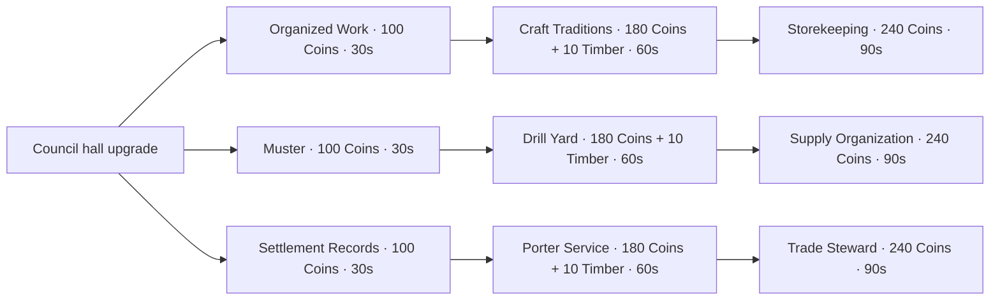

# Miniature civilization redesign

Latest revision: [Simple Shop and Automatic Troops](Simple%20Shop%20and%20Automatic%20Troops.md)
records the current research-free shop, automatic building-owned groups under ten
and expanded map. Older research/inspection/roster milestones below are history.

Design drafted October28 and revised October29,2026. The first economy/art
prototype passed; the requested inventory/shared-stall interaction revision is
now being implemented.

Follow the [implementation log](2026-10-29-miniature-implementation.md) for
verified progress and the currently available build. All thirteen prototype
kits and the first economy/research loop passed native checks. The newer
[Inventory and Shared Shops](Miniature%20Inventory%20and%20Shared%20Shops.md) note
records the user-approved replacement for the original manual controls and mixed
material purchase costs. The original design below is retained as rationale;
that revision controls whenever the two differ.

Start with [the user's reference collection](Mini%20Wars%20References.md).
Requirements and delivery tracking belong to the
[OpenSpec change](../../openspec/changes/miniature-civilization-redesign/proposal.md).
Historical art directions and troop candidates are in
[Civilization Building and Army Reference](Civilization%20Building%20and%20Army%20Reference.md).

## Original design and reference rationale

The user likes the existing miniature preview's look and confirmed keeping all
13 civilizations for now. Preserve the period windows in
[GAME_VISION](../GAME_VISION.md): this is a historical crossover, rather than
making Georgian Britain, Sengoku Japan or the Ottomans ancient.
Normal-size players build, trade and command; miniature troops do the fighting.
Eight protected settlements and exclusive civilization claims remain the target.
The shared Black Market remains deferred. The production build, old profiles,
dated backup and clean scale preview remain available.

Everything numerical below is a proposed **game balance rule**, not a historical
claim or a copied Mini War value. This document explains choices; OpenSpec owns
the implementable contracts. The current preview still only has three buildings,
six moving actors, inspection and camera controls.

## What the references actually establish

| Evidence reviewed | Observation | Adaptation |
| --- | --- | --- |
| Shop AVIF image in the user's note | Restock countdown; Factory/Houses/Military/Special categories; stock counts, item pictures and two purchase currencies | Personal merchant with Production/Homes/Military/Civic categories, model previews, stock and unlock reasons; one Coin currency |
| Gameplay JPGs ending `150259`, `150304`, `150344` | Buy/Country/Sell navigation, research and quest shortcuts, inventory strip, offline-income message and automation buttons | Build/Settlement/Trade navigation, compact goods/worker HUD, optional research convenience; offline simulation requires a later decision |
| Research JPG ending `150336` | Connected hexagonal nodes, unlocked colors and unknown silhouettes; small labels are not reliably readable | A readable connected graph with text, prerequisites, costs and explicit locked states; original assets and node art |

The [official Roblox description](https://www.roblox.com/games/131346454575416/Mini-War)
confirms the broad city/economy/army/capture loop. It does not establish precise
rates or shop probabilities. The user's
[building pages](https://miniwarhub.com/buildings/) provide useful category ideas;
the [factory](https://miniwarhub.com/buildings/factories/),
[house](https://miniwarhub.com/buildings/houses/),
[military](https://miniwarhub.com/buildings/military-buildings/) and
[special-building](https://miniwarhub.com/buildings/special-buildings/) pages are
unofficial guidance. Treat their numbers and strategy assertions as unverified.

The supplied [Sportskeeda research guide](https://www.sportskeeda.com/roblox-news/mini-war-research-tree-guide)
could not be fetched (HTTP 405); it was not used as if read. The accessible
[TechWiser guide](https://techwiser.com/mini-war-research-tree/), updated September
21, 2026, describes branching military, economic and management research, including
capacity and automation unlocks. Use that structural idea, not its research counts,
prices, timers or complete progression. These sources are not an exact rulebook
for our game. The source note and its images remain intact.

## The player loop

Walk around a lively miniature settlement. Buy a building plan from your own
merchant, place it, assign available workers, and watch visible batches accumulate.
Collect goods, sell a chosen surplus at the trade stall, then decide between more
production, housing, storage, research or military infrastructure. Eventually send
the army to shared objectives while the settlement stays protected.

Production, collection and sale are three distinct operations. Farms produce food,
not coins; collecting transfers goods without awarding money; selling removes
goods and adds coins once. Essential controls work from the start. Research adds
convenience and strategic options rather than repairing deliberately awkward UI.

## Economy proposed for the first playable slice

- One abstract currency: **Coins**. The name is a shared game unit; it does not
  assert every civilization used an identical monetary economy.
- Four inventory classes: Food, Timber, Craft Material and Crafted Goods. Each
  civilization supplies its own local names and appearances. Sparta initially
  uses grain, timber, clay and pottery. A pastoral or woodland economy can use
  different materials and recipes with the same economic budget; no faction is
  forced to manufacture historically inappropriate goods.
- A fresh sandbox civilization receives 200 Coins, a civic hall/trade stall, one
  house, one farm and two assigned workers. Its initial housing supports four
  workers. Production starts empty; the existing decorative patrol is not a free
  trained army. The starter farm, civic hall and last occupied house cannot be
  removed. These safeguards keep a zero-Coin player able to recover by selling.
- Workers each take one housing place and cost 25 Coins once. At most eight
  workers, twelve placed buildings including starters, and twelve unplaced plans
  per plot in this initial sandbox. Plans use separate capacity from goods.
  Military capacity is separate, avoiding a worker/army population deadlock.
- Completed construction and assignment start immediately. Visible builders can
  animate without introducing construction queues in the first slice.
- Production advances only for a living session with an active claim and writable
  injected profile. No offline or inactive-civilization production. Worker animation
  never decides yield. Paused/full buildings do not bank missed time.
- Collection is explicit and free. Each producer holds 60 output units; the
  player's collected inventory holds 200 total units, increased to 400 by a
  Storehouse. Full buffers stop production with visible feedback. Workshops consume
  collected inputs and create output atomically; inputs are not lost to full output.
- Initial NPC sale prices are fixed. Direct trading, variable prices, adjacency
  multipliers, recurring upkeep and territory income are later design work.
- A private 180-second merchant cycle guarantees two basic-farm plans and two
  house plans; advanced unlocked plans have one each. Unused stock is replaced,
  not accumulated. Required starters are granted; no luck or paid refresh blocks
  the first loop. Restock state survives fake-store release/reacquisition, and
  returning after absence grants at most one fresh cycle, never accumulated stock.
- A bought plan enters an inventory slot; placement consumes it exactly once.
  Invalid placement leaves it intact. Relocation is free within one's plot.
  Unpacking returns a plan and pauses its work; buildings never sell back for Coins.

| Sparta role | Build-plan price | Work per assigned worker | NPC sale price | Purpose |
| --- | --- | --- | --- | --- |
| Grain farm | 120 Coins | 2 Food / 10 active seconds; 2 worker slots | 2 Coins / Food | Reliable starting income |
| Timber yard | 160 Coins | 1 Timber / 10 seconds; 2 slots | 4 Coins / Timber | Later building inputs |
| Clay pit | 200 Coins | 1 Craft Material / 15 seconds; 2 slots | 6 Coins / Material | Workshop inputs |
| Potter's workshop | 240 Coins + 20 Timber | 1 Material becomes 1 Crafted Good / 15 seconds; 2 slots | 15 Coins / Good | A valuable second production step |
| House | 80 Coins | +4 worker housing, subject to eight-worker sandbox cap | Not sellable | Economic capacity |
| Storehouse | 200 Coins + 20 Timber | Raises collected inventory cap to 400; unique | Not sellable | Longer collection intervals |
| Training yard/barracks | 250 Coins + 20 Timber | Two fighter presentation slots after Muster; four after Drill Yard | Not sellable | Future army roster foundation |
| Council hall upgrade | 160 Coins + 10 Timber | Enables the starter research graph | Not sellable | Settlement development |

Other civilizations use equivalent role prices/throughput while their materials,
recipes and designs vary. The civic hall upgrade modifies the starter hall rather
than taking another building slot. The trade stall is part of that starter site.
Prices containing Timber are paid when buying the plan, not again on placement.

Balance arithmetic to test: one worker on the free farm earns a potential
24 Coins/minute when goods are sold; both workers yield 48/minute. A second farm
plus two workers costs 170 Coins and adds 48/minute, a 3.54-minute simple payback
before collection/travel. Two clay workers plus two potters turn eight clay/minute
into eight pots worth 120 Coins/minute; four basic farmers would produce goods
worth 96/minute. The crafting chain earns 25% more per worker at higher setup cost.
Research, buffer fullness and unused inputs must be accounted for separately.
These are theoretical active rates, not measured retention or income promises.

First playtest targets: first collection/sale under two minutes, a meaningful
production choice within five minutes, first research around ten minutes and a
useful 30–45-minute session. Measure new-player behavior before finalizing prices.

## Buildings and armies

Keep recognizable functional families: homes, farms/material yards, workshops,
storehouses, merchant stalls, training yards, council halls and healer shelters.
Every civilization-role pair gets a named design with distinct geometry, roof,
materials and work props. Sharing code and snap footprints is fine; recoloring
the same generic model is not sufficient. A farm should look productive; ordinary
housing should not become a temple because a temple is that culture's best-known
landmark. Sacred/royal motifs belong selectively in a civic landmark.

Replace modern unit escalation with role choices: frontline infantry, missile
troops and support first; then faction-appropriate skirmishers, cavalry or siege
where historically supported. Do not give every culture elephants, cavalry,
catapults or muskets just to fill identical slots. Historical weapons become game
roles with balanced reach/cooldown budgets; this is not a simulation of a musket
versus a Bronze Age bow. Period firearms remain possible for later-era factions.
No aircraft, tanks, missiles or robotic equivalents.

This change delivers roster presentation and recruitment-capacity feedback, not
combat: the first new playable slice is the economy. Scaled attack ranges,
damage, formation spacing and faction weapons require a later combat change and
native validation. Reusing a quarter-scale cosmetic rig does not prove combat
works. Troop candidates in the historical matrix remain research/review leads.

## Research: three connected branches

One project at a time; paid once; active time only. Show every node's name,
prerequisites, cost, duration and exact effect. Every predecessor edge is required.
The diagram shows the first nine nodes, not an entire final endgame tree.

| Branch | Node effects in order |
| --- | --- |
| Economy | Organized Work: reduce raw-producer intervals by 10%; Craft Traditions: unlock the artisan-workshop plan; Storekeeping: unlock Storehouse plan |
| Army | Muster: unlock training-yard plan with two visible fighter slots; Drill Yard: increase to four presentation slots; Supply Organization: unlock one noncombat healer presentation slot with its shelter |
| Civic | Settlement Records: enables optional worker-assignment presets; Porter Service: optionally collect complete outputs into available inventory; Trade Steward: optionally sell selected surplus above a player-set reserve at the same NPC prices |

Healer shelter plan: 200 Coins + 20 Timber, one per settlement; healing is not
implemented here. Nodes that unlock plans do not grant the buildings. Worker
presets only assign owned workers within housing/building bounds. Automation
uses the same atomic transactions and guards as manual actions; no income bonus,
instant resets, queueing while authority is lost or offline catch-up. Reserve
settings apply per good; automatic sales cannot consume protected workshop input
amounts. Workshop consumption and sales share one inventory ledger. Manual collection, selling
and management stay available without these nodes.

Later branches can add faction equipment traditions, proper formations,
construction options, cart logistics and researched mobility/siege. Do not copy
multi-day research timers or percentage stacks into the initial graph.

## UI adapted to the theme

- Top navigation: **Build / Settlement / Trade**. Side actions: **Research** and
  **Army**; quests/alliances wait for actual gameplay. Keep Walk/Overview controls.
- HUD: Coins, goods capacity, assigned/available workers and army capacity.
  Grain sacks, timber bundles, baskets, wax/clay records and trade seals replace
  dollar stacks, factory chimneys and science-fiction symbols.
- Merchant: four tabs, civilization-specific building model, clear function,
  price, owned/unplaced count, stock, countdown and a reason when locked. No
  premium purchase column, fake rarity or large paid Restock call to action.
- Placement: snapped footprint, four-stud commander lanes, rotate/confirm/cancel,
  and text for overlap, boundary or route conflicts. A canceled ghost spends
  nothing and never accepts a client-provided final price or transform.
- Building inspector: worker assignment, local goods, time until next batch,
  missing input/full output state, collect, move and unpack. Confirmation before
  unpacking any building; refuse actions that orphan workers or strand goods.
- Research: connected nodes and branch tabs; pan/zoom plus a text-list alternative.
  Distinguish locked/researching/owned with labels and icons as well as color.
- Retain independent minimization and draft state. Hidden panels keep updating
  and revalidate owner/life/claim/building context before any purchase.
- Use the preview's restrained warm stone, wood and cloth palette, readable text
  and large touch targets. Faction accent colors supplement distinct architecture.
  Verify 320×360, 320×568, 640×360 and 1024×768 layouts in Studio.

## Delivery and later decisions

The [tasks](../../openspec/changes/miniature-civilization-redesign/tasks.md)
start with an isolated fake-store sandbox and a Spartan production-to-sale loop,
then merchant/placement, research and management. The thirteen-faction art rollout
follows in small batches with a native review for each kit. Nothing is declared
implemented merely because a design document or model table exists.

Later separate changes: validated miniature combat, battlefield objectives and
conquest, opt-in trade between players, any capped offline production, deeper
recipes, faction combat bonuses, published storage and migration policy. Shared
objectives can offer optional contracts or bounded rewards while protected
settlements retain a complete production path. New progress must never silently
replace or reinterpret legacy progression.
