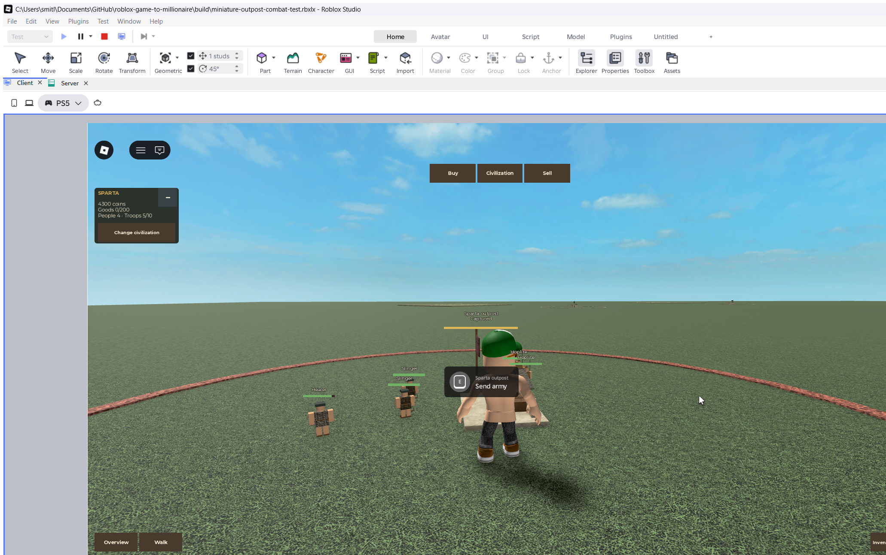

# Miniature combat and outposts

Latest follow-up: [Original Miniature Army](Original%20Miniature%20Army.md) replaces
this first slice's simplified figures/AI with original troop models, outfits,
joint animation and baseline tactical/medical helpers. The original-state boundary
and balance paragraphs below describe the earlier acceptance milestone.

This separate combat slice builds on the [current shop and army](Simple%20Shop%20and%20Automatic%20Troops.md)
and the user's [Mini Wars references](Mini%20Wars%20References.md).
The implementation contract is the active
[combat change](../../openspec/changes/miniature-outpost-combat/proposal.md).

The miniature uses a separate server-controlled combat simulation. The original
full-scale build's formations, shields, weapon skills and advanced movement have
not been ported; production code remains unchanged.

## Play loop

Buy and place a military building as usual. Its own allocated troops automatically
march toward the first outpost directly in front of your home, toward the map
center. Each of the eight plots has one first outpost in this slice, initially
defended by **two neutral melee troops and one ranged troop**. Harder objectives
closer to the center are later content.

Defeat the defenders and keep living troops inside the outpost for **20 clear
seconds**. The overhead bar shows progress. Returning neutral defenders pause
the bar until defeated; an enemy army contests it. If all attacking troops leave
or die, the bar resets. Capturing raises your civilization's game flag.

Walk to the center of any outpost and press **E** to send your whole army there.
This also directs later replacements there. Troops walk rather than teleport.
With no manual order, the army follows its own ordered line; at the last current
outpost it stays to defend. Additional line nodes are supported by the rules but
are not yet placed in the native map.

A captured outpost can be taken by another civilization under the same rules.
Neutral respawns stop after capture; there are no free allied garrisons that
increase your army size. Your existing troops defend it. The **ten-troop limit**
still includes medics; civilian and building limits remain separate and unchanged.
Home settlements cannot be conquered. Commanders and civilians are not targets.

Melee/ranged troops fight automatically; medics support living allied troops.
Dead allocated troops are replaced at their own military building after a delay.
Reclaiming a building removes its allocated troops and pending replacements.
Unrelated lives, health and deadlines stay intact.

## First-outpost test balance

These are isolated sandbox defaults, separate from production weapon/progression
stats. No civilization gets a statistical bonus in this first slice.

| Troop | Army health / damage | Neutral health / damage |
| --- | --- | --- |
| Melee |160 /30 |50 /7 |
| Ranged |120 /24 |45 /5 |
| Medic |100 /0;12healing every1.25s | No neutral medic slot |

Army replacements wait10seconds; neutral replacements wait8seconds while their
outpost is neutral. The occupation radius is22studs and nearby combat stays within
six additional studs. Army melee/medic walk at12studs/second and ranged at11.
Ranged damage is server-validated after windup; the short-lived flying projectile
is a visual cue, not a client hit detector. These generous first-outpost army
stats are intended to make the early test approachable and can be tuned later.

## Ownership and development scope

Combat, capture, targets and respawn clocks are owned by the server. E is only
an intent: the existing gateway checks commander life, distance, claim/write
authority, session, revision and replay budget. Client-supplied damage, health,
capture credit and home targets are not accepted. The game retains its existing
movement controller; combat adds no player weapon or movement key replacement.

These outposts use server-session ownership. Civilization/claim release or loss
of write authority removes that army and neutralizes its captured outposts.
Commander death alone does not heal or reset the army. Starting another Play
starts fresh fake progress. No production store, saved schema, conquest reward,
research progression or published experience is changed.

The camps, flags and neutral equipment are game interpretations. Neutral guards
reuse inert, muted Spartan-derived preview clones rather than claiming a new
historical civilization. Captured flag colors/names identify the selected game
civilization; they are not assertions about surviving historical flags.

## Verification

The [first native run](../assets/miniature-outpost-native-first-2026-10-29.json)
passed actual shop purchases/placement, automatic movement, attacks, visible
projectiles and health changes, paused/resumed capture, the Spartan flag and actual
E retargeting to another outpost. It started with5000Coins only, zero goods and no
research, then paid700for the2/2/1army, ending with4300Coins. The capture observation
lasted23.2317wall seconds including defender pauses, with9neutral deaths from the
three initial slots,13shots and25hits. The ordinary start remains200Coins.

The built-in MCP image omitted world billboards and default prompts. A separate
OS capture of only the owned Studio window confirmed their actual visibility;
the saved image above includes the labels, bars and E prompt. No game workaround
was added for the capture tool's omission.

Native malformed-progress, distant, home-ID, stale-life and foreign-session order
probes were refused while Coins and the army objective stayed unchanged. The
simulation's17battle cases and7command-authority cases pass alongside the earlier
74miniature cases. Full gates passed29OpenSpec items,5Node cases,345Luau syntax
compilations and244existing logic cases, plus Selene/StyLua. The
[final stricter native flow](../assets/miniature-outpost-native-final-2026-10-29.json)
also passed: it recorded seven neutral life replacements during partial capture,
a bar held at6.7383seconds for0.2005seconds while a returning defender was alive,
then renewed progress and capture after24.4486wall seconds. It again used actual
shop/placement/walking/E input and ended with4300Coins and five allocated/alive
troops under the unchanged cap10. All ten UI intents passed on their first press.

A bounded90-frame desktop sample after capture, with23rendered combat actors and
the user's other Studio playtest open, measured16.6861ms median and18.0433ms p95.
This is a warm desktop observation, not a combat-storm, phone or published-server
performance guarantee. The only retained console warnings concern the existing
farmer asset type203785492; no first-party combat script errors appeared.

The ordinary combat build is `build/miniature-combat-playtest.rbxlx`; open it and
press Play, without Rojo Sync. It starts with200Coins and uses the same temporary
fake economy. An older running build keeps its earlier code until the new place
is opened. The clean preview and production build remain separate.

Published multiplayer, physical device controls/performance and real storage
remain separate evidence. The native rival fixture uses simulated teams and time.

The isolated native server fixture passed:8outposts and24initial neutral
actors, quarter-scale inert clones, immutable preview/template sources, life
replacement/dead cleanup, projectile travel/expiry,20-second capture and a Roman
recapture of a Spartan-owned objective. Its rival teams and clock were simulated;
it did not impersonate real players or establish multiplayer acceptance. The
deterministic cases cover synthetic two-node auto advance; only one outpost per
line is currently present in the native map.

Roblox's [server-boundary guidance](https://create.roblox.com/docs/scripting/security/client-server-boundary)
and [model pivot API](https://create.roblox.com/docs/reference/engine/classes/PVInstance)
inform the guarded prompt and anchored miniature rendering approach.
