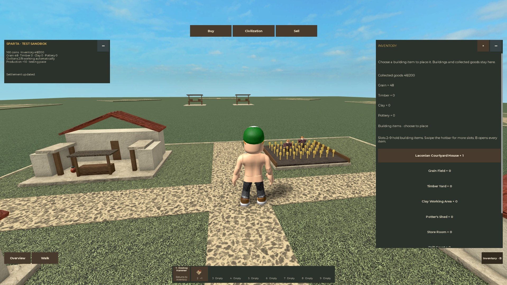

# Miniature inventory and shared shops

Latest revision: [Simple Shop and Automatic Troops](Simple%20Shop%20and%20Automatic%20Troops.md)
records the current research-free shop, automatic building-owned groups under ten
and expanded map. Older research/inspection/roster milestones below are history.

User direction, October29,2026. Implemented and verified in the isolated native
sandbox; this replaces the first prototype's manual building-management flow.

The saved [Mini Wars screenshots](Mini%20Wars%20References.md) show three top
travel buttons and a bottom item strip. Our matching navigation is **Buy /
Civilization / Sell**. Buy and Sell travel to separate shared stalls; Civilization
returns to the currently owned plot. Both stalls serve every civilization while
stock and inventory remain private to each owner/civilization.

The inventory contains building items and collected goods. The hotbar selects a
building for placement or the **Destroy Hammer**, which returns an eligible
building to inventory. Its output must fit first; a refusal discards nothing.
There is no separate Move button. The civic site and last house stay protected;
the starter farm can return as a free-to-place item.

Houses provide civilians automatically: four each, bounded by eight for this
test. Available civilians fill open production jobs, retaining valid existing
assignments. There is no paid hiring or manual Assign button. More housing makes
more civilians; more production creates job demand.

Walk up to a producing farm and press **E** to collect all goods that fit. Crops
enter carried inventory without granting Coins. The shared sell stall has one
**Sell all goods** button. Every purchase/research price uses Coins only; goods
are not a second currency. Pottery may consume clay as a production ingredient.

Production is currently ten times faster for testing: one-second farm/timber and
1.5-second clay/pottery batches before Organized Work. Research and merchant
restock clocks retain their existing durations. This is test tuning, not final
game balance.

The implementation contracts and checks remain in the
[active change](../../openspec/changes/miniature-civilization-redesign/tasks.md),
task group9. Follow the [launch guide](../MINIATURE_GAMEPLAY.md) for controls and
the [implementation log](2026-10-29-miniature-implementation.md) for actual passes.
This remains the isolated fake-store test build; production and the clean scale
preview are preserved.

## Recorded acceptance

The [final native run](../assets/miniature-inventory-final-2026-10-29.json) passed
E collection, Sell All, Coin-only buying, inventory/hotbar placement, population
4→8, full-output hammer reclamation/replacement and automatic jobs. Four layouts,
Rome→Sparta restoration, text-focus shortcuts and real death/respawn passed.
The new life walked16.27studs horizontally with normal Roblox controls.
[Independent minimization](../assets/miniature-inventory-visibility-2026-10-29.json)
retained the held house and kept top navigation/hammer available. Native distance
and malformed-destination requests were [refused](../assets/miniature-inventory-protocol-2026-10-29.json).

Startup input readiness now refreshes the normal controller's device selection
in the actual game context. The user confirmed physical movement after that fix;
see [readiness evidence](../assets/miniature-input-readiness-2026-10-29.json).
Tool fixtures never load another PlayerModule controller. There are no custom
movement bindings, forced enabling or private Keyboard patches.

Mouse/touch-style clicks and supported virtual keys are covered. Physical number1,
phone/controller and published-client checks remain separate. Hammer selection
changes the owned-building prompt to Return to inventory; toggle the hammer off
to use the ordinary E collection prompt. Goods and progress remain fake-only.
