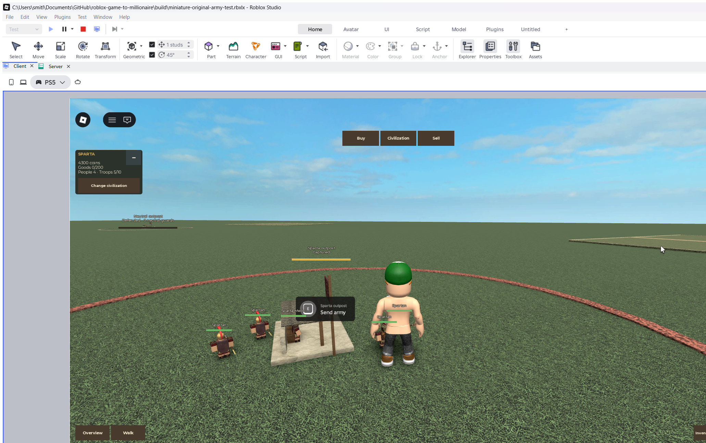

# Original miniature army

The [smooth-army and frontier-outpost follow-up](Smooth%20Armies%20and%20Frontier%20Outposts.md)
tracks the current walking fix,95% neutral balance and outpost scenery. The4speed/
9range neutral tuning and weak-defender capture timings below describe the prior
verified build; they are superseded by that follow-up as it is verified.

Current request: reuse the original full-scale game's troop models, outfits,
animations and baseline behavior while keeping miniature armies and outpost
conquest. The active [original-army change](../../openspec/changes/miniature-original-army/proposal.md)
tracks the implementation separately from the [first combat slice](Miniature%20Combat%20and%20Outposts.md).

## Identity and motion

Combat roles are built through the original
[WarriorRig](../../src/server/WarriorRig.luau),
[NPC template sanitizer](../../src/server/NPCModelTemplates.luau),
[equipment](../../src/server/Equipment.luau) and
[outfit](../../src/server/OutfitTemplates.luau) pipeline. The five custom melee
skins retain their original clothing/headwear; all thirteen generated ranged and
medic roles use their original civilization outfits. Neutral defenders use the
original generic neutral warrior/archer rather than recolored Spartan kit figures.

Only fresh clones are scaled to one quarter. Original body joints, wardrobe,
weapon families, imported equipment and grip offsets are preserved. The original
joint animation drives walking, weapon windup/contact/recovery and medic throws;
whole-body hovering/bobbing is removed. The retained Humanoid renders classic
clothes but its movement, state machine, autorotation and physical collisions
are disabled. NPC Tools remain inert cosmetics and cannot be picked up.

Foot placement measures the lowest posed R6 leg corners against support raycasts.
Grass, raised plots and marked outpost footings are valid supports. Characters,
other troops and invisible selection boxes cannot lift the feet. A0.005stud
sole clearance avoids numerical penetration; weapons/cosmetic bounds do not
determine height.

## Tactical behavior and requested tuning

The miniature adapter reuses the original
[CombatEncounter](../../src/server/CombatEncounter.luau),
[CombatTactics](../../src/server/CombatTactics.luau), crowd/footwork and medical
planning/services. Target reservations, close spacing, bounded ranged retreat,
planted attack phases and current-life contacts remain server decisions. Outpost
orders, deaths, replacements, capture and the ten-troop limit remain owned by the
miniature lifecycle layer. No player/civilian or home-plot offensive targets are added.

| Current miniature limit | Value | Previous first slice |
| --- | --- | --- |
| Player troop movement |6studs/second |11–12 |
| Neutral movement |4studs/second |7–8 |
| Player ranged reach |10studs |20 |
| Neutral ranged reach |9studs |18 |
| Medic healing reach |7studs |14 |

Source configurations remain unchanged. Read-only sandbox wrappers convert the
shorter reaches into the original planners' virtual full-scale units:40ranged
and28medical. Medical recovery distance24virtual/6actual stays within the new
seven-stud coverage. Original level-one equipment is used; paid/progression-gated
formations and weapon skills remain with later progression, with no new research
or roster UI. Original health/damage progression is not imported into fake economy.

The original physical projectile service cannot raycast virtual coordinate actors
against the visible world. The adapter retains original release/cadence and scaled
flight rules using numeric sweeps plus current-life/range/visibility checks;
rendered shots remain visual-only. This boundary is explicit rather than claiming
that the full production army service/bootstrap is running in miniature.

## Isolation and verification

Only explicitly allowlisted helper modules and immutable assets are mapped into
the sandbox. Production Bootstrap, ProfileService, Economy and troop-spawning
services are absent. Original source/default mapping, clean preview and backup
remain unchanged. No combat state is saved and no live storage is opened.

The [native scene fixtures](../assets/miniature-original-army-scenes-2026-10-29.json)
pass39culture roles and2neutral roles, five custom melee skins, original outfits/
equipment, immutable sources, grips and518grounded poses at flat/raised support
with avatar exclusion. The rendered styles include thrust, slash, chop, bow,
firearm and throw. A separate adapter fixture preserves life rendering and
simulated Spartan capture/Roman recapture; rivalry is not a real second client.

Ten new cases execute the actual original encounter/crowd/medical helpers with
Lune's Roblox Vector3/CFrame maths and explicit life/raycast doubles. They cover
attack phases and cadence,6/4movement caps, finite shots, range/visibility/new-life
refusals, original12HP/3s medicine under7studs, unchanged wrapper sources and
capture timing. The full miniature suite now passes108cases; production logic
remains244cases, with5Node tooling cases,351syntax compilations and30OpenSpec
items. Selene/StyLua pass.

The [actual UI flow](../assets/miniature-original-army-flow-2026-10-29.json) also
passed with the original models/tactics: ordinary military purchases/placement,
automatic march and combat, nine neutral life replacements during partial
capture, a measured defender pause/resume, the Spartan flag and actual E
retargeting of the whole army. Capture took30.4646wall seconds including defense
pauses; clear credit remained20seconds. All10intents passed first press. The
explicit5000-Coin-only fake seed became4300Coins after700of military purchases;
no goods, research or local state/position were injected. Five2/2/1slots remained
alive under the existing10cap. The ordinary build still starts200Coins.

Actual server rendering recorded32bandage launches during the extended run;
weapon-specific shots use original arrow/spear/axe/bullet/stone/bolt shapes at
quarter scale. A90-frame warm desktop sample with23combat models alongside the
user's existing Play measured16.6564ms median/19.4123ms p95. This does not establish
combat-storm, phone or published-server performance. No first-party gameplay
script errors appeared in the final integrated run.

Roblox rejects the existing original Spartan torso decal6989384332 as not approved
for this requester. Clothing, models and source properties are restored; that
decorative decal's rendered fidelity remains permission-dependent. The known
farmer asset-type warning203785492 also remains. Original sources were preserved
rather than replacing either asset.

The initial native setup caught a mapped-wrapper parent lookup; it now reads the
absolute MiniatureGame.Config location. An imported Egyptian khopesh matrix also
exposed a fixture-only comparison error: its near-unit axes caused ToAxisAngle
to overstate tiny error. Direct basis-vector and position checks retain the0.002
tolerance, with4620isolated attachment checks passing and maximum position drift
0.000271stud. No original model or animation correction was needed for that case.

Published multiplayer and physical-device performance remain separate evidence.

The ordinary review build is `build/miniature-original-army-playtest.rbxlx`.
Open it and press Play; no Rojo Sync is needed for this rebuilt file. During
verification the user's identified `miniature-combat-playtest.rbxlx` session was
left untouched. Existing Studio connections ended after evidence capture; the
new ordinary review Play opened cleanly with24original neutral actors,8outposts,
the requested tuning and no funded fixture. Older running builds retain their
previous code until reopened. The older simple sandbox was stopped only to free
a verification slot after the user identified the combat session as active.

Roblox documents [model scaling](https://create.roblox.com/docs/reference/engine/classes/Model)
and [disabling Humanoid physics/state evaluation](https://create.roblox.com/docs/reference/engine/classes/Humanoid).
