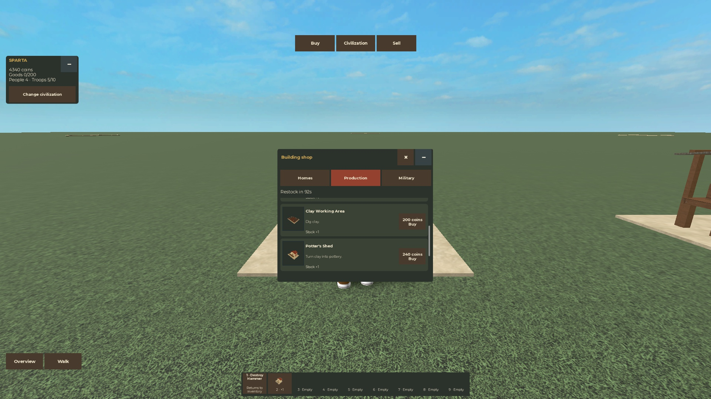

# Simple shop and automatic troops

Latest follow-up: [Miniature Combat and Outposts](Miniature%20Combat%20and%20Outposts.md)
activates these building-owned troops in a separate miniature simulation. The
passive-figure statements below describe this earlier shop acceptance milestone.

Current user revision, October29,2026. Implemented and natively verified in the
separate fake-store sandbox. This supersedes the older inspection, research and
training-roster interface. The [reference shop image](Mini%20Wars%20References.md)
was viewed directly: its tab row, thumbnail-left list and short item descriptions
guide the compact original UI.

**Buy** teleports to the shared building stall and opens a420×360desktop shop.
Exactly **Homes / Production / Military** tabs sit above scrolling rows with a
real civilization model image, Coin price, stock and a brief function. Sell opens
a280×200surface. **Civilization** returns home and closes popups. The compact HUD
retains a Change civilization button; no Inspect, Research, hall-upgrade or
Training roster controls remain. Inventory, hammer, placement and E collection
continue to work.

Every building type is available without research. Fresh military stock is two
of each type per ordinary180-second cycle. All purchases use Coins. Dormant
legacy research is validated and preserved, but projects, bonuses and research
services are paused. A missing-only catalog upgrade opens formerly locked stock
once; it cannot refill spent stock on every rejoin.

Each melee building supplies **two melee**, each ranged building **two ranged**,
and each medic post **one medic**. The total army cap is **ten including medics**;
buildings never raise it. Whole groups fill in stable building order, waiting
for space when necessary. A single medic can use a remaining place. Reclaiming
a building removes its group and lets waiting groups fill freed space. Civilians
have their own separate eight-person limit. These troops remain passive prototype
figures; combat and healing are separate gameplay work.

The map is now **1200×1200studs**, with eight settlement centers on a400-stud
radius. Starting buildable areas are now **80×64studs**, four times the previous
40×32area. No research or purchase is needed; current buildings keep their local
positions. Each has disjoint room for a later160×128expansion; the remainder of
that reserve is not yet buildable. A future expansion option remains planned.
All thirteen civilization identities remain. Each kit now includes a distinct
[ranged practice-site design](Ranged%20Training%20Yards.md).

The [larger-settlement native check](../assets/miniature-large-settlements-native-2026-10-29.json)
passed all eight plot/lane sizes, all thirteen cultures' outer farm placement and
restoration through isolated State/Actions/World factories,3784 rendered-part
corner checks, source immutability and the existing scene checks. The current
ordinary build for the next Play is `build/miniature-large-settlements.rbxlx`.
An already running older Play keeps its old bounds until the rebuilt place is opened.

The [native flow](../assets/miniature-simple-shop-native-2026-10-29.json) used an
explicit5000-Coin-only fake fixture with zero goods and no research, then actual
collection/sale, buying, placement and hammer replacement. It verified automatic
2/2/1groups, four layouts, civilization restoration and real death/respawn with
16.27horizontal studs of walking. The ordinary starter remains200Coins.

[Server evidence](../assets/miniature-simple-shop-server-2026-10-29.json) records
the1200-stud map,13ranged kits, one fake-store boundary, immutable templates,
per-building cleanup and a12-demand native case capped at ten with waiting-group
backfill. Deterministic tests also cover whole-group allocation, stock migration
and conservation. Physical number1, phone/controller, published clients and real
storage remain separate checks. Use the [launch guide](../MINIATURE_GAMEPLAY.md)
and [current task checklist](../../openspec/changes/miniature-civilization-redesign/tasks.md).
