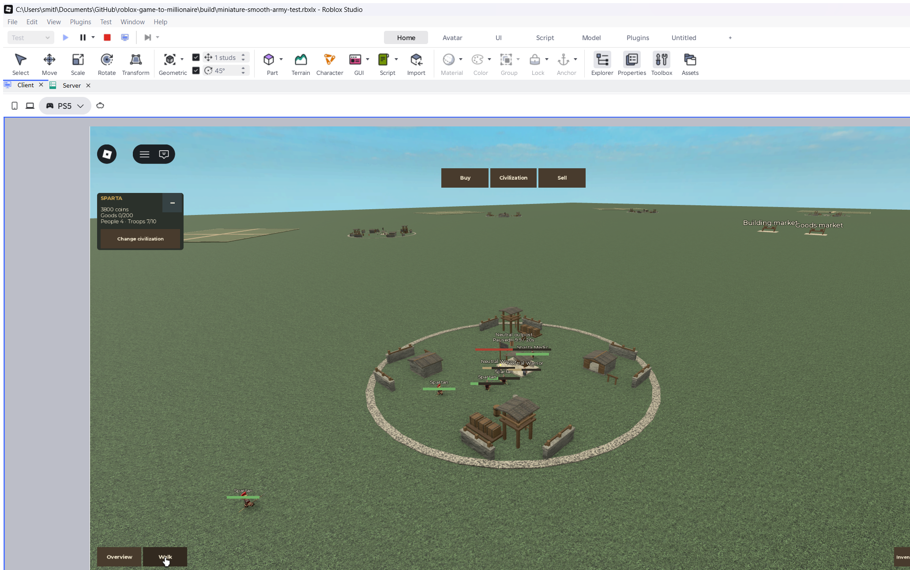

# Smooth armies and frontier outposts

Follow-up to [Original Miniature Army](Original%20Miniature%20Army.md), 2026-10-29.
The user reported framey walking, requested neutral troops only slightly weaker
than player counterparts, and asked for walls, buildings and decoration at the
capturable settlements. Tracked in the
[active change](../../openspec/changes/miniature-smooth-troops/proposal.md).

## Walking diagnosis

The miniature combat loop updates at 10 Hz. Its renderer wrote anchored original
body-part poses on that same loop; it had no client interpolation. A read-only
four-second observation in the user's running build measured 242 rendered frames,
but each of two walking melee roots changed on only 26 frames, with maximum jumps
of 0.707 studs. High rendering FPS alone therefore did not establish smooth walking.
The [baseline measurements](../assets/miniature-walking-baseline-2026-10-29.json)
record the two observed moving melee lives without modifying the user's Play.

The implementation draws client-only copies between atomic original
pose samples. The server still decides movement, attack phases, health, healing,
target lives and capture. Source visibility is hidden locally only once a clone
is ready; local rendering must clean up and restore surviving sources on teardown.
The original rig, garments, weapon grips and sampled-ground rules remain required.

## Neutral strength decision

The former weak test defenders had 50 HP / 7 damage melee and 45 HP / 5 damage ranged,
against player 160 / 30 and 120 / 24. The new values derive neutral health,
damage and movement speed at 95% of the matching player role; range and timing
match. That means melee 152 HP / 28.5 damage, ranged 114 HP / 22.8 damage and movement 5.7
versus 6 studs/second. Both ranged roles reach 10 studs; medic reach remains 7.
Fractional damage is supported by the server combat layer.

This deliberately supersedes the earlier neutral 4-speed / 9-range limits. Defender
roster 2 melee / 1 ranged, eight-second neutral replacements, ten-troop army cap and
twenty clear occupied seconds with defender pauses remain unchanged. An
outnumbered force is not guaranteed a win. Production combat profiles are untouched.

## Frontier settlement direction

Every current capturable outpost now has an ancient frontier compound:
partial walls or palisades, open entrances, small buildings, watch posts and
camp decoration. The center flag, capture bar, E interaction and approach routes
stay clear. These are shared neutral settlements, with no new economy, research,
wall damage or defensive bonuses. Architecture is a prototype interpretation,
not a claim of one culture's historically reconstructed settlement.

All eight integrated camps passed native geometry checks: 134 static parts each,
1,072 total, inside the unchanged 22-stud capture radius. Ten-stud-wide cardinal
approaches and the clear center remain open. Roof support and ladder-rung
connections have geometric regressions; props cannot intercept combat raycasts.

## Commander travel

The user also requested double player speed. The sandbox server now sets the
normal-sized commander's walking speed to 32 studs/second on each character spawn,
twice the previous default 16. This is independent of army speed and uses normal
Roblox movement input. Native checks confirm 32 on both initial spawn and respawn;
actual W input moved 31.757 studs in 1.016 seconds, without loading PlayerModule or
changing a controller. The
[lifecycle and walking evidence](../assets/miniature-smooth-lifecycle-2026-10-29.json)
records these observations.

## Verification status

Neutral balance has passed 31 targeted Battle/original-adapter/balance cases;
the complete miniature logic suite currently passes 127 cases, including twelve
pose interpolation/codec cases. The exact original adapter's nine-unit mixed
army captures normally. A five-unit 2/2/1 force also captures in about 230 simulated
seconds as clear windows accumulate between eight-second defender replacements;
no balance or capture conditions were relaxed to shorten that wait.

The [native server checks](../assets/miniature-smooth-server-2026-10-29.json)
pass all eight camps, original rig creation and 518 source poses plus 518 poses
solved through the new rendering math across all 39 civilization roles and 2 neutral
roles. Sources remain immutable with fingerprint `92214:3573182113`.

The [ordinary UI capture flow](../assets/miniature-smooth-outpost-flow-2026-10-29.json)
passes all 14 intents on first press: normal shop purchases and five placements,
actual commander walking, automatic 9-troop fighting, neutral replacement waves,
capture pause/resume, the Spartan flag and E retargeting of the whole army.
The 4 melee / 4 ranged / 1 medic force costs 1,200 Coins; the explicit 5,000-Coin fake
seed ends at 3,800 with nine living troops under cap 10. Capture observation lasts
59.33 wall seconds including pauses, with 20 clear credited seconds and 14 observed
defender replacements. No profile/position/goods/research state was injected.

The [final native movement measurement](../assets/miniature-smooth-native-movement-2026-10-29.json)
passes unchanged assertions from an actual LocalScript in the active owned Studio
window: 181 frames in 3.018 seconds, 59.97 FPS, 26 source updates and 154 intermediate
movements. The troop traveled 17.96 studs; maximum local step was 0.128 studs against
0.706 studs for the server samples. All isolated lifecycle checks passed alongside it.

The tool-launched module observer sampled at 15 Hz even during an attempted
foreground run; its under-50-ms frame filter excluded all samples. A direct
PreRender probe measured 60 FPS, and running the unchanged fixture in a native
LocalScript then passed all frame thresholds. Do not treat the tool observer's
15Hz sample as the actual player's rendering rate. The generated test project
now includes a dormant native runner, triggered with client attribute
`RunMiniatureArmySmoothing`, to reproduce the valid execution context.

Server posed bodies still update at 10 Hz alongside compact snapshots; this fix
does not claim reduced network traffic. Desktop Studio evidence does not
establish mobile, adverse-network or published multiplayer performance. Rival
recapture remains a native simulated-team fixture rather than two real clients.

The isolated client lifecycle checks now pass full geometry/cosmetic readiness,
one health display, original grips and ground, late-packet rejection, new-life
replacement and idempotent cleanup restoring original source visibility. An
initial foot test incorrectly compared the old support height after shifting a
cloned neutral across a 0.25-stud outpost footing edge; an actual raycast probe
confirmed that exact height change. The corrected isolated fixture uses its own
known 0.4-stud support. The first expanded-army UI test also clicked near the
Studio viewport edge for its final placement; it now chooses a legal visible
site at (26, 8). Neither correction changes gameplay or relaxes assertions.

## Completed build and checks

`npm run check:dev` passes: 31 OpenSpec items, five Node tooling tests, 362 Luau
syntax compilations, 244 existing logic cases and 127 miniature cases. Selene
and StyLua pass. A deliberate stale-time regression was rejected by the new pose
tests, then the unchanged implementation passed again. The full active native
scene contained 1,727 scenery parts excluding Humanoid actors, below 2,000.

The ordinary 200-Coin review is `build/miniature-smooth-army-playtest.rbxlx`, copied
identically to `build/miniature-playtest.rbxlx`. The funded verification place
includes the dormant native runner; it is a separate artifact. The owned testing
window was stopped and closed after evidence capture, and the ordinary review
was opened separately. The user's original Play remained untouched. Rebuilt
places already contain the scripts; opening this build does not require Rojo Sync.

Production scripts, source assets, default mapping, clean scale preview and dated
backups remain unchanged. No save fields, real storage or dependency versions
were changed. The vault check found no broken relative links across 31 Markdown
files and 324 links.

## Face visibility correction

The user noticed faces floating ahead of running troops. The client hid source
BaseParts but left their Decals visible, so source faces stayed at the current
server position while local bodies correctly interpolated behind it. Source
decals and inherited Texture objects now use their own local visibility modifier;
cloned faces reset that modifier to zero and remain attached to cloned heads.
Original modifiers are restored on removal, life replacement and teardown.
Textures, face orientation and source assets are unchanged. Roblox documents
the separate [Decal local modifier](https://create.roblox.com/docs/reference/engine/classes/Decal/LocalTransparencyModifier).

The [native face regression](../assets/miniature-face-visibility-native-2026-10-29.json)
first fails against the old renderer, then passes with the fix. It checks source
faces, visible clone faces, late Decal/Texture arrivals and restoration of a
nonzero original local modifier. The live check finds 25 rendered actors with
25 attached visible faces, 27 hidden source decals and zero escaping decals.
The corrected presentation controller was applied in the user's existing Play
without touching army/profile state, camera or input controls.

The next-session ordinary build is `build/miniature-face-fixed-playtest.rbxlx`,
also copied to canonical `build/miniature-playtest.rbxlx`. Existing open places
keep their loaded code; use the new build when starting another session.
